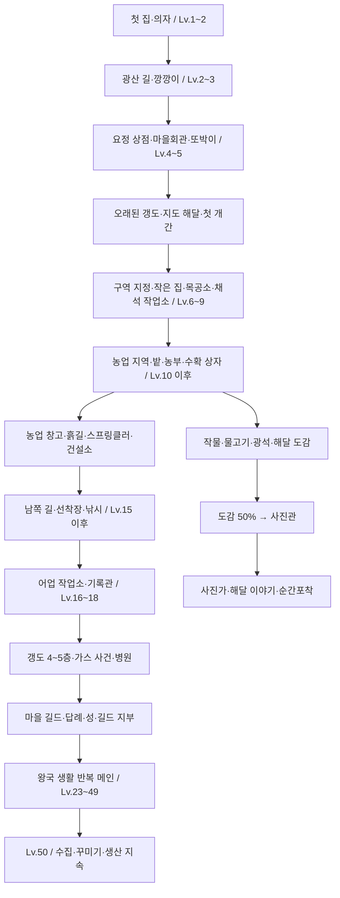

# 해달 왕국 게임 진행 흐름 통합 정리

기준일: **2026-11-03**. 현재 작업 폴더의 코드와 등록된 데이터 에셋을 기준으로 작성했다. 이번 QA 후속 수정(집 예약·가방 24~56칸 등)을 포함하며, 배포된 예전 빌드의 동작과는 다를 수 있다.

이 문서는 **현재 구현된 흐름을 설명하는 문서**다. 개선 제안이나 과거 기획을 현재 규칙으로 섞지 않았다. 새 게임을 다시 플레이해 측정한 소요 시간표는 아니며, 표의 공사 시간은 할인·장신구·개발용 빠른 타이머를 적용하기 전 기본값이다.

## 문서 안내

- [전체 흐름](#1-전체-흐름)과 [진행 규칙](#2-진행을-결정하는-네-가지-축)
- [실제 시설·기능 해금 순서](#3-실제-기능-해금과-시설-진행)와 [레벨별 메인 표](#4-레벨별-메인-퀘스트-요약)
- [건설·공동사업](#5-건설생산공동사업), [영토](#6-영토-확장과-구역-지정), [농사·낚시](#7-농사--상자--설비--낚시), [갱도 사건](#8-오래된-갱도와-마을-사건), [해달·수집](#9-해달-방문입주도감사진관)
- [반복 활동과 경제](#10-반복-활동과-경제)
- [현재 구현의 주의점](#11-현재-데이터에서-주의할-차이)과 [원본](#12-원본과-유지-관리-기준)
- [메인 215개 전체 목표·보상](#부록-a-등록된-메인-퀘스트-215개), [도전 66개 전체 목표·보상](#부록-b-등록된-도전-퀘스트-66개)

## 1. 전체 흐름

플레이어는 광장에서 재료를 모아 첫 집과 의자를 만들고, 광산을 열어 자동 생산을 시작한다. 이후 주민과 마을회관을 늘리고, 정찰·개간·구역 지정을 통해 생산 시설과 농장을 마련한다. 농사와 낚시로 경제를 넓힌 뒤 깊은 갱도의 사건을 해결하고, 마을 길드와 성을 세운다. 사진관·도감·해달 이야기·순간포착은 이 과정과 병행하는 수집 축이다. Lv.23부터는 기존 콘텐츠를 활용하는 생활형 반복 메인이 이어지고, 최고 레벨은 Lv.50이다.

그림의 레벨대는 흐름을 이해하기 위한 묶음이다. 모든 건물이 반드시 그 레벨에서만 지어지는 것은 아니며, 아래의 실제 건설 조건과 메인 퀘스트 등록 레벨을 따로 확인해야 한다.

## 2. 진행을 결정하는 네 가지 축

| 축 | 플레이어가 보는 것 | 실제 판단 기준 |
|---|---|---|
| 왕국 레벨 | HUD의 Lv·경험치 | 경험치 표와 아직 끝내지 않은 레벨 제한 부탁 |
| 메인 퀘스트 | 퀘스트 창의 메인 줄 | 요구 레벨 충족 + 앞 메인의 **보상 수령** + 콘텐츠 접근 조건 |
| 게시판 부탁·공동사업 | 집·시설·입주·납품 | 발전 기록, 주민·시설 기록, 재료와 작업 조건 |
| 영토·구역 | 섬 지도·개간·용도 지정 | 발견 기록 → 개간 → 확장 미션 → 열린 땅에 구역 지정 |

**현재 레벨, 메인 퀘스트의 표시 레벨, 시설의 최소 건설 레벨은 같은 값이 아니다.** 부탁·공동사업을 먼저 진행하거나 생활 의뢰·도전으로 경험치를 얻으면 레벨과 메인 줄이 서로 앞뒤로 벌어질 수 있다.

### 2.1 경험치와 레벨 제한

- 경험치가 충분해도 큰 발전을 끝내지 않았으면 다음 레벨로 넘어가지 못한다. 제한 중의 경험치는 보존한다.
- `_kingdomLevel`이 지정된 부탁을 완료하면 해당 레벨까지 부족한 경험치를 보충해 올린다. 이 값은 **공사를 시작하는 최소 레벨**이 아니라 **완료 시 도달시키는 레벨**다.
- 예를 들어 목공소는 Lv.6부터 건설할 수 있고, 관련 부탁을 완료하면 Lv.7에 도달한다.
- 농업 창고는 `farmland`가 있으면 건설 가능하며 완료 시 Lv.12에 도달시킨다. 그래서 Lv.10에서 완공하면 여러 레벨을 한 번에 지날 수 있다.
- 메인 보상 외에도 공동사업·영토 확장·일일·도전·생활 의뢰가 경험치를 준다.

### 2.2 퀘스트 집계

- 메인은 한 줄 체인이다. 현재 목표를 끝내도 보상을 받기 전에는 다음 메인이 열리지 않는다.
- `모두 받기`는 누른 시점에 받을 수 있는 보상만 받는다. 그 결과 새로 열린 메인은 다시 확인하고 받아야 한다.
- 건설·만난 해달·발전·장소 방문·열린 밭 칸처럼 기록으로 판단하는 목표는 먼저 해 둔 행동도 반영한다.
- 판매·수확·낚시·일반 구매·일반 강화 등 이벤트 집계 목표는 원칙적으로 해당 퀘스트가 열린 뒤의 실적을 센다. 일부 목표에는 별도의 기록 보정이 있다.
- `도감 등록`과 `가방 수량 증가`도 다르다. 가방이 차 있어도 새 물고기·갱도 광석의 발견은 도감에 남기지만, 가방으로 들어온 개수를 세는 수확·낚시·채굴 퀘스트와는 구분된다.

## 3. 실제 기능 해금과 시설 진행

| 기준 | 새로 가능한 일 | 선행 조건·의미 |
|---|---|---|
| Lv.1 | 첫 집 | 시작 재화: 골드 100 · 목재 30 · 돌 15. 첫 집 비용은 목재 8 · 돌 5이며, 이후 짓는 600골드짜리 작은 집과 별도다. |
| Lv.1 → 2 | 의자 | 첫 집 뒤 의자를 만들면 Lv.2 제한이 풀린다. |
| Lv.2 → 3 | 광산 길 | 장애물을 치우고 주민 작업을 끝낸다. 광부 깡깡이가 찾아오고, 배치·채굴 시작이 이어진다. |
| 광부 배치 이후 / 메인 Lv.4 | 요정 상점·가챠 | 요정의 초대·등장을 진행한다. 가구와 모종을 살 수 있고, 특수 해달 조각·장신구 수집을 병행한다. |
| 메인 Lv.5 | 마을회관·또박이 | 게시판을 마을회관으로 넓힌다. 또박이 배치 뒤 첫 구역·행정·게시판 활동을 연다. |
| Lv.5 이상 + 추가 조건 | 오래된 갱도 | 광산 곡괭이 Lv.2 이상, 깡깡이의 광산 배치·채굴 중, 또박이 배치 완료가 필요하다. |
| Lv.6 전후 | 첫 개간·작은 집 | 첫 개간은 정찰 없이 진행하는 튜토리얼 예외다. `board_upgraded` 뒤 자유 건설 작은 집과 짤랑이 입주 흐름도 가능하다. |
| Lv.6부터 건설 → 7 | 목공소 | 첫 개간과 꾸벅이·쿵쿵이 정착을 이어 생산 구역에 건설한다. 첫 목재 수령이 데굴이 입주 부탁의 선행 조건이다. |
| Lv.7 이상 + 게시판 | 생활 의뢰·첫 비축 | 생활 의뢰와 비축 공동사업을 통해 확장·주택 재료와 경험치를 마련한다. |
| Lv.8부터 건설 → 9 | 채석 작업소 | 데굴이 입주와 생산 구역이 필요하다. 건축용 돌 생산을 연다. |
| Lv.9부터 건설 → 10 | 해달 상점 | 짤랑이 정착 후 상업 구역에 건설한다. 판매가 +10%가 붙는다. 일일 퀘스트의 데이터상 시작 레벨도 9다. |
| Lv.10 + 농업 구역 | 광장 농장 | 광산 생산 진행 + 농업 지역 지정으로 밭을 발견한다. 밭 칸·농부·수확 상자를 준비한다. |
| 밭 해금 뒤 건설 → 12 | 농업 창고 | 별도 건설 레벨·특성 제한 없이 `farmland`가 선행 조건이다. 상자 확대·흙길·흙 개선 흐름을 연다. |
| Lv.11~13 중심 | 밭 증설·유료 모종 | 밭 칸을 늘리고 감자·고구마·딸기 등으로 작물을 확장한다. 메인에는 목공소·입주 목표가 이 구간에 남아 있다. |
| Lv.14부터 건설 → 15 | 건설소 | 콩콩이 정착 후 건설한다. 공사 시간 -15%, 수레·밭 공사 관련 기능과 남쪽 진출을 연결한다. |
| Lv.15 + 농장·남쪽 경로 | 선착장·낚시 | 남쪽 정찰·개간으로 선착장 경로를 확보하고 수리한다. 첨벙이 배치 후 낚시를 시작한다. |
| Lv.16부터 건설 → 17 | 어업 작업소 | 낚시 운영 → 퐁당이 입주 → 어업 작업소. 낚시 수확량 +20%를 얻는다. |
| Lv.17부터 건설 → 18 | 기록관 | 끄적이 입주 후 건설한다. 생활 의뢰 보상 +10%를 얻는다. |
| 갱도 4층 진입 이후 | 가스 사건 | 또박이의 걱정 → 약초 10개 → 임시 진료 → 5층 발생원 제거 → 병원 → 마을 길드 → 답례. |
| 길드 + 질서도 80 + Lv.16 이상 | 성 | 현재 코드의 성 최소 레벨은 16이다. 다만 실제 길드는 깊은 갱도 사건 뒤여서, 보통 후반에 도달한다. 메인에서는 Lv.20에 안내한다. |
| 성 완성 이후 | 길드 지부 | 상업 구역에 건설한다. 메인 등록은 Lv.21이며 건물에 별도 숫자 레벨 제한은 없다. |
| 고정 레벨 없음 / 도감 50% | 사진관 | 상업 구역에 사진관 건설 → 사진가 방문 → 순간포착 해금. 성·Lv.20 자체가 직접 조건은 아니다. |
| Lv.23~49 | 왕국 생활 메인 | 일일 3개, 테마 목표 2개, 판매 목표 1개를 레벨마다 수행한다. 최고 레벨은 50이다. |

### 3.1 완료로 레벨 제한을 푸는 부탁

| 완료 시 도달 레벨 | 부탁 | 시작 기준 | 대상 |
|---|---|---|---|
| 2 | [쉬어 갈 의자](<../Assets/Scriptable Obejects/Settlement/Requests/req_chair.asset>) | 숫자 제한 없음; 선행 발전 필요 | 의자 |
| 3 | [광산 길 열기](<../Assets/Scriptable Obejects/Settlement/Requests/req_mine_path.asset>) | 숫자 제한 없음; 선행 발전 필요 | 광산 길 열기 |
| 7 | [나무가 모자라요](<../Assets/Scriptable Obejects/Settlement/Requests/req_p4_workshop.asset>) | Lv.6 | 목공소 |
| 9 | [돌 깨는 일터](<../Assets/Scriptable Obejects/Settlement/Requests/req_p4_quarry.asset>) | Lv.8 | 채석 작업소 |
| 10 | [짤랑이의 가게](<../Assets/Scriptable Obejects/Settlement/Requests/req_p4_shop.asset>) | Lv.9 | 해달 상점 |
| 12 | [밭 옆 창고](<../Assets/Scriptable Obejects/Settlement/Requests/req_p4_granary.asset>) | 숫자 제한 없음; 선행 발전 필요 | 농업 창고 |
| 15 | [건설소](<../Assets/Scriptable Obejects/Settlement/Requests/req_p5_workyard.asset>) | Lv.14 | 건설소 |
| 17 | [바다 일터](<../Assets/Scriptable Obejects/Settlement/Requests/req_p5_fishery.asset>) | Lv.16 | 어업 작업소 |
| 18 | [기록관](<../Assets/Scriptable Obejects/Settlement/Requests/req_p5_archive.asset>) | Lv.17 | 기록관 |

## 4. 레벨별 메인 퀘스트 요약

표의 Lv는 **퀘스트 데이터의 요구 레벨**이다. 화살표는 메인 줄의 순서이며, 실제 시설을 처음 해금하는 순서와 같다고 해석하면 안 된다. 세부 목표 수치와 개별 골드·경험치는 부록 A에 실었다.

| Lv | 주제 | 메인 순서 | 메인 XP 합 | 다음 Lv 필요 XP | 다음 Lv 보상 조개 |
|---|---|---|---|---|---|
| 1 | 첫 정착 | 첫 번째 집 → 부지런한 손 → 티끌 모아 왕국 → 쉬어 갈 의자 | 100 | 100 | 5 |
| 2 | 광산 길 | 광산을 찾았어요 → 돌 깨는 해달 → 광산 길 열기 | 150 | 150 | 5 |
| 3 | 광부·새 이웃 | 광산에서 일할 친구 → 첫 곡괭이질 → 새 이웃의 집 | 220 | 220 | 10 |
| 4 | 요정·장사 | 요정이 왔어요 → 광장 놀이터 → 광석 모으기 → 첫 장사 | 320 | 320 | 20 |
| 5 | 마을회관·행정·갱도 | 더 좋은 도구 → 부탁이 많아졌어요 → 게시판을 맡아 줄 친구 → 왕국의 첫 구역 → 부지런한 광부 → 오래된 갱도 → 갱도 속으로 | 450 | 450 | 10 |
| 6 | 쉼터·상점·갱도 | 다 같이 쉴 자리 → 요정 상점 단골 → 길을 막은 돌 | 600 | 600 | 10 |
| 7 | 비축·섬 지도 | 갱도 한 바퀴 → 우리 마을의 첫 비축 → 섬 지도를 그려요 | 240 | 800 | 15 |
| 8 | 영토·구역 | 영토 넓히기 → 넓어진 땅의 쓰임 → 알뜰 살림 | 450 | 1,050 | 15 |
| 9 | 공동사업·일일 | 새 이웃 맞이하기 → 환영 공간 꾸미기 → 오늘의 할 일 → 광산의 단골 | 400 | 1,350 | 30 |
| 10 | 농장 시작·창고 | 농업 지역 → 먹거리를 길러요 → 농사를 지을 해달 → 첫 수확을 해봐요 → 우리 마을의 첫 모임 → 살림 밑천 → 놀러 온 친구의 집 → 밭 옆 창고 | 1,275 | 1,700 | 15 |
| 11 | 감자·밭 증설·상점 | 짤랑이가 살 집 → 요정과 첫 거래 → 밭 넓히기 → 밭 칸 하나 더 → 부지런한 농부 → 감자 농사 → 짤랑이의 가게 | 2,100 | 2,100 | 15 |
| 12 | 고구마·설비·목공소 | 해달 상점 첫 장사 → 여섯째 밭 칸 → 달콤한 고구마 → 일곱째 밭 칸 → 장인의 손길 → 꾸벅이와 쿵쿵이의 집 → 나무가 모자라요 | 2,600 | 2,600 | 20 |
| 13 | 목재·스프링클러·딸기 | 목공소의 첫 목재 → 물을 뿌려요 → 새빨간 딸기 → 여덟째 밭 칸 → 딸기 농사 → 아홉째 밭 칸 → 보들이가 살 집 | 3,200 | 3,200 | 20 |
| 14 | 길·수확·채석 | 밭으로 가는 길 → 완벽한 설비 → 넉넉한 창고 → 데굴이가 살 집 → 돌 깨는 일터 | 3,900 | 3,900 | 40 |
| 15 | 돌길·선착장·낚시 | 채석 작업소의 첫 돌 → 단단한 돌길 → 바다로 나가는 선착장 → 낚시를 할 해달 → 바다가 열렸다 → 첫 만선 → 퐁당이가 살 집 → 바다 일터 | 4,700 | 4,700 | 20 |
| 16 | 입주·낚시·건설소 | 망치 소리 → 그물 가득 → 아늑한 광장 → 공사를 빠르게 | 5,600 | 5,600 | 25 |
| 17 | 끄적이·기록관 | 밤의 메모쟁이 → 깊은 광맥 → 광장의 큰손 → 모두의 기록 | 6,600 | 6,600 | 25 |
| 18 | 갱도·약초 | 지하 3층 정복 → 더 단단한 곡괭이 → 또박이의 걱정 → 주민들을 위한 약초 → 깊은 곳의 광석 | 7,700 | 7,700 | 30 |
| 19 | 가스 해결·병원·길드 | 깊은 갱도의 원인 → 마을에 남을 병원 → 함께 세우는 마을 길드 → 요정 나라에 보내는 답례 → 반짝이는 당근 | 9,000 | 9,000 | 50 |
| 20 | 성·황금 흙 | 성을 세울 준비 → 왕국의 성 → 황금 흙 → 성의 살림 | 10,400 | 10,400 | 30 |
| 21 | 길드 지부·갱도·황금 감자 | 길드 지부 → 전설의 곡괭이 → 지하 4층 정복 → 반짝이는 감자 → 바다의 단골 | 11,900 | 11,900 | 30 |
| 22 | 최심부·왕국 살림 | 지하 5층 정복 → 보물 광맥 → 성의 곳간 → 왕국의 금고 | 13,500 | 13,500 | 30 |
| 23 | 농사 | 바쁜 하루 → 풍성한 밭 → 반짝이는 당근밭 → 성의 장부 | 15,200 | 15,200 | 30 |
| 24 | 바다·꾸미기 | 바쁜 하루 → 바다의 선물 → 바닷가 꾸미기 → 성의 장부 | 17,000 | 17,000 | 80 |
| 25 | 광산·채집 | 바쁜 하루 → 깊은 광맥 → 광장 정리 → 성의 장부 | 18,900 | 18,900 | 30 |
| 26 | 꾸미기·농사 | 바쁜 하루 → 아늑한 광장 → 반짝이는 감자밭 → 성의 장부 | 20,900 | 20,900 | 30 |
| 27 | 농사 | 부지런한 왕국 → 가득 찬 곳간 → 황금 당근 잔치 → 번창하는 시장 | 23,000 | 23,000 | 30 |
| 28 | 바다·꾸미기 | 부지런한 왕국 → 그물 가득 → 모래사장 놀이터 → 번창하는 시장 | 25,200 | 25,200 | 30 |
| 29 | 광산·채집 | 부지런한 왕국 → 광석 수레 → 부지런한 손길 → 번창하는 시장 | 27,500 | 27,500 | 80 |
| 30 | 꾸미기·농사 | 부지런한 왕국 → 새 단장 → 황금 감자 잔치 → 번창하는 시장 | 29,900 | 29,900 | 30 |
| 31 | 농사 | 오늘도 힘차게 → 밭의 노래 → 당근 부자 → 왕국의 보물 창고 | 32,400 | 32,400 | 30 |
| 32 | 바다·꾸미기 | 오늘도 힘차게 → 물고기 축제 → 파도 소리 광장 → 왕국의 보물 창고 | 35,000 | 35,000 | 30 |
| 33 | 광산·채집 | 오늘도 힘차게 → 반짝이는 갱도 → 깨끗한 왕국 → 왕국의 보물 창고 | 37,700 | 37,700 | 30 |
| 34 | 꾸미기·농사 | 오늘도 힘차게 → 모두의 쉼터 → 감자 부자 → 왕국의 보물 창고 | 40,500 | 40,500 | 80 |
| 35 | 농사 | 해달들의 하루 → 들판의 축제 → 빛나는 당근 → 큰 장날 | 43,400 | 43,400 | 30 |
| 36 | 바다·꾸미기 | 해달들의 하루 → 바다의 단골 → 해변 산책로 → 큰 장날 | 46,400 | 46,400 | 30 |
| 37 | 광산·채집 | 해달들의 하루 → 보석 상자 → 자재 모으기 → 큰 장날 | 49,500 | 49,500 | 30 |
| 38 | 꾸미기·농사 | 해달들의 하루 → 꽃길 광장 → 빛나는 감자 → 큰 장날 | 52,700 | 52,700 | 30 |
| 39 | 농사 | 알찬 하루 → 황금 들녘 → 당근 축제 → 황금빛 장사 | 56,000 | 56,000 | 80 |
| 40 | 바다·꾸미기 | 알찬 하루 → 만선의 깃발 → 바다 쉼터 → 황금빛 장사 | 59,400 | 59,400 | 30 |
| 41 | 광산·채집 | 알찬 하루 → 광부의 노래 → 광장 산책 → 황금빛 장사 | 62,900 | 62,900 | 30 |
| 42 | 꾸미기·농사 | 알찬 하루 → 축제 준비 → 감자 축제 → 황금빛 장사 | 66,500 | 66,500 | 30 |
| 43 | 농사 | 모두의 일과 → 넉넉한 수확 → 황금빛 당근 → 소문난 상인 | 70,200 | 70,200 | 30 |
| 44 | 바다·꾸미기 | 모두의 일과 → 파도 위의 해달 → 조개 정원 → 소문난 상인 | 74,000 | 74,000 | 80 |
| 45 | 광산·채집 | 모두의 일과 → 끝없는 광맥 → 손이 바쁜 날 → 소문난 상인 | 77,900 | 77,900 | 30 |
| 46 | 꾸미기·농사 | 모두의 일과 → 광장의 밤 → 황금빛 감자 → 소문난 상인 | 81,900 | 81,900 | 30 |
| 47 | 농사 | 왕국의 일과 → 농부의 자랑 → 당근 왕국 → 왕국의 부자 | 86,000 | 86,000 | 30 |
| 48 | 바다·꾸미기 | 왕국의 일과 → 바다의 왕 → 물결 광장 → 왕국의 부자 | 90,200 | 90,200 | 30 |
| 49 | 광산·채집 | 왕국의 일과 → 광산의 전설 → 알뜰한 살림 → 왕국의 부자 | 94,500 | 94,500 | 80 |
| 50 | 최고 레벨 | 새 레벨별 메인 없음. 기존 생산·의뢰·수집·꾸미기를 지속한다. | — | MAX | — |

### 4.1 메인 XP와 공동사업 XP의 관계

| 현재 Lv | 다음 레벨 필요 XP | 메인 XP | 나머지로 설계된 콘텐츠 XP |
|---|---:|---:|---|
| 7 | 800 | 240 | 첫 비축 560 |
| 8 | 1,050 | 450 | 영토 확장 미션 600 |
| 9 | 1,350 | 400 | 새 이웃 610 + 환영 공간 340 |
| 10 | 1,700 | 1,275 | 첫 모임 425 |

나머지 Lv.1~49의 메인 XP 합은 현재 레벨 표의 다음 레벨 필요 XP와 일치한다. 다만 추가 의뢰·도전·다른 영토 미션 보상과 시설 완공의 레벨 보정이 함께 있으므로, 플레이 중 레벨이 메인보다 앞서는 것은 가능하다.

### 4.2 Lv.23~49의 반복 구조

각 레벨의 메인은 4개다. `오늘의 일일 3개 모두` → 테마 목표 1 → 테마 목표 2 → 판매 순서다. 경험치 비중은 대략 20% / 30% / 30% / 20%이며 실제 보상은 에셋에 저장된 반올림 값이다.

- 농사 테마: 작물 수확 + 황금 당근.
- 바다 테마: 물고기 + 가구 4개.
- 광산 테마: 광석 + 광장 채집.
- 꾸미기 테마: 가구 6개 + 황금 감자.
- 네 테마가 반복되며 수확·낚시·광석·판매 수량은 레벨에 따라 커진다. 예: Lv.23 판매 60,000골드 → Lv.49 판매 216,000골드.
- 이 구간은 현재 신규 지역·이야기보다 기존 콘텐츠의 장기 활용에 초점을 둔 반복 메인이다.

## 5. 건설·생산·공동사업

건설 최소 레벨만 충족해도 바로 지어지는 것은 아니다. 선행 발전, 정착한 특성 해달, 구역, 부지, 비용과 다른 공사 여부도 확인한다.

| 건물 | 최소 Lv / 선행 발전 | 구역 | 기본 골드 | 기본 재료 | 기본 공사 시간 | 첫 활용 |
|---|---|---|---|---|---|---|
| [작은 집](<../Assets/Scriptable Obejects/Decor/Buildings/Building_SmallHouse.asset>) | 별도 없음 / `board_upgraded` | 주거 | 600 | 목재 20 · 돌 10 | 3분 | 방문 해달 입주 |
| [목공소](<../Assets/Scriptable Obejects/Decor/Buildings/Building_Workshop.asset>) | 6 / `p4_lumber_settled` | 생산 | 700 | 목재 12 · 돌 8 | 1분 30초 | 목재 생산; 첫 목재 수령 → 데굴이 부탁 |
| [채석 작업소](<../Assets/Scriptable Obejects/Decor/Buildings/Building_Quarry.asset>) | 8 / `p4_miner_settled` | 생산 | 1,200 | 목재 20 · 돌 12 | 2분 | 돌 생산; 농장 이후 돌길 설비 |
| [해달 상점](<../Assets/Scriptable Obejects/Decor/Buildings/Building_Shop.asset>) | 9 / `p4_trader_settled` | 상업 | 2,000 | 목재 40 · 돌 20 | 3분 | 판매가 +10%; 요정 상점 거점 |
| [농업 창고](<../Assets/Scriptable Obejects/Decor/Buildings/Building_Granary.asset>) | 별도 없음 / `farmland` | 생산 | 2,000 | 목재 40 · 돌 20 | 3분 | 수확 상자 확대·흙길·기름진 흙 |
| [건설소](<../Assets/Scriptable Obejects/Decor/Buildings/Building_Workyard.asset>) | 14 / `p5_builder_settled` | 생산 | 4,000 | 목재 70 · 돌 40 | 4분 | 공사 시간 -15%; 수레·밭 공사 개선 |
| [어업 작업소](<../Assets/Scriptable Obejects/Decor/Buildings/Building_Fishery.asset>) | 16 / `p5_fisher_settled` | 생산 | 6,000 | 목재 80 · 돌 60 | 6분 | 낚시 수확량 +20% |
| [기록관](<../Assets/Scriptable Obejects/Decor/Buildings/Building_Archive.asset>) | 17 / `p5_recorder_settled` | 중앙 | 8,000 | 목재 100 · 돌 80 | 8분 | 생활 의뢰 보상 +10% |
| [마을 병원](<../Assets/Scriptable Obejects/Decor/Buildings/Building_bld_mine_hospital.asset>) | 별도 없음 / `mine_source_removed` | 제한 없음 | 2,000 | 돌 30 | 2분 | 가스 사건 뒤 정식 병원 |
| [길드 지부](<../Assets/Scriptable Obejects/Decor/Buildings/Building_GuildBranch.asset>) | 별도 없음 / `castle_built` | 상업 | 2,500 | 목재 50 · 돌 30 | 5분 | 성 이후 길드의 새 거점 |
| [사진관](<../Assets/Scriptable Obejects/Decor/Buildings/Building_PhotoStudio.asset>) | 별도 없음 / `없음` | 상업 | 6,000 | 목재 80 · 돌 60 | 9분 | 사진가 방문·순간포착 |

- 작은 집의 600골드·목재 20·돌 10은 기본값이다. 같은 종류를 더 지으면 비용이 증가한다(`_costGrowth = 0.3`). 튜토리얼 첫 집과 별개다.
- 목공소의 기본 생산량은 일할 수 있는 해당 특성 해달 1명당 시간당 목재 30개, 채석 작업소는 돌 60개다. 정찰·주민 작업·전문 직무 배치 등으로 실제 일손이 달라지며, 편성·장신구 효과도 반영된다.
- 생산 시설은 가방에 못 넣은 몫을 최대 8시간분 보관한다. 농장 상자, 갱도 대기 광석, 가방은 서로 다른 수령 단계를 가진다.
- 행정 진행 이후 작은 집은 주거, 상점·사진관·길드 지부는 상업, 작업소는 생산, 밭·농장 부품은 농업 구역을 사용한다.
- 고정 부지 칸을 다 썼어도 열린 같은 구역의 실제 빈 땅을 후보로 찾는다. 그렇다고 잠긴 영토가 무료로 열리는 것은 아니다.
- 열린 입주 부탁의 주인공에게 빈 집을 먼저 예약한다. 다른 방문객은 남는 집에 입주한다.

주요 특성 조건은 목공소 나무하기 2명, 채석 작업소 광산 2명, 해달 상점 거래 1명, 건설소 건설 2명, 어업 작업소 낚시 2명, 기록관 기록 2명이다. 농업 창고에는 특성 조건이 없다. 건설 자격을 판단하는 특성 인원과 현재 생산에 참여할 수 있는 일손은 다르다.

### 5.1 공동사업

| 사업 | 최소 Lv | 선행 발전 | 골드 | 재료 | 기본 XP | 결과 발전 |
|---|---|---|---|---|---|---|
| [우리 마을의 첫 비축](<../Assets/Scriptable Obejects/Settlement/Projects/Project_p3_supply_01.asset>) | 7 | `board_upgraded` | 1,200 | 목재 12 · 돌 6 | 560 | `supply_ready` |
| [새 이웃 맞이하기](<../Assets/Scriptable Obejects/Settlement/Projects/Project_p3_neighbor_01.asset>) | 9 | `territory_first` | 3,200 | 목재 24 · 돌 16 | 610 | `p3_neighbor_settled` |
| [환영 공간 꾸미기](<../Assets/Scriptable Obejects/Settlement/Projects/Project_p3_welcome_01.asset>) | 9 | `p3_neighbor_settled` | 600 | 목재 6 | 340 | `welcome_corner_ready` |
| [우리 마을의 첫 모임](<../Assets/Scriptable Obejects/Settlement/Projects/Project_p3_gathering_01.asset>) | 10 | `welcome_corner_ready` | 1,200 | 목재 8 · 당근 12 | 425 | `first_gathering_complete` |
| [마을 생활 준비](<../Assets/Scriptable Obejects/Settlement/Projects/Project_p3_village_life.asset>) | 10 | `first_gathering_complete` | 0 | — | 0 | `회차 진행` |

첫 비축은 비축 상자, 새 이웃 맞이는 새 이웃집·입주, 환영 공간은 화분 또는 빨랫줄, 첫 모임은 공동 식탁·모임으로 이어진다. 납품과 실제 공사·입주 단계는 하나의 사업 안에서 이어진다. 영토 확장 미션은 이 일반 공동사업 줄과 별도로 처리한다.

## 6. 영토 확장과 구역 지정

일반적인 순서는 **지도 해달 합류 → 정찰 → 발견 → 개간 작업 → 영토 확장 미션 납품 → 확장 완료 → 구역 용도 지정**이다.

1. 첫 개간은 Lv.6 전후의 튜토리얼 예외로, 지도 해달과 정찰을 기다리지 않는다.
2. 오래된 갱도에서 지도 해달의 합류 조건을 채우고, 마을회관·또박이 진행과 연결해 섬 지도를 연다.
3. 정찰은 주민 1~2명을 보내며 재료 비용은 없다. 1단계 땅은 90초, 2단계는 360초, 3단계는 540초다.
4. 발견한 땅을 차례로 개간하고 확장 미션에 재료를 낸다. 정찰 체계를 쓰는 새 세이브에서는 개간 기회를 예전의 레벨당 횟수로만 제한하지 않는다.
5. 같은 방향의 깊은 숲은 기존 구역의 영역을 넓히기도 한다. **새 영토 하나 = 새 구역 하나**가 아니다.
6. 농장용 구역이 필요하면 서쪽 숲 → 서쪽 들판 → 농업 지정이 대표 경로다. 남쪽 경로는 농장 진행 뒤 열려 낚시로 연결된다.
7. 구역 지정·재지정은 건물을 옮기지 않는다. 건물 용도와 구역이 어긋나면 질서도·민원·이사 진행에 영향을 준다.
8. 성 준비는 질서도 80이 조건이다. 질서도는 구역 용도와 배치·이사 진행도 함께 보므로 레벨만으로 성이 열리지 않는다.

| 방향 | 단계 | 지역 | 개간 작업 수 | 기본 개간 골드 순서 | 확장 미션 골드 | 미션 재료 | 미션 XP |
|---|---|---|---|---|---|---|---|
| 북동 | 1 | [북동쪽 숲](<../Assets/Scriptable Obejects/Settlement/Territory/Territory_ne_1.asset>) | 3 | 0 → 400 → 500 | 980 | 목재 28 · 돌 11 | 600 |
| 북동 | 2 | [북동쪽 깊은 숲](<../Assets/Scriptable Obejects/Settlement/Territory/Territory_ne_2.asset>) | 2 | 1000 → 1300 | 2,450 | 목재 49 · 돌 21 | 1000 |
| 북동 | 3 | [북동쪽 언덕 숲](<../Assets/Scriptable Obejects/Settlement/Territory/Territory_ne_3.asset>) | 2 | 2000 → 2600 | 4,900 | 목재 77 · 돌 35 | 1500 |
| 북서 | 1 | [북서쪽 숲](<../Assets/Scriptable Obejects/Settlement/Territory/Territory_nw_1.asset>) | 3 | 300 → 400 → 500 | 980 | 목재 28 · 돌 11 | 600 |
| 북서 | 2 | [북서쪽 깊은 숲](<../Assets/Scriptable Obejects/Settlement/Territory/Territory_nw_2.asset>) | 2 | 1000 → 1300 | 2,450 | 목재 49 · 돌 21 | 1000 |
| 북서 | 3 | [북서쪽 끝 숲](<../Assets/Scriptable Obejects/Settlement/Territory/Territory_nw_3.asset>) | 2 | 2000 → 2600 | 4,900 | 목재 77 · 돌 35 | 1500 |
| 서쪽 | 1 | [서쪽 숲](<../Assets/Scriptable Obejects/Settlement/Territory/Territory_w_1.asset>) | 3 | 300 → 400 → 500 | 980 | 목재 28 · 돌 11 | 600 |
| 서쪽 | 2 | [서쪽 깊은 숲](<../Assets/Scriptable Obejects/Settlement/Territory/Territory_w_2.asset>) | 2 | 1000 → 1300 | 2,450 | 목재 49 · 돌 21 | 1000 |
| 서쪽 | 3 | [서쪽 끝 숲](<../Assets/Scriptable Obejects/Settlement/Territory/Territory_w_3.asset>) | 2 | 2000 → 2600 | 4,900 | 목재 77 · 돌 35 | 1500 |
| 남쪽 | 1 | [남쪽 숲](<../Assets/Scriptable Obejects/Settlement/Territory/Territory_s_1.asset>) | 3 | 300 → 400 → 500 | 980 | 목재 28 · 돌 11 | 600 |
| 남쪽 | 2 | [남쪽 깊은 숲](<../Assets/Scriptable Obejects/Settlement/Territory/Territory_s_2.asset>) | 2 | 1000 → 1300 | 2,450 | 목재 49 · 돌 21 | 1000 |
| 남쪽 | 3 | [바닷가 숲](<../Assets/Scriptable Obejects/Settlement/Territory/Territory_s_3.asset>) | 2 | 2000 → 2600 | 4,900 | 목재 77 · 돌 35 | 1500 |
| 동쪽 | 1 | [동쪽 숲](<../Assets/Scriptable Obejects/Settlement/Territory/Territory_e_1.asset>) | 3 | 300 → 400 → 500 | 980 | 목재 28 · 돌 11 | 600 |

위 표는 영토 데이터의 기본 비용이다. 첫 개간 튜토리얼의 무료·자동 처리, 공사 시간 보너스, 이미 진행한 세이브의 이관 규칙은 별도로 적용된다.

지도 해달의 기본 합류 조건은 **탐험 한 번에 지하 1층 돌을 3개 이상 부수고 나오기 × 2회**다. 단순 입장 횟수와 조건을 채운 탐험 횟수는 다르다. Lv.7 메인 ‘갱도 한 바퀴’의 ‘한 층 돌을 모두 부수고 나오기’와도 구분한다.

## 7. 농사 → 상자 → 설비 → 낚시

### 7.1 농장 운영 루프

`농업 구역 지정 → 밭 발견·해금 → 밭 칸 짓기 → 새싹이 배치 → 작물 심기 → 성장 → 농부 수확 → 상자 보관 → 가방 수령 → 판매·퀘스트·도감`

- **다 자란 작물과 가방에 들어온 수확물은 다르다.** 농부가 수확하려면 수확 상자에 공간이 있어야 한다.
- 당근·오이는 씨앗이 무제한이다. 나머지 작물은 심을 때마다 모종을 소비하며, 모종이 없으면 같은 작물의 재파종을 기다린다.
- 밭 칸 기본 상한은 Lv.10에 3개, Lv.11에 5개, Lv.12에 7개, Lv.13에 9개다. 그 뒤 레벨마다 +1이므로 Lv.20에는 16개다. 상한만큼 자동 지급하는 것은 아니다.
- 수확 상자는 기본 20개를 보관하고 농업 창고로 40개가 된다. 건설소의 수레 관련 조건을 충족하면 60초 간격 수거를 사용한다.
- 농업 창고는 흙길·기름진 흙, 목공소는 스프링클러 설비, 채석 작업소는 돌길 설비, 건설소는 수레·밭 공사 개선으로 이어진다. 일부 설비는 회관의 설비 확장과 선행 사용 기록까지 확인한다.
- 기름진 흙은 성장 시간 배수 0.8·추가 수확 확률 5%, 황금 흙은 0.6·15%다. 황금 흙은 성 완성이 필요하다.
- 메인의 밭 증설은 처음 밭 3개를 제외한 추가 칸 수로 계산한다. 예전에 지은 칸도 기록으로 반영한다.

새 진행 기준의 설비 확장은 회관의 ‘일터·농장 설비’에서 진행한다.

| 설비 | 추가 선행 조건 | 확장 비용 |
|---|---|---|
| 스프링클러 | 목공소 + 농장 운영 + Lv.13 | 골드 500 · 목재 15 · 돌 5 |
| 돌길 | 채석 작업소 + 농장 운영 + Lv.13 + 흙길 첫 배치 | 골드 700 · 목재 10 · 돌 15 |

설비를 확장했다고 스프링클러 물건이 자동 배치되는 것은 아니다. 스프링클러는 부품을 지어 배치하고, 돌길은 기존 길의 그림·기능을 개선한다. 개편 전 세이브는 이미 사용하던 기능을 유지하는 이관 예외가 있다.

### 7.2 요정 상점 모종 해금

아래는 상점 상품의 레벨 조건이다. 시작 지급 모종·가방 보유 모종으로 일찍 심는 것과 상점 구매 해금은 구분한다.

| 구매 Lv | 모종 | 상품 ID |
|---|---|---|
| 10 | 무 모종 | `shop_seed_radish` |
| 10 | 비트 모종 | `shop_seed_beet` |
| 11 | 감자 모종 | `shop_seed_potato` |
| 11 | 토란 모종 | `shop_seed_taro` |
| 12 | 고구마 모종 | `shop_seed_sweetpotato` |
| 12 | 애호박 모종 | `shop_seed_zucchini` |
| 12 | 자색 감자 모종 | `shop_seed_purple_potato` |
| 13 | 딸기 모종 | `shop_seed_strawberry` |
| 13 | 산딸기 모종 | `shop_seed_raspberry` |
| 14 | 하얀 딸기 모종 | `shop_seed_white_strawberry` |
| 15 | 블루베리 모종 | `shop_seed_blueberry` |
| 17 | 황금 당근 모종 | `shop_seed_golden_carrot` |
| 19 | 황금 감자 모종 | `shop_seed_golden_potato` |

### 7.3 낚시 해금

낚시는 **왕국 Lv.15 도달 + 농장 개간 + 남쪽 경로 확보 + 선착장 수리 + 첨벙이 배치**의 묶음이다. Lv.15가 됐다는 이유만으로 즉시 모든 낚시 활동을 쓸 수 있는 것은 아니다.

낚시 운영을 시작하면 퐁당이 방문·입주 → 어업 작업소 → 끄적이 입주 → 기록관으로 이어진다. 낚싯대·어업 작업소·동료 편성·장신구는 별도의 성장 축이다. 현재 코드에는 옛 낚싯대 단계와 개편된 바다 낚시의 줄·찌·릴 데이터가 함께 있어, 과거 문서의 낚싯대 확률표를 그대로 현재 기준으로 옮기지 않았다.

## 8. 오래된 갱도와 마을 사건

광장/광산의 곡괭이 강화와 **갱도 작업대의 곡괭이 제작은 서로 다른 성장 축**이다. 갱도에 들어갈 수 있어도 아래층으로 내려가는 돌파 조건은 따로 충족해야 한다.

| 현재 층 | 광맥 이름 | 돌파 왕국 Lv | 필요 곡괭이 | 기본 타격 수 | 돌파 결과 |
|---|---|---|---|---|---|
| 1 | 조약돌 굴 | 9 | 조개 구리 곡괭이 | 30 | 지하 2층 개방 |
| 2 | 물결 갱도 | 13 | 물결 철 곡괭이 | 45 | 지하 3층 개방 |
| 3 | 산호 수정 동굴 | 16 | 달빛 은 곡괭이 | 60 | 지하 4층 개방 |
| 4 | 진주 광맥 | 18 | 해님 금 곡괭이 | 80 | 지하 5층 개방 |
| 5 | 용궁 보석방 | 20 | 별빛 다이아 곡괭이 | 100 | 가스 발생원 제거 |

| 작업대 단계(0 시작) | 곡괭이 | 힘 | 제작 골드 | 제작 광석 |
|---|---|---|---|---|
| 0 | [조약돌 곡괭이](<../Assets/Scriptable Obejects/MineRework/Pickaxes/Pickaxe_0.asset>) | 1 | 0 | — |
| 1 | [조개 구리 곡괭이](<../Assets/Scriptable Obejects/MineRework/Pickaxes/Pickaxe_1.asset>) | 2 | 150 | 조개 구리 12 |
| 2 | [물결 철 곡괭이](<../Assets/Scriptable Obejects/MineRework/Pickaxes/Pickaxe_2.asset>) | 3 | 500 | 물결 철 15 · 조개 구리 10 |
| 3 | [달빛 은 곡괭이](<../Assets/Scriptable Obejects/MineRework/Pickaxes/Pickaxe_3.asset>) | 4 | 1,500 | 달빛 은 10 · 물결 철 20 |
| 4 | [해님 금 곡괭이](<../Assets/Scriptable Obejects/MineRework/Pickaxes/Pickaxe_4.asset>) | 6 | 4,000 | 해님 금 10 · 산호 수정 15 |
| 5 | [별빛 다이아 곡괭이](<../Assets/Scriptable Obejects/MineRework/Pickaxes/Pickaxe_5.asset>) | 9 | 10,000 | 별빛 다이아 3 · 바다 루비 5 |

### 8.1 가스 사건 순서

1. 낚시 경로를 연 상태에서 갱도 지하 4층에 진입하면 사건이 시작된다.
2. 또박이의 걱정을 수락한다. 초기 농장 성장 배수는 0.90이다.
3. 지원 약초 10개를 받고 납품해 다온이의 임시 진료를 시작한다. 성장 배수는 0.95로 완화된다.
4. 지하 5층에서 별빛 다이아 곡괭이를 만들고, 왕국 Lv.20 조건을 충족해 발생 돌을 제거한다. 성장 배수가 정상으로 돌아온다.
5. 마을 병원 → 마을회관을 마을 길드로 확장 → 요정 나라에 답례를 진행한다.
6. 마을 길드·행정 진행·질서도 80·성 레벨 조건이 충족되면 성을 짓고, 이어 길드 지부를 준비한다.

이 사건은 한 번 진행하는 이야기다. 접속을 끈 시간만으로 질병이 더 악화되거나 약초를 계속 소비하지 않는다. 발생원 제거 뒤에도 1~5층 광맥·보물·자동 채굴은 이어진다.

**현재 주의점:** 가스 원인 제거 메인은 Lv.19에 등록돼 있지만, 실제 5층 발생원은 왕국 Lv.20을 요구한다. 또한 Lv.21의 4층 정복은 앞선 가스 해결 과정에서 이미 끝날 수 있다. 이 문서는 그 차이를 수정하지 않고 현재 데이터 그대로 기록했다.

## 9. 해달 방문·입주·도감·사진관

### 9.1 해달의 역할

- 시작 해달과 광장 주민, 전문 해달, 관리 역할, 특수 동료는 모두 같은 개념이 아니다.
- 깡깡이·새싹이·첨벙이는 해당 장소에 배치하고 일을 시작하는 전문 해달이다.
- 또박이는 게시판·행정 역할을 맡는다. 일반 주민 작업과 전문 직무·정찰을 동시에 수행할 수는 없다.
- 방문객은 집이 없어도 광장에 머물고, 일반 방문객의 도감·이야기는 만난 기록으로 진행할 수 있다.
- 입주는 빈 집의 입주민 기록과 주민 상태를 함께 바꾼다. 부탁을 기다리는 주인공의 빈 집은 우선 예약한다.
- 데이터에 남은 `otter_toy_*` ID는 과거 장난감 방문 시절의 저장 키다. 현재는 아래 생활 진행 기록으로 확정 방문하는 해달들이며 장난감 배치가 공통 필수 조건은 아니다.

### 9.2 생활 진행으로 찾아오는 해달

| 해달 | 방문 조건 |
|---|---|
| 쿵쿵이 | 첫 영토 개간·확장 기록 |
| 데굴이 | 목공소 완공 |
| 보들이 | 농장 운영 시작 |
| 퐁당이 | 낚시 운영 시작 |
| 두리번 | 첫 영토 개간·확장 기록 |
| 살랑이 | 첫 모임 완료 |
| 영차 | 수확 상자 첫 수령 |
| 재잘이 | 해달 상점 완공 |
| 꼼꼼이 | 스프링클러 첫 배치 |
| 찰칵이 | 사진관 완공 |

짤랑이는 마을회관 이후의 ‘놀러 온 친구의 집’ 부탁으로 연결된다. 물감이·뚝딱이는 초기 광부 진행, 포근이는 공동사업, 지도 해달은 갱도 탐험 기록으로 이어지는 별도 등장 경로를 가진다. 여러 방문 조건을 함께 충족하면 한 번에 한 마리씩 순서대로 등장할 수 있다.

### 9.3 수집 진행

`여러 작물 재배 + 낚시 + 갱도 광석 + 해달 만나기 → 도감 채우기 → 전체 도감 50% → 사진관 건설 → 사진가 방문 + 순간포착`

- 사진관은 전체 도감 등록률 50%를 요구한다. 25차 QA 당시 도감은 88개였고 44개 등록으로 50%에 도달했다. 기준은 고정 44개가 아니라 현재 도감 전체 수의 50%다.
- 사진관 비용은 골드 6,000·목재 80·돌 60, 기본 공사는 9분, 상업 구역을 사용한다. 건설소 보너스로 실제 시간은 짧아질 수 있다.
- 각 해달 이야기는 해당 도감 항목을 등록한 뒤 본다. 이야기 보기 자체가 모든 장면을 자동 촬영하는 것은 아니다.
- 순간포착 4개는 꾸벅이의 벤치, 재잘이의 식탁, 끄적이의 밤 가로등, 두리번의 가로등 장면이다. 주인공·가구 자리·동료가 필요하며 대화 마지막의 카메라를 눌러 등록한다.
- 미포착 장면을 먼저 시도하고, 1분 이상 기다리면 자리 방문·시작 확률을 보완한다. 필요한 해달이나 동료·자리가 없으면 시간만으로 강제 발생하지 않는다.
- 특수 해달 가챠는 조각 수집·해금·별 승급·최대 3칸 편성, 장신구 획득·강화·주민 장착으로 생산·건설·수집을 보조한다. 광장 주민에게 집을 주는 입주 진행과는 별도다.

## 10. 반복 활동과 경제

### 10.1 일일 퀘스트

데이터상 세 퀘스트 모두 Lv.9부터다. 다만 실제 노출·진행에는 농장·낚시 등 해당 콘텐츠 접근 조건이 붙으므로, Lv.9에 세 가지를 전부 할 수 있다는 뜻은 아니다. 기기 시각 새벽 4시에 초기화한다. 경험치는 보상을 받을 때 현재 레벨의 다음 레벨 필요 XP의 10%다.

| 일일 | 목표 | 골드 | XP |
|---|---|---|---|
| 오늘의 수확 | 작물 30개 수확하기 | 150 | 현재 레벨 필요 XP의 10% |
| 오늘의 낚시 | 물고기 3마리 낚기 | 150 | 현재 레벨 필요 XP의 10% |
| 오늘의 장사 | 판매로 1,000골드 벌기 | 200 | 현재 레벨 필요 XP의 10% |

### 10.2 생활 의뢰

생활 의뢰는 Lv.7부터의 게시판 반복 활동이다. 현재 기본 템플릿은 아래 세 가지이며, 가능한 아이템·시설·주민 작업 상태를 보고 의뢰를 구성한다. 기록관은 생활 의뢰 보상 +10%를 준다.

| 의뢰 | 하는 일 | 기본 골드 | 기본 XP |
|---|---|---|---|
| [마을회관 주변 정리](<../Assets/Scriptable Obejects/Settlement/LifeRequests/Life_hall_tidy.asset>) | 주민 정리 작업 | 40 | 현재 레벨 필요 XP의 8% |
| [집수리 재료](<../Assets/Scriptable Obejects/Settlement/LifeRequests/Life_repair.asset>) | 가용 아이템 6개 납품 | 80 | 현재 레벨 필요 XP의 8% |
| [오늘의 간식](<../Assets/Scriptable Obejects/Settlement/LifeRequests/Life_snack.asset>) | 가용 아이템 8개 납품 | 60 | 현재 레벨 필요 XP의 8% |

### 10.3 도전·가방·오프라인

- 도전 퀘스트는 현재 66개다. 수확·판매·채굴·해달·도감·건설·일일 수령 등의 누적 체인이며, 골드와 각 에셋의 고정 XP를 준다. 전체 목표는 부록 B에 실었다.
- 가방은 기본 24칸, 최대 56칸, 조개 100으로 8칸씩 확장한다. 종류별 칸과 아이템별 최대 보관량은 별도 제한이다.
- 골드는 건설·도구·모종·설비에, 목재·돌은 주택·시설·영토에, 조개는 가방 확장 등 별도 성장에 쓴다.
- 온라인 수확·광산·낚시, 시설의 자동 생산, 오프라인 생산을 병행한다. 오프라인 계산은 최대 8시간을 중심으로 제한하며 농사·낚시·갱도·시설의 계산 방식은 서로 같다거나 동일 효율이라고 가정하지 않는다.
- 팔기 전에 다음 공사의 재료를 남기는 것이 중요하다. 갱도 판매는 종류·수량을 선택하며, 가방 초과 갱도 광석은 대기 보관에서 곡괭이 제작 재료로 쓰일 수도 있다.

## 11. 현재 데이터에서 주의할 차이

이 장은 새 개선안을 확정한 것이 아니라, 문서를 읽을 때 서로 다른 기준을 혼동하지 않도록 정리한 현황이다.

| 항목 | 현재 실제 구현 | 읽을 때 주의할 점 |
|---|---|---|
| 시설 레벨과 메인 레벨 | 목공소 건설 Lv.6·메인 Lv.12, 채석 건설 Lv.8·메인 Lv.14, 상점 건설 Lv.9·메인 Lv.11 | 메인 표만 읽으면 생산 시설이 훨씬 늦게 열리는 것처럼 보임 |
| 농업 창고 | 밭 해금 직후 건설 가능, 완공 시 Lv.12, 메인은 Lv.10 줄 끝 | ‘Lv.12 건설 해금’으로 쓰면 실제와 다름 |
| 건설소 | 건설 Lv.14·완공 Lv.15, 관련 메인 Lv.16 | 시설을 먼저 지은 뒤 메인이 기록으로 따라잡을 수 있음 |
| 가스 발생원 | 메인 Lv.19, 실제 발생 돌 왕국 Lv.20 | 레벨 보충 활동이 필요할 수 있음 |
| 성 | 코드상 최소 Lv.16 + 마을 길드·질서도 80, 메인 Lv.20 | Lv.16 즉시 건설이라고 안내하면 선행 사건을 빠뜨림 |
| 첫 집과 작은 집 | 첫 집은 목재 8·돌 5, 반복 건설 작은 집은 600골드부터 | 같은 이름처럼 보여도 비용·역할·기록이 별도 |
| 마을회관·마을 길드·길드 지부 | 게시판 확장 → 가스 사건 뒤 회관을 길드로 확장 → 성 이후 지부 건설 | 모두 같은 건물을 새로 짓는 3회 공사로 해석하면 안 됨 |
| 밭·고랑 | 현재는 광장 농업 구역의 밭 칸. 옛 고랑 목표·저장 키가 남아 있음 | 과거 독립 Farm 씬·3×3 고랑 문서를 현재 배치 UI로 오해하지 않기 |
| 장난감 해달 | 이름·ID 일부는 옛 데이터지만 현재 방문 조건은 생활 발전 기록 | 장난감을 사야 찾아오는 공통 규칙으로 설명하지 않기 |
| 기획서와 데이터 | 기존 문서에는 이전 시설 순서·최고 Lv.20·가방 16칸 등의 설명이 남아 있음 | 이 문서의 기준일과 실제 에셋을 우선 확인 |

## 12. 원본과 유지 관리 기준

수치와 표는 등록된 데이터베이스에서 추출했다. 폴더에 남아 있는 미등록·이관용 에셋을 현재 활성 퀘스트로 세지 않았다. 현재 등록 퀘스트는 **메인 215 + 일일 3 + 도전 66 = 284개**다.

| 확인할 내용 | 원본 |
|---|---|
| 전체 퀘스트 등록·개별 목표·보상 | [QuestDatabase](<../Assets/Scriptable Obejects/Quest/QuestDatabase.asset>), [퀘스트 에셋 폴더](<../Assets/Scriptable Obejects/Quest/Quests>) |
| 경험치·레벨업 조개·최고 레벨 | [LevelTable](<../Assets/Scriptable Obejects/Profile/LevelTable.asset>) |
| 최근 시설·부탁 진행표 | [flow.json](../Tools/Progression/flow.json), [진행표 적용 도구](../Tools/Progression/apply-flow.mjs) |
| 현재 부탁·공동사업·구역 연결 | [SettlementConfig](<../Assets/Scriptable Obejects/Settlement/SettlementConfig.asset>) |
| 시설 비용·건설 가능 레벨 | [건물 에셋](<../Assets/Scriptable Obejects/Decor/Buildings>), [BuildingRules](../Assets/Scripts/Settlement/Model/BuildingRules.cs) |
| 레벨 제한·완료 레벨 보정 | [SettlementRules](../Assets/Scripts/Settlement/Model/SettlementRules.cs), [SettlementManager](../Assets/Scripts/Settlement/SettlementManager.cs) |
| 농장 기능·밭 상한·상자·흙 | [PlazaFarmConfig](<../Assets/Scriptable Obejects/Settlement/PlazaFarmConfig.asset>), [농장 연결 코드](../Assets/Scripts/Settlement/SettlementManager.Farm.cs) |
| 영토·정찰·개간·용도 | [영토 에셋](<../Assets/Scriptable Obejects/Settlement/Territory>), [ScoutingRules](../Assets/Scripts/Settlement/Model/ScoutingRules.cs), [TerritoryRules](../Assets/Scripts/Settlement/Model/TerritoryRules.cs) |
| 갱도 층·돌파 조건·제작 | [갱도 데이터](<../Assets/Scriptable Obejects/MineMaze>), [곡괭이 데이터](<../Assets/Scriptable Obejects/MineRework/Pickaxes>), [마을 사건 상태](../Assets/Scripts/MineMaze/MineCommunityState.cs) |
| 확정 방문·사진관·순간포착 | [StoryArrivalRules](../Assets/Scripts/Settlement/Model/StoryArrivalRules.cs), [PlazaMomentDirector](../Assets/Scripts/Settlement/World/PlazaMomentDirector.cs) |
| 이번 QA 개선·실기기 검증 범위 | [QA 플레이테스트 기록](QA_플레이테스트_기록.md) |

진행을 수정할 때는 메인 목표의 요구 레벨, 실제 건설 최소 레벨, 부탁의 완료 도달 레벨, 발전 선행 조건을 함께 바꿔야 한다. 기존 [레벨별 메인퀘스트](레벨별_메인퀘스트.md)는 변천 기록과 상세 기획을 참고하는 용도로 함께 읽는다.

## 부록 A. 등록된 메인 퀘스트 215개

각 레벨 안에서 아래 순서로 이어진다. ‘앞 메인 없음’은 체인의 시작이고, 나머지는 표에 적힌 요구 레벨 외에 앞 메인의 보상 수령도 필요하다. XP 0인 목표도 실제 시설·공동사업 진행을 요구할 수 있다. 수량·골드는 에셋의 기본값이다.

### Lv.1 메인 (4개)

| 순서 | 퀘스트 | 실제 목표 설명 | 골드 | XP | 목표 기록 / ID |
|---|---|---|---|---|---|
| 1 | [첫 번째 집](<../Assets/Scriptable Obejects/Quest/Quests/M01_House.asset>) | 게시판 부탁: 첫 번째 집 만들기 | 30 | 40 | `req_first_house` `main_lv1_house` |
| 2 | [부지런한 손](<../Assets/Scriptable Obejects/Quest/Quests/Main_Gather_1.asset>) | 광장에서 재료 10개 줍기 | 30 | 30 | `main_gather_1` |
| 3 | [티끌 모아 왕국](<../Assets/Scriptable Obejects/Quest/Quests/Main_Sales_1.asset>) | 판매로 10골드 벌기 | 30 | 30 | `main_sales_1` |
| 4 | [쉬어 갈 의자](<../Assets/Scriptable Obejects/Quest/Quests/M01_Chair.asset>) | 게시판 부탁: 쉬어 갈 의자 만들기 | 50 | 0 | `req_chair` `main_lv1_chair` |

### Lv.2 메인 (3개)

| 순서 | 퀘스트 | 실제 목표 설명 | 골드 | XP | 목표 기록 / ID |
|---|---|---|---|---|---|
| 1 | [광산을 찾았어요](<../Assets/Scriptable Obejects/Quest/Quests/M02_VisitMine.asset>) | 광산에 가 보기 | 30 | 50 | `Mine` `main_lv2_visit_mine` |
| 2 | [돌 깨는 해달](<../Assets/Scriptable Obejects/Quest/Quests/Main_Rock_1.asset>) | 광장 바위를 깨서 돌 6개 얻기 | 30 | 100 | `main_rock_1` |
| 3 | [광산 길 열기](<../Assets/Scriptable Obejects/Quest/Quests/M02_MinePath.asset>) | 광산 길을 막은 나무·바위 치우기 | 50 | 0 | `req_mine_path` `main_lv2_mine_path` |

### Lv.3 메인 (3개)

| 순서 | 퀘스트 | 실제 목표 설명 | 골드 | XP | 목표 기록 / ID |
|---|---|---|---|---|---|
| 1 | [광산에서 일할 친구](<../Assets/Scriptable Obejects/Quest/Quests/M03_Miner.asset>) | 깡깡이를 광산에 배치하기 | 50 | 50 | `req_assign_miner` `main_lv3_miner` |
| 2 | [첫 곡괭이질](<../Assets/Scriptable Obejects/Quest/Quests/Main_Mine_1.asset>) | 광산에서 광석 5개 캐기 | 30 | 70 | `main_mine_1` |
| 3 | [새 이웃의 집](<../Assets/Scriptable Obejects/Quest/Quests/M03_Neighbor.asset>) | 게시판 부탁: 새 이웃의 집 짓기 | 100 | 100 | `req_neighbor_house` `main_lv3_neighbor` |

### Lv.4 메인 (4개)

| 순서 | 퀘스트 | 실제 목표 설명 | 골드 | XP | 목표 기록 / ID |
|---|---|---|---|---|---|
| 1 | [요정이 왔어요](<../Assets/Scriptable Obejects/Quest/Quests/M04_Fairy.asset>) | 광장에 찾아온 요정 만나기 | 50 | 60 | `fairy_arrived` `main_lv4_fairy` |
| 2 | [광장 놀이터](<../Assets/Scriptable Obejects/Quest/Quests/M10_Decor.asset>) | 가구 2개 놓기 | 300 | 80 | `main_lv10_decor` |
| 3 | [광석 모으기](<../Assets/Scriptable Obejects/Quest/Quests/M04_Mine.asset>) | 광산에서 광석 20개 캐기 | 80 | 80 | `main_lv4_mine` |
| 4 | [첫 장사](<../Assets/Scriptable Obejects/Quest/Quests/M04_Sales.asset>) | 판매로 300골드 벌기 | 50 | 100 | `main_lv4_sales` |

### Lv.5 메인 (7개)

| 순서 | 퀘스트 | 실제 목표 설명 | 골드 | XP | 목표 기록 / ID |
|---|---|---|---|---|---|
| 1 | [더 좋은 도구](<../Assets/Scriptable Obejects/Quest/Quests/M10_Upgrade.asset>) | 광산 곡괭이 강화하기 | 300 | 100 | `pickaxe` `main_lv10_upgrade` |
| 2 | [부탁이 많아졌어요](<../Assets/Scriptable Obejects/Quest/Quests/M05_Board.asset>) | 게시판을 마을회관으로 넓히기 | 100 | 120 | `req_upgrade_board` `main_lv5_board` |
| 3 | [게시판을 맡아 줄 친구](<../Assets/Scriptable Obejects/Quest/Quests/M06_Clerk.asset>) | 또박이에게 게시판 맡기기 | 50 | 30 | `req_assign_receptionist` `main_lv6_clerk` |
| 4 | [왕국의 첫 구역](<../Assets/Scriptable Obejects/Quest/Quests/M07_District.asset>) | 또박이와 첫 구역 정하기 | 150 | 30 | `district_first` `main_lv7_district` |
| 5 | [부지런한 광부](<../Assets/Scriptable Obejects/Quest/Quests/M05_Mine.asset>) | 광산에서 광석 60개 캐기 | 150 | 70 | `main_lv5_mine` |
| 6 | [오래된 갱도](<../Assets/Scriptable Obejects/Quest/Quests/M05_MazeFound.asset>) | 채굴하는 깡깡이가 오래된 갱도 찾기 | 100 | 40 | `mine_maze_found` `main_lv5_maze_found` |
| 7 | [갱도 속으로](<../Assets/Scriptable Obejects/Quest/Quests/M05_MazeEnter.asset>) | 광산 카트를 눌러 오래된 갱도에 들어가 보기 | 100 | 60 | `MineMaze` `main_lv5_maze_enter` |

### Lv.6 메인 (3개)

| 순서 | 퀘스트 | 실제 목표 설명 | 골드 | XP | 목표 기록 / ID |
|---|---|---|---|---|---|
| 1 | [다 같이 쉴 자리](<../Assets/Scriptable Obejects/Quest/Quests/M06_Common.asset>) | 광장에 쉴 자리 정리하기 | 50 | 160 | `req_prepare_common_space` `main_lv6_common` |
| 2 | [요정 상점 단골](<../Assets/Scriptable Obejects/Quest/Quests/M06_Shop.asset>) | 요정 상점에서 물건 사기 | 100 | 210 | `main_lv6_shop` |
| 3 | [길을 막은 돌](<../Assets/Scriptable Obejects/Quest/Quests/M06_Guild.asset>) | 오래된 갱도에서 돌 부수기 | 200 | 230 | `maze_first_rock` `main_lv6_guild` |

### Lv.7 메인 (3개)

| 순서 | 퀘스트 | 실제 목표 설명 | 골드 | XP | 목표 기록 / ID |
|---|---|---|---|---|---|
| 1 | [갱도 한 바퀴](<../Assets/Scriptable Obejects/Quest/Quests/M07_TownHall.asset>) | 지하 1층 돌을 모두 부수고 나오기 | 300 | 80 | `maze_first_trip` `main_lv7_town_hall` |
| 2 | [우리 마을의 첫 비축](<../Assets/Scriptable Obejects/Quest/Quests/M07_Supply.asset>) | 공동사업: 비축 상자 만들기 | 100 | 0 | `supply_ready` `main_lv7_supply` |
| 3 | [섬 지도를 그려요](<../Assets/Scriptable Obejects/Quest/Quests/M07_Mine.asset>) | 갱도에서 지도 해달을 만나 마을회관에 합류시키기 | 200 | 160 | `island_map_joined` `main_lv7_mine` |

### Lv.8 메인 (3개)

| 순서 | 퀘스트 | 실제 목표 설명 | 골드 | XP | 목표 기록 / ID |
|---|---|---|---|---|---|
| 1 | [영토 넓히기](<../Assets/Scriptable Obejects/Quest/Quests/M08_Territory.asset>) | 숲을 개간해 첫 영토 열기 | 200 | 0 | `territory_first` `main_lv8_territory` |
| 2 | [넓어진 땅의 쓰임](<../Assets/Scriptable Obejects/Quest/Quests/M08_District.asset>) | 새로 넓힌 땅의 구역 정하기 | 200 | 300 | `district_second` `main_lv8_district` |
| 3 | [알뜰 살림](<../Assets/Scriptable Obejects/Quest/Quests/M08_Sales.asset>) | 판매로 3,000골드 벌기 | 200 | 150 | `main_lv8_sales` |

### Lv.9 메인 (4개)

| 순서 | 퀘스트 | 실제 목표 설명 | 골드 | XP | 목표 기록 / ID |
|---|---|---|---|---|---|
| 1 | [새 이웃 맞이하기](<../Assets/Scriptable Obejects/Quest/Quests/M09_Neighbor.asset>) | 공동사업: 새 이웃의 집 | 200 | 0 | `p3_neighbor_settled` `main_lv9_neighbor` |
| 2 | [환영 공간 꾸미기](<../Assets/Scriptable Obejects/Quest/Quests/M09_Welcome.asset>) | 공동사업: 화분이나 빨랫줄 놓기 | 200 | 0 | `welcome_corner_ready` `main_lv9_welcome` |
| 3 | [오늘의 할 일](<../Assets/Scriptable Obejects/Quest/Quests/M09_Daily.asset>) | 일일 퀘스트 1개 끝내기 | 100 | 100 | `main_lv9_daily` |
| 4 | [광산의 단골](<../Assets/Scriptable Obejects/Quest/Quests/M09_Mine.asset>) | 광산에서 광석 150개 캐기 | 300 | 300 | `main_lv9_mine` |

### Lv.10 메인 (8개)

| 순서 | 퀘스트 | 실제 목표 설명 | 골드 | XP | 목표 기록 / ID |
|---|---|---|---|---|---|
| 1 | [농업 지역](<../Assets/Scriptable Obejects/Quest/Quests/M10_Agri.asset>) | 땅 하나를 농업 지역으로 정하기 | 200 | 250 | `farm_discovered` `main_lv10_agri` |
| 2 | [먹거리를 길러요](<../Assets/Scriptable Obejects/Quest/Quests/M04_Farmland.asset>) | 밭을 개간하기 | 100 | 300 | `req_farmland` `main_lv4_farmland` |
| 3 | [농사를 지을 해달](<../Assets/Scriptable Obejects/Quest/Quests/M04_Farmer.asset>) | 새싹이를 밭에 배치하기 | 50 | 250 | `req_assign_farmer` `main_lv4_farmer` |
| 4 | [첫 수확을 해봐요](<../Assets/Scriptable Obejects/Quest/Quests/Main_FirstCarrots.asset>) | 당근 3개 수확하기 | 30 | 175 | `quest_first_carrots` |
| 5 | [우리 마을의 첫 모임](<../Assets/Scriptable Obejects/Quest/Quests/M10_Gathering.asset>) | 공동사업: 첫 모임 열기 | 300 | 0 | `first_gathering_complete` `main_lv10_gathering` |
| 6 | [살림 밑천](<../Assets/Scriptable Obejects/Quest/Quests/M10_CropSale.asset>) | 판매로 1,000골드 벌기 | 200 | 300 | `main_lv10_crop_sale` |
| 7 | [놀러 온 친구의 집](<../Assets/Scriptable Obejects/Quest/Quests/M10_FriendHome.asset>) | 게시판 부탁: 놀러 온 친구가 머물 작은 집 짓기 | 300 | 0 | `req_p4_first_home` `main_lv10_friend_home` |
| 8 | [밭 옆 창고](<../Assets/Scriptable Obejects/Quest/Quests/M13_Granary.asset>) | 게시판 부탁: 농업 창고 짓기 | 1,000 | 0 | `req_p4_granary` `main_lv13_granary` |

### Lv.11 메인 (7개)

| 순서 | 퀘스트 | 실제 목표 설명 | 골드 | XP | 목표 기록 / ID |
|---|---|---|---|---|---|
| 1 | [짤랑이가 살 집](<../Assets/Scriptable Obejects/Quest/Quests/M11_TraderHome.asset>) | 게시판 부탁: 짤랑이를 작은 집에 입주시키기 | 200 | 300 | `req_p4_trader_home` `main_lv11_trader_home` |
| 2 | [요정과 첫 거래](<../Assets/Scriptable Obejects/Quest/Quests/M05_Seed.asset>) | 요정 상점에서 감자 모종 사기 | 50 | 200 | `main_lv5_seed` |
| 3 | [밭 넓히기](<../Assets/Scriptable Obejects/Quest/Quests/M05_Furrow.asset>) | 농업 지역에 밭 칸 하나 더 짓기 | 0 | 200 | `1` `main_lv5_furrow` |
| 4 | [밭 칸 하나 더](<../Assets/Scriptable Obejects/Quest/Quests/M06_Furrow.asset>) | 농업 지역에 밭 칸 하나 더 짓기 | 0 | 200 | `2` `main_lv6_furrow` |
| 5 | [부지런한 농부](<../Assets/Scriptable Obejects/Quest/Quests/M05_Harvest.asset>) | 작물 60개 수확하기 | 100 | 700 | `main_lv5_harvest` |
| 6 | [감자 농사](<../Assets/Scriptable Obejects/Quest/Quests/M06_Potato.asset>) | 감자 20개 수확하기 | 100 | 500 | `main_lv6_potato` |
| 7 | [짤랑이의 가게](<../Assets/Scriptable Obejects/Quest/Quests/M11_Shop.asset>) | 게시판 부탁: 해달 상점 짓기 | 500 | 0 | `req_p4_shop` `main_lv11_shop` |

### Lv.12 메인 (7개)

| 순서 | 퀘스트 | 실제 목표 설명 | 골드 | XP | 목표 기록 / ID |
|---|---|---|---|---|---|
| 1 | [해달 상점 첫 장사](<../Assets/Scriptable Obejects/Quest/Quests/M12_ShopSale.asset>) | 판매로 2,000골드 벌기 (해달 상점 판매가 +10%) | 300 | 400 | `main_lv12_shop_sale` |
| 2 | [여섯째 밭 칸](<../Assets/Scriptable Obejects/Quest/Quests/M08_Furrow.asset>) | 농업 지역에 밭 칸 하나 더 짓기 | 0 | 250 | `3` `main_lv8_furrow` |
| 3 | [달콤한 고구마](<../Assets/Scriptable Obejects/Quest/Quests/M08_SweetPotato.asset>) | 고구마 30개 수확하기 | 200 | 650 | `main_lv8_sweet_potato` |
| 4 | [일곱째 밭 칸](<../Assets/Scriptable Obejects/Quest/Quests/M09_Furrow.asset>) | 농업 지역에 밭 칸 하나 더 짓기 | 0 | 250 | `4` `main_lv9_furrow` |
| 5 | [장인의 손길](<../Assets/Scriptable Obejects/Quest/Quests/M12_Upgrade.asset>) | 생산 업그레이드 2회 | 800 | 600 | `main_lv12_upgrade` |
| 6 | [꾸벅이와 쿵쿵이의 집](<../Assets/Scriptable Obejects/Quest/Quests/M12_LumberHome.asset>) | 게시판 부탁: 꾸벅이와 쿵쿵이를 집에 입주시키기 | 300 | 450 | `req_p4_lumber_home` `main_lv12_lumber_home` |
| 7 | [나무가 모자라요](<../Assets/Scriptable Obejects/Quest/Quests/M12_Workshop.asset>) | 게시판 부탁: 목공소 짓기 | 800 | 0 | `req_p4_workshop` `main_lv12_workshop` |

### Lv.13 메인 (7개)

| 순서 | 퀘스트 | 실제 목표 설명 | 골드 | XP | 목표 기록 / ID |
|---|---|---|---|---|---|
| 1 | [목공소의 첫 목재](<../Assets/Scriptable Obejects/Quest/Quests/M13_FirstWood.asset>) | 목공소 해달들이 모은 목재 받기 | 300 | 500 | `produced_bld_workshop` `main_lv13_first_wood` |
| 2 | [물을 뿌려요](<../Assets/Scriptable Obejects/Quest/Quests/M13_Sprinkler.asset>) | 밭 옆에 스프링클러 놓기 | 300 | 500 | `farm_sprinkler_placed` `main_lv13_sprinkler` |
| 3 | [새빨간 딸기](<../Assets/Scriptable Obejects/Quest/Quests/M11_StrawberrySeed.asset>) | 요정 상점에서 딸기 모종 사기 | 200 | 250 | `main_lv11_strawberry_seed` |
| 4 | [여덟째 밭 칸](<../Assets/Scriptable Obejects/Quest/Quests/M11_Furrow.asset>) | 농업 지역에 밭 칸 하나 더 짓기 | 0 | 250 | `5` `main_lv11_furrow` |
| 5 | [딸기 농사](<../Assets/Scriptable Obejects/Quest/Quests/M11_Strawberry.asset>) | 딸기 100개 수확하기 | 800 | 900 | `main_lv11_strawberry` |
| 6 | [아홉째 밭 칸](<../Assets/Scriptable Obejects/Quest/Quests/M13_Furrow.asset>) | 농업 지역에 밭 칸 하나 더 짓기 | 0 | 250 | `6` `main_lv13_furrow` |
| 7 | [보들이가 살 집](<../Assets/Scriptable Obejects/Quest/Quests/M13_FarmerHome.asset>) | 게시판 부탁: 보들이를 집에 입주시키기 | 300 | 550 | `req_p4_farmer_home` `main_lv13_farmer_home` |

### Lv.14 메인 (5개)

| 순서 | 퀘스트 | 실제 목표 설명 | 골드 | XP | 목표 기록 / ID |
|---|---|---|---|---|---|
| 1 | [밭으로 가는 길](<../Assets/Scriptable Obejects/Quest/Quests/M14_Path.asset>) | 밭과 수확 상자 사이에 흙길 놓기 | 500 | 800 | `farm_path_placed` `main_lv14_path` |
| 2 | [완벽한 설비](<../Assets/Scriptable Obejects/Quest/Quests/M14_Upgrade.asset>) | 생산 업그레이드 2회 | 1,500 | 900 | `main_lv14_upgrade` |
| 3 | [넉넉한 창고](<../Assets/Scriptable Obejects/Quest/Quests/M14_BigHarvest.asset>) | 작물 300개 수확하기 | 1,000 | 1,200 | `main_lv14_big_harvest` |
| 4 | [데굴이가 살 집](<../Assets/Scriptable Obejects/Quest/Quests/M14_MinerHome.asset>) | 게시판 부탁: 데굴이를 집에 입주시키기 | 500 | 1,000 | `req_p4_miner_home` `main_lv14_miner_home` |
| 5 | [돌 깨는 일터](<../Assets/Scriptable Obejects/Quest/Quests/M14_Quarry.asset>) | 게시판 부탁: 채석 작업소 짓기 | 1,500 | 0 | `req_p4_quarry` `main_lv14_quarry` |

### Lv.15 메인 (8개)

| 순서 | 퀘스트 | 실제 목표 설명 | 골드 | XP | 목표 기록 / ID |
|---|---|---|---|---|---|
| 1 | [채석 작업소의 첫 돌](<../Assets/Scriptable Obejects/Quest/Quests/M15_FirstStone.asset>) | 채석 작업소 해달들이 모은 돌 받기 | 500 | 500 | `produced_bld_quarry` `main_lv15_first_stone` |
| 2 | [단단한 돌길](<../Assets/Scriptable Obejects/Quest/Quests/M15_StonePath.asset>) | 흙길을 돌길로 바꾸기 (길이 깔려 있으면 바로 끝나요) | 300 | 300 | `farm_stone_path` `main_lv15_stone_path` |
| 3 | [바다로 나가는 선착장](<../Assets/Scriptable Obejects/Quest/Quests/M15_Dock.asset>) | 게시판 부탁: 선착장 고치기 | 1,000 | 1,200 | `req_fishing_dock` `main_lv15_dock` |
| 4 | [낚시를 할 해달](<../Assets/Scriptable Obejects/Quest/Quests/M15_Fisher.asset>) | 첨벙이를 낚시터에 배치하기 | 500 | 500 | `req_assign_fisher` `main_lv15_fisher` |
| 5 | [바다가 열렸다](<../Assets/Scriptable Obejects/Quest/Quests/M15_VisitDock.asset>) | 낚시터에 가 보기 | 300 | 300 | `Fishing` `main_lv15_visit_dock` |
| 6 | [첫 만선](<../Assets/Scriptable Obejects/Quest/Quests/M15_Catch.asset>) | 물고기 30마리 낚기 | 2,000 | 1,200 | `main_lv15_catch` |
| 7 | [퐁당이가 살 집](<../Assets/Scriptable Obejects/Quest/Quests/M15_FisherHome.asset>) | 게시판 부탁: 퐁당이를 집에 입주시키기 | 500 | 700 | `req_p5_fisher_home` `main_lv15_fisher_home` |
| 8 | [바다 일터](<../Assets/Scriptable Obejects/Quest/Quests/M15_Fishery.asset>) | 게시판 부탁: 어업 작업소 짓기 | 2,000 | 0 | `req_p5_fishery` `main_lv15_fishery` |

### Lv.16 메인 (4개)

| 순서 | 퀘스트 | 실제 목표 설명 | 골드 | XP | 목표 기록 / ID |
|---|---|---|---|---|---|
| 1 | [망치 소리](<../Assets/Scriptable Obejects/Quest/Quests/M16_Builder.asset>) | 게시판 부탁: 콩콩이가 살 집 | 1,000 | 1,200 | `req_p5_builder_home` `main_lv16_builder` |
| 2 | [그물 가득](<../Assets/Scriptable Obejects/Quest/Quests/M16_Catch.asset>) | 물고기 100마리 낚기 | 2,500 | 2,000 | `main_lv16_catch` |
| 3 | [아늑한 광장](<../Assets/Scriptable Obejects/Quest/Quests/M16_Decor.asset>) | 가구 4개 놓기 | 1,500 | 1,000 | `main_lv16_decor` |
| 4 | [공사를 빠르게](<../Assets/Scriptable Obejects/Quest/Quests/M16_Workyard.asset>) | 게시판 부탁: 건설소 짓기 | 2,000 | 1,400 | `req_p5_workyard` `main_lv16_workyard` |

### Lv.17 메인 (4개)

| 순서 | 퀘스트 | 실제 목표 설명 | 골드 | XP | 목표 기록 / ID |
|---|---|---|---|---|---|
| 1 | [밤의 메모쟁이](<../Assets/Scriptable Obejects/Quest/Quests/M17_Recorder.asset>) | 게시판 부탁: 끄적이가 살 집 | 1,000 | 1,200 | `req_p5_recorder_home` `main_lv17_recorder` |
| 2 | [깊은 광맥](<../Assets/Scriptable Obejects/Quest/Quests/M17_Mine.asset>) | 광산에서 광석 600개 캐기 | 2,500 | 1,700 | `main_lv17_mine` |
| 3 | [광장의 큰손](<../Assets/Scriptable Obejects/Quest/Quests/M17_Sales.asset>) | 판매로 120,000골드 벌기 | 3,000 | 1,900 | `main_lv17_sales` |
| 4 | [모두의 기록](<../Assets/Scriptable Obejects/Quest/Quests/M17_Archive.asset>) | 게시판 부탁: 기록관 짓기 | 2,500 | 1,800 | `req_p5_archive` `main_lv17_archive` |

### Lv.18 메인 (5개)

| 순서 | 퀘스트 | 실제 목표 설명 | 골드 | XP | 목표 기록 / ID |
|---|---|---|---|---|---|
| 1 | [지하 3층 정복](<../Assets/Scriptable Obejects/Quest/Quests/M18_Floor3.asset>) | 오래된 갱도 지하 3층의 돌을 모두 부수기 | 2,000 | 1,200 | `maze_floor_3_cleared` `main_lv18_floor3` |
| 2 | [더 단단한 곡괭이](<../Assets/Scriptable Obejects/Quest/Quests/M18_Pickaxe.asset>) | 갱도 작업대에서 4단계 곡괭이 만들기 | 2,000 | 1,000 | `maze_pickaxe_4` `main_lv18_pickaxe` |
| 3 | [또박이의 걱정](<../Assets/Scriptable Obejects/Quest/Quests/M18_Concern.asset>) | 지하 4층에 들어가 보고, 또박이의 걱정 들어 주기 | 2,000 | 1,500 | `mine_herbs_open` `main_lv18_concern` |
| 4 | [주민들을 위한 약초](<../Assets/Scriptable Obejects/Quest/Quests/M18_Herbs.asset>) | 요정 약초를 모아 주민들 돌봐 주기 | 3,000 | 2,000 | `mine_temporary_clinic` `main_lv18_herbs` |
| 5 | [깊은 곳의 광석](<../Assets/Scriptable Obejects/Quest/Quests/M18_Ore.asset>) | 광산에서 광석 300개 캐기 | 3,000 | 2,000 | `main_lv18_ore` |

### Lv.19 메인 (5개)

| 순서 | 퀘스트 | 실제 목표 설명 | 골드 | XP | 목표 기록 / ID |
|---|---|---|---|---|---|
| 1 | [깊은 갱도의 원인](<../Assets/Scriptable Obejects/Quest/Quests/M19_Source.asset>) | 갱도 깊은 곳에서 가스의 원인 없애기 | 3,000 | 2,000 | `mine_source_removed` `main_lv19_source` |
| 2 | [마을에 남을 병원](<../Assets/Scriptable Obejects/Quest/Quests/M19_Hospital.asset>) | 광장에 병원 짓기 | 3,000 | 2,000 | `mine_hospital` `main_lv19_hospital` |
| 3 | [함께 세우는 마을 길드](<../Assets/Scriptable Obejects/Quest/Quests/M19_Guild.asset>) | 게시판 부탁: 마을회관을 마을 길드로 넓히기 | 3,000 | 2,000 | `town_hall_built` `main_lv19_guild` |
| 4 | [요정 나라에 보내는 답례](<../Assets/Scriptable Obejects/Quest/Quests/M19_Thanks.asset>) | 요정 나라에 답례 보내기 | 3,000 | 1,500 | `mine_fairy_trade` `main_lv19_thanks` |
| 5 | [반짝이는 당근](<../Assets/Scriptable Obejects/Quest/Quests/M19_GoldenCarrot.asset>) | 황금 당근 20개 수확하기 | 3,000 | 1,500 | `main_lv19_golden_carrot` |

### Lv.20 메인 (4개)

| 순서 | 퀘스트 | 실제 목표 설명 | 골드 | XP | 목표 기록 / ID |
|---|---|---|---|---|---|
| 1 | [성을 세울 준비](<../Assets/Scriptable Obejects/Quest/Quests/M20_CastleReady.asset>) | 구역을 정돈해 질서도 80 채우기 | 3,000 | 2,400 | `castle_ready` `main_lv20_castle_ready` |
| 2 | [왕국의 성](<../Assets/Scriptable Obejects/Quest/Quests/M20_Castle.asset>) | 게시판 부탁: 성 짓기 | 5,000 | 3,000 | `castle_built` `main_lv20_castle` |
| 3 | [황금 흙](<../Assets/Scriptable Obejects/Quest/Quests/M20_GoldenSoil.asset>) | 밭 칸 하나를 황금 흙으로 바꾸기 | 3,000 | 2,500 | `farm_soil_2` `main_lv20_golden_soil` |
| 4 | [성의 살림](<../Assets/Scriptable Obejects/Quest/Quests/M20_Sales.asset>) | 판매로 50,000골드 벌기 | 3,000 | 2,500 | `main_lv20_sales` |

### Lv.21 메인 (5개)

| 순서 | 퀘스트 | 실제 목표 설명 | 골드 | XP | 목표 기록 / ID |
|---|---|---|---|---|---|
| 1 | [길드 지부](<../Assets/Scriptable Obejects/Quest/Quests/M21_Branch.asset>) | 게시판 부탁: 상업 지역에 길드 지부 짓기 | 4,000 | 3,000 | `guild_branch_built` `main_lv21_branch` |
| 2 | [전설의 곡괭이](<../Assets/Scriptable Obejects/Quest/Quests/M21_Pickaxe.asset>) | 갱도 작업대에서 5단계 곡괭이 만들기 | 3,000 | 2,000 | `maze_pickaxe_5` `main_lv21_pickaxe` |
| 3 | [지하 4층 정복](<../Assets/Scriptable Obejects/Quest/Quests/M21_Floor4.asset>) | 오래된 갱도 지하 4층의 돌을 모두 부수기 | 4,000 | 3,000 | `maze_floor_4_cleared` `main_lv21_floor4` |
| 4 | [반짝이는 감자](<../Assets/Scriptable Obejects/Quest/Quests/M21_GoldenPotato.asset>) | 황금 감자 20개 수확하기 | 3,000 | 2,000 | `main_lv21_golden_potato` |
| 5 | [바다의 단골](<../Assets/Scriptable Obejects/Quest/Quests/M21_Catch.asset>) | 물고기 150마리 낚기 | 3,000 | 1,900 | `main_lv21_catch` |

### Lv.22 메인 (4개)

| 순서 | 퀘스트 | 실제 목표 설명 | 골드 | XP | 목표 기록 / ID |
|---|---|---|---|---|---|
| 1 | [지하 5층 정복](<../Assets/Scriptable Obejects/Quest/Quests/M22_Floor5.asset>) | 오래된 갱도 가장 깊은 지하 5층의 돌을 모두 부수기 | 6,000 | 4,500 | `maze_floor_5_cleared` `main_lv22_floor5` |
| 2 | [보물 광맥](<../Assets/Scriptable Obejects/Quest/Quests/M22_Mine.asset>) | 광산에서 광석 500개 캐기 | 4,000 | 3,000 | `main_lv22_mine` |
| 3 | [성의 곳간](<../Assets/Scriptable Obejects/Quest/Quests/M22_Harvest.asset>) | 작물 1,000개 수확하기 | 4,000 | 3,000 | `main_lv22_harvest` |
| 4 | [왕국의 금고](<../Assets/Scriptable Obejects/Quest/Quests/M22_Sales.asset>) | 판매로 100,000골드 벌기 | 4,000 | 3,000 | `main_lv22_sales` |

### Lv.23 메인 (4개)

| 순서 | 퀘스트 | 실제 목표 설명 | 골드 | XP | 목표 기록 / ID |
|---|---|---|---|---|---|
| 1 | [바쁜 하루](<../Assets/Scriptable Obejects/Quest/Quests/M23_Daily.asset>) | 오늘의 일일 퀘스트 3개 모두 끝내기 | 750 | 3,050 | `main_lv23_daily` |
| 2 | [풍성한 밭](<../Assets/Scriptable Obejects/Quest/Quests/M23_Harvest.asset>) | 작물 600개 수확하기 | 1,500 | 4,550 | `main_lv23_harvest` |
| 3 | [반짝이는 당근밭](<../Assets/Scriptable Obejects/Quest/Quests/M23_GoldenCarrot.asset>) | 황금 당근 30개 수확하기 | 1,500 | 4,550 | `main_lv23_goldencarrot` |
| 4 | [성의 장부](<../Assets/Scriptable Obejects/Quest/Quests/M23_Sales.asset>) | 판매로 60,000골드 벌기 | 1,500 | 3,050 | `main_lv23_sales` |

### Lv.24 메인 (4개)

| 순서 | 퀘스트 | 실제 목표 설명 | 골드 | XP | 목표 기록 / ID |
|---|---|---|---|---|---|
| 1 | [바쁜 하루](<../Assets/Scriptable Obejects/Quest/Quests/M24_Daily.asset>) | 오늘의 일일 퀘스트 3개 모두 끝내기 | 825 | 3,400 | `main_lv24_daily` |
| 2 | [바다의 선물](<../Assets/Scriptable Obejects/Quest/Quests/M24_Catch.asset>) | 물고기 132마리 낚기 | 1,650 | 5,100 | `main_lv24_catch` |
| 3 | [바닷가 꾸미기](<../Assets/Scriptable Obejects/Quest/Quests/M24_Decor.asset>) | 가구 4개 놓기 | 1,650 | 5,100 | `main_lv24_decor` |
| 4 | [성의 장부](<../Assets/Scriptable Obejects/Quest/Quests/M24_Sales.asset>) | 판매로 66,000골드 벌기 | 1,650 | 3,400 | `main_lv24_sales` |

### Lv.25 메인 (4개)

| 순서 | 퀘스트 | 실제 목표 설명 | 골드 | XP | 목표 기록 / ID |
|---|---|---|---|---|---|
| 1 | [바쁜 하루](<../Assets/Scriptable Obejects/Quest/Quests/M25_Daily.asset>) | 오늘의 일일 퀘스트 3개 모두 끝내기 | 900 | 3,800 | `main_lv25_daily` |
| 2 | [깊은 광맥](<../Assets/Scriptable Obejects/Quest/Quests/M25_Mine.asset>) | 광산에서 광석 360개 캐기 | 1,800 | 5,650 | `main_lv25_mine` |
| 3 | [광장 정리](<../Assets/Scriptable Obejects/Quest/Quests/M25_Gather.asset>) | 광장에서 재료 44개 줍기 | 1,800 | 5,650 | `main_lv25_gather` |
| 4 | [성의 장부](<../Assets/Scriptable Obejects/Quest/Quests/M25_Sales.asset>) | 판매로 72,000골드 벌기 | 1,800 | 3,800 | `main_lv25_sales` |

### Lv.26 메인 (4개)

| 순서 | 퀘스트 | 실제 목표 설명 | 골드 | XP | 목표 기록 / ID |
|---|---|---|---|---|---|
| 1 | [바쁜 하루](<../Assets/Scriptable Obejects/Quest/Quests/M26_Daily.asset>) | 오늘의 일일 퀘스트 3개 모두 끝내기 | 975 | 4,200 | `main_lv26_daily` |
| 2 | [아늑한 광장](<../Assets/Scriptable Obejects/Quest/Quests/M26_Decor.asset>) | 가구 6개 놓기 | 1,950 | 6,250 | `main_lv26_decor` |
| 3 | [반짝이는 감자밭](<../Assets/Scriptable Obejects/Quest/Quests/M26_GoldenPotato.asset>) | 황금 감자 39개 수확하기 | 1,950 | 6,250 | `main_lv26_goldenpotato` |
| 4 | [성의 장부](<../Assets/Scriptable Obejects/Quest/Quests/M26_Sales.asset>) | 판매로 78,000골드 벌기 | 1,950 | 4,200 | `main_lv26_sales` |

### Lv.27 메인 (4개)

| 순서 | 퀘스트 | 실제 목표 설명 | 골드 | XP | 목표 기록 / ID |
|---|---|---|---|---|---|
| 1 | [부지런한 왕국](<../Assets/Scriptable Obejects/Quest/Quests/M27_Daily.asset>) | 오늘의 일일 퀘스트 3개 모두 끝내기 | 1,050 | 4,600 | `main_lv27_daily` |
| 2 | [가득 찬 곳간](<../Assets/Scriptable Obejects/Quest/Quests/M27_Harvest.asset>) | 작물 840개 수확하기 | 2,100 | 6,900 | `main_lv27_harvest` |
| 3 | [황금 당근 잔치](<../Assets/Scriptable Obejects/Quest/Quests/M27_GoldenCarrot.asset>) | 황금 당근 42개 수확하기 | 2,100 | 6,900 | `main_lv27_goldencarrot` |
| 4 | [번창하는 시장](<../Assets/Scriptable Obejects/Quest/Quests/M27_Sales.asset>) | 판매로 84,000골드 벌기 | 2,100 | 4,600 | `main_lv27_sales` |

### Lv.28 메인 (4개)

| 순서 | 퀘스트 | 실제 목표 설명 | 골드 | XP | 목표 기록 / ID |
|---|---|---|---|---|---|
| 1 | [부지런한 왕국](<../Assets/Scriptable Obejects/Quest/Quests/M28_Daily.asset>) | 오늘의 일일 퀘스트 3개 모두 끝내기 | 1,125 | 5,050 | `main_lv28_daily` |
| 2 | [그물 가득](<../Assets/Scriptable Obejects/Quest/Quests/M28_Catch.asset>) | 물고기 180마리 낚기 | 2,250 | 7,550 | `main_lv28_catch` |
| 3 | [모래사장 놀이터](<../Assets/Scriptable Obejects/Quest/Quests/M28_Decor.asset>) | 가구 4개 놓기 | 2,250 | 7,550 | `main_lv28_decor` |
| 4 | [번창하는 시장](<../Assets/Scriptable Obejects/Quest/Quests/M28_Sales.asset>) | 판매로 90,000골드 벌기 | 2,250 | 5,050 | `main_lv28_sales` |

### Lv.29 메인 (4개)

| 순서 | 퀘스트 | 실제 목표 설명 | 골드 | XP | 목표 기록 / ID |
|---|---|---|---|---|---|
| 1 | [부지런한 왕국](<../Assets/Scriptable Obejects/Quest/Quests/M29_Daily.asset>) | 오늘의 일일 퀘스트 3개 모두 끝내기 | 1,200 | 5,500 | `main_lv29_daily` |
| 2 | [광석 수레](<../Assets/Scriptable Obejects/Quest/Quests/M29_Mine.asset>) | 광산에서 광석 480개 캐기 | 2,400 | 8,250 | `main_lv29_mine` |
| 3 | [부지런한 손길](<../Assets/Scriptable Obejects/Quest/Quests/M29_Gather.asset>) | 광장에서 재료 52개 줍기 | 2,400 | 8,250 | `main_lv29_gather` |
| 4 | [번창하는 시장](<../Assets/Scriptable Obejects/Quest/Quests/M29_Sales.asset>) | 판매로 96,000골드 벌기 | 2,400 | 5,500 | `main_lv29_sales` |

### Lv.30 메인 (4개)

| 순서 | 퀘스트 | 실제 목표 설명 | 골드 | XP | 목표 기록 / ID |
|---|---|---|---|---|---|
| 1 | [부지런한 왕국](<../Assets/Scriptable Obejects/Quest/Quests/M30_Daily.asset>) | 오늘의 일일 퀘스트 3개 모두 끝내기 | 1,275 | 6,000 | `main_lv30_daily` |
| 2 | [새 단장](<../Assets/Scriptable Obejects/Quest/Quests/M30_Decor.asset>) | 가구 6개 놓기 | 2,550 | 8,950 | `main_lv30_decor` |
| 3 | [황금 감자 잔치](<../Assets/Scriptable Obejects/Quest/Quests/M30_GoldenPotato.asset>) | 황금 감자 51개 수확하기 | 2,550 | 8,950 | `main_lv30_goldenpotato` |
| 4 | [번창하는 시장](<../Assets/Scriptable Obejects/Quest/Quests/M30_Sales.asset>) | 판매로 102,000골드 벌기 | 2,550 | 6,000 | `main_lv30_sales` |

### Lv.31 메인 (4개)

| 순서 | 퀘스트 | 실제 목표 설명 | 골드 | XP | 목표 기록 / ID |
|---|---|---|---|---|---|
| 1 | [오늘도 힘차게](<../Assets/Scriptable Obejects/Quest/Quests/M31_Daily.asset>) | 오늘의 일일 퀘스트 3개 모두 끝내기 | 1,350 | 6,500 | `main_lv31_daily` |
| 2 | [밭의 노래](<../Assets/Scriptable Obejects/Quest/Quests/M31_Harvest.asset>) | 작물 1,080개 수확하기 | 2,700 | 9,700 | `main_lv31_harvest` |
| 3 | [당근 부자](<../Assets/Scriptable Obejects/Quest/Quests/M31_GoldenCarrot.asset>) | 황금 당근 54개 수확하기 | 2,700 | 9,700 | `main_lv31_goldencarrot` |
| 4 | [왕국의 보물 창고](<../Assets/Scriptable Obejects/Quest/Quests/M31_Sales.asset>) | 판매로 108,000골드 벌기 | 2,700 | 6,500 | `main_lv31_sales` |

### Lv.32 메인 (4개)

| 순서 | 퀘스트 | 실제 목표 설명 | 골드 | XP | 목표 기록 / ID |
|---|---|---|---|---|---|
| 1 | [오늘도 힘차게](<../Assets/Scriptable Obejects/Quest/Quests/M32_Daily.asset>) | 오늘의 일일 퀘스트 3개 모두 끝내기 | 1,425 | 7,000 | `main_lv32_daily` |
| 2 | [물고기 축제](<../Assets/Scriptable Obejects/Quest/Quests/M32_Catch.asset>) | 물고기 228마리 낚기 | 2,850 | 10,500 | `main_lv32_catch` |
| 3 | [파도 소리 광장](<../Assets/Scriptable Obejects/Quest/Quests/M32_Decor.asset>) | 가구 4개 놓기 | 2,850 | 10,500 | `main_lv32_decor` |
| 4 | [왕국의 보물 창고](<../Assets/Scriptable Obejects/Quest/Quests/M32_Sales.asset>) | 판매로 114,000골드 벌기 | 2,850 | 7,000 | `main_lv32_sales` |

### Lv.33 메인 (4개)

| 순서 | 퀘스트 | 실제 목표 설명 | 골드 | XP | 목표 기록 / ID |
|---|---|---|---|---|---|
| 1 | [오늘도 힘차게](<../Assets/Scriptable Obejects/Quest/Quests/M33_Daily.asset>) | 오늘의 일일 퀘스트 3개 모두 끝내기 | 1,500 | 7,550 | `main_lv33_daily` |
| 2 | [반짝이는 갱도](<../Assets/Scriptable Obejects/Quest/Quests/M33_Mine.asset>) | 광산에서 광석 600개 캐기 | 3,000 | 11,300 | `main_lv33_mine` |
| 3 | [깨끗한 왕국](<../Assets/Scriptable Obejects/Quest/Quests/M33_Gather.asset>) | 광장에서 재료 60개 줍기 | 3,000 | 11,300 | `main_lv33_gather` |
| 4 | [왕국의 보물 창고](<../Assets/Scriptable Obejects/Quest/Quests/M33_Sales.asset>) | 판매로 120,000골드 벌기 | 3,000 | 7,550 | `main_lv33_sales` |

### Lv.34 메인 (4개)

| 순서 | 퀘스트 | 실제 목표 설명 | 골드 | XP | 목표 기록 / ID |
|---|---|---|---|---|---|
| 1 | [오늘도 힘차게](<../Assets/Scriptable Obejects/Quest/Quests/M34_Daily.asset>) | 오늘의 일일 퀘스트 3개 모두 끝내기 | 1,575 | 8,100 | `main_lv34_daily` |
| 2 | [모두의 쉼터](<../Assets/Scriptable Obejects/Quest/Quests/M34_Decor.asset>) | 가구 6개 놓기 | 3,150 | 12,150 | `main_lv34_decor` |
| 3 | [감자 부자](<../Assets/Scriptable Obejects/Quest/Quests/M34_GoldenPotato.asset>) | 황금 감자 63개 수확하기 | 3,150 | 12,150 | `main_lv34_goldenpotato` |
| 4 | [왕국의 보물 창고](<../Assets/Scriptable Obejects/Quest/Quests/M34_Sales.asset>) | 판매로 126,000골드 벌기 | 3,150 | 8,100 | `main_lv34_sales` |

### Lv.35 메인 (4개)

| 순서 | 퀘스트 | 실제 목표 설명 | 골드 | XP | 목표 기록 / ID |
|---|---|---|---|---|---|
| 1 | [해달들의 하루](<../Assets/Scriptable Obejects/Quest/Quests/M35_Daily.asset>) | 오늘의 일일 퀘스트 3개 모두 끝내기 | 1,650 | 8,700 | `main_lv35_daily` |
| 2 | [들판의 축제](<../Assets/Scriptable Obejects/Quest/Quests/M35_Harvest.asset>) | 작물 1,320개 수확하기 | 3,300 | 13,000 | `main_lv35_harvest` |
| 3 | [빛나는 당근](<../Assets/Scriptable Obejects/Quest/Quests/M35_GoldenCarrot.asset>) | 황금 당근 66개 수확하기 | 3,300 | 13,000 | `main_lv35_goldencarrot` |
| 4 | [큰 장날](<../Assets/Scriptable Obejects/Quest/Quests/M35_Sales.asset>) | 판매로 132,000골드 벌기 | 3,300 | 8,700 | `main_lv35_sales` |

### Lv.36 메인 (4개)

| 순서 | 퀘스트 | 실제 목표 설명 | 골드 | XP | 목표 기록 / ID |
|---|---|---|---|---|---|
| 1 | [해달들의 하루](<../Assets/Scriptable Obejects/Quest/Quests/M36_Daily.asset>) | 오늘의 일일 퀘스트 3개 모두 끝내기 | 1,725 | 9,300 | `main_lv36_daily` |
| 2 | [바다의 단골](<../Assets/Scriptable Obejects/Quest/Quests/M36_Catch.asset>) | 물고기 276마리 낚기 | 3,450 | 13,900 | `main_lv36_catch` |
| 3 | [해변 산책로](<../Assets/Scriptable Obejects/Quest/Quests/M36_Decor.asset>) | 가구 4개 놓기 | 3,450 | 13,900 | `main_lv36_decor` |
| 4 | [큰 장날](<../Assets/Scriptable Obejects/Quest/Quests/M36_Sales.asset>) | 판매로 138,000골드 벌기 | 3,450 | 9,300 | `main_lv36_sales` |

### Lv.37 메인 (4개)

| 순서 | 퀘스트 | 실제 목표 설명 | 골드 | XP | 목표 기록 / ID |
|---|---|---|---|---|---|
| 1 | [해달들의 하루](<../Assets/Scriptable Obejects/Quest/Quests/M37_Daily.asset>) | 오늘의 일일 퀘스트 3개 모두 끝내기 | 1,800 | 9,900 | `main_lv37_daily` |
| 2 | [보석 상자](<../Assets/Scriptable Obejects/Quest/Quests/M37_Mine.asset>) | 광산에서 광석 720개 캐기 | 3,600 | 14,850 | `main_lv37_mine` |
| 3 | [자재 모으기](<../Assets/Scriptable Obejects/Quest/Quests/M37_Gather.asset>) | 광장에서 재료 68개 줍기 | 3,600 | 14,850 | `main_lv37_gather` |
| 4 | [큰 장날](<../Assets/Scriptable Obejects/Quest/Quests/M37_Sales.asset>) | 판매로 144,000골드 벌기 | 3,600 | 9,900 | `main_lv37_sales` |

### Lv.38 메인 (4개)

| 순서 | 퀘스트 | 실제 목표 설명 | 골드 | XP | 목표 기록 / ID |
|---|---|---|---|---|---|
| 1 | [해달들의 하루](<../Assets/Scriptable Obejects/Quest/Quests/M38_Daily.asset>) | 오늘의 일일 퀘스트 3개 모두 끝내기 | 1,875 | 10,550 | `main_lv38_daily` |
| 2 | [꽃길 광장](<../Assets/Scriptable Obejects/Quest/Quests/M38_Decor.asset>) | 가구 6개 놓기 | 3,750 | 15,800 | `main_lv38_decor` |
| 3 | [빛나는 감자](<../Assets/Scriptable Obejects/Quest/Quests/M38_GoldenPotato.asset>) | 황금 감자 75개 수확하기 | 3,750 | 15,800 | `main_lv38_goldenpotato` |
| 4 | [큰 장날](<../Assets/Scriptable Obejects/Quest/Quests/M38_Sales.asset>) | 판매로 150,000골드 벌기 | 3,750 | 10,550 | `main_lv38_sales` |

### Lv.39 메인 (4개)

| 순서 | 퀘스트 | 실제 목표 설명 | 골드 | XP | 목표 기록 / ID |
|---|---|---|---|---|---|
| 1 | [알찬 하루](<../Assets/Scriptable Obejects/Quest/Quests/M39_Daily.asset>) | 오늘의 일일 퀘스트 3개 모두 끝내기 | 1,950 | 11,200 | `main_lv39_daily` |
| 2 | [황금 들녘](<../Assets/Scriptable Obejects/Quest/Quests/M39_Harvest.asset>) | 작물 1,560개 수확하기 | 3,900 | 16,800 | `main_lv39_harvest` |
| 3 | [당근 축제](<../Assets/Scriptable Obejects/Quest/Quests/M39_GoldenCarrot.asset>) | 황금 당근 78개 수확하기 | 3,900 | 16,800 | `main_lv39_goldencarrot` |
| 4 | [황금빛 장사](<../Assets/Scriptable Obejects/Quest/Quests/M39_Sales.asset>) | 판매로 156,000골드 벌기 | 3,900 | 11,200 | `main_lv39_sales` |

### Lv.40 메인 (4개)

| 순서 | 퀘스트 | 실제 목표 설명 | 골드 | XP | 목표 기록 / ID |
|---|---|---|---|---|---|
| 1 | [알찬 하루](<../Assets/Scriptable Obejects/Quest/Quests/M40_Daily.asset>) | 오늘의 일일 퀘스트 3개 모두 끝내기 | 2,025 | 11,900 | `main_lv40_daily` |
| 2 | [만선의 깃발](<../Assets/Scriptable Obejects/Quest/Quests/M40_Catch.asset>) | 물고기 324마리 낚기 | 4,050 | 17,800 | `main_lv40_catch` |
| 3 | [바다 쉼터](<../Assets/Scriptable Obejects/Quest/Quests/M40_Decor.asset>) | 가구 4개 놓기 | 4,050 | 17,800 | `main_lv40_decor` |
| 4 | [황금빛 장사](<../Assets/Scriptable Obejects/Quest/Quests/M40_Sales.asset>) | 판매로 162,000골드 벌기 | 4,050 | 11,900 | `main_lv40_sales` |

### Lv.41 메인 (4개)

| 순서 | 퀘스트 | 실제 목표 설명 | 골드 | XP | 목표 기록 / ID |
|---|---|---|---|---|---|
| 1 | [알찬 하루](<../Assets/Scriptable Obejects/Quest/Quests/M41_Daily.asset>) | 오늘의 일일 퀘스트 3개 모두 끝내기 | 2,100 | 12,600 | `main_lv41_daily` |
| 2 | [광부의 노래](<../Assets/Scriptable Obejects/Quest/Quests/M41_Mine.asset>) | 광산에서 광석 840개 캐기 | 4,200 | 18,850 | `main_lv41_mine` |
| 3 | [광장 산책](<../Assets/Scriptable Obejects/Quest/Quests/M41_Gather.asset>) | 광장에서 재료 76개 줍기 | 4,200 | 18,850 | `main_lv41_gather` |
| 4 | [황금빛 장사](<../Assets/Scriptable Obejects/Quest/Quests/M41_Sales.asset>) | 판매로 168,000골드 벌기 | 4,200 | 12,600 | `main_lv41_sales` |

### Lv.42 메인 (4개)

| 순서 | 퀘스트 | 실제 목표 설명 | 골드 | XP | 목표 기록 / ID |
|---|---|---|---|---|---|
| 1 | [알찬 하루](<../Assets/Scriptable Obejects/Quest/Quests/M42_Daily.asset>) | 오늘의 일일 퀘스트 3개 모두 끝내기 | 2,175 | 13,300 | `main_lv42_daily` |
| 2 | [축제 준비](<../Assets/Scriptable Obejects/Quest/Quests/M42_Decor.asset>) | 가구 6개 놓기 | 4,350 | 19,950 | `main_lv42_decor` |
| 3 | [감자 축제](<../Assets/Scriptable Obejects/Quest/Quests/M42_GoldenPotato.asset>) | 황금 감자 87개 수확하기 | 4,350 | 19,950 | `main_lv42_goldenpotato` |
| 4 | [황금빛 장사](<../Assets/Scriptable Obejects/Quest/Quests/M42_Sales.asset>) | 판매로 174,000골드 벌기 | 4,350 | 13,300 | `main_lv42_sales` |

### Lv.43 메인 (4개)

| 순서 | 퀘스트 | 실제 목표 설명 | 골드 | XP | 목표 기록 / ID |
|---|---|---|---|---|---|
| 1 | [모두의 일과](<../Assets/Scriptable Obejects/Quest/Quests/M43_Daily.asset>) | 오늘의 일일 퀘스트 3개 모두 끝내기 | 2,250 | 14,050 | `main_lv43_daily` |
| 2 | [넉넉한 수확](<../Assets/Scriptable Obejects/Quest/Quests/M43_Harvest.asset>) | 작물 1,800개 수확하기 | 4,500 | 21,050 | `main_lv43_harvest` |
| 3 | [황금빛 당근](<../Assets/Scriptable Obejects/Quest/Quests/M43_GoldenCarrot.asset>) | 황금 당근 90개 수확하기 | 4,500 | 21,050 | `main_lv43_goldencarrot` |
| 4 | [소문난 상인](<../Assets/Scriptable Obejects/Quest/Quests/M43_Sales.asset>) | 판매로 180,000골드 벌기 | 4,500 | 14,050 | `main_lv43_sales` |

### Lv.44 메인 (4개)

| 순서 | 퀘스트 | 실제 목표 설명 | 골드 | XP | 목표 기록 / ID |
|---|---|---|---|---|---|
| 1 | [모두의 일과](<../Assets/Scriptable Obejects/Quest/Quests/M44_Daily.asset>) | 오늘의 일일 퀘스트 3개 모두 끝내기 | 2,325 | 14,800 | `main_lv44_daily` |
| 2 | [파도 위의 해달](<../Assets/Scriptable Obejects/Quest/Quests/M44_Catch.asset>) | 물고기 372마리 낚기 | 4,650 | 22,200 | `main_lv44_catch` |
| 3 | [조개 정원](<../Assets/Scriptable Obejects/Quest/Quests/M44_Decor.asset>) | 가구 4개 놓기 | 4,650 | 22,200 | `main_lv44_decor` |
| 4 | [소문난 상인](<../Assets/Scriptable Obejects/Quest/Quests/M44_Sales.asset>) | 판매로 186,000골드 벌기 | 4,650 | 14,800 | `main_lv44_sales` |

### Lv.45 메인 (4개)

| 순서 | 퀘스트 | 실제 목표 설명 | 골드 | XP | 목표 기록 / ID |
|---|---|---|---|---|---|
| 1 | [모두의 일과](<../Assets/Scriptable Obejects/Quest/Quests/M45_Daily.asset>) | 오늘의 일일 퀘스트 3개 모두 끝내기 | 2,400 | 15,600 | `main_lv45_daily` |
| 2 | [끝없는 광맥](<../Assets/Scriptable Obejects/Quest/Quests/M45_Mine.asset>) | 광산에서 광석 960개 캐기 | 4,800 | 23,350 | `main_lv45_mine` |
| 3 | [손이 바쁜 날](<../Assets/Scriptable Obejects/Quest/Quests/M45_Gather.asset>) | 광장에서 재료 84개 줍기 | 4,800 | 23,350 | `main_lv45_gather` |
| 4 | [소문난 상인](<../Assets/Scriptable Obejects/Quest/Quests/M45_Sales.asset>) | 판매로 192,000골드 벌기 | 4,800 | 15,600 | `main_lv45_sales` |

### Lv.46 메인 (4개)

| 순서 | 퀘스트 | 실제 목표 설명 | 골드 | XP | 목표 기록 / ID |
|---|---|---|---|---|---|
| 1 | [모두의 일과](<../Assets/Scriptable Obejects/Quest/Quests/M46_Daily.asset>) | 오늘의 일일 퀘스트 3개 모두 끝내기 | 2,475 | 16,400 | `main_lv46_daily` |
| 2 | [광장의 밤](<../Assets/Scriptable Obejects/Quest/Quests/M46_Decor.asset>) | 가구 6개 놓기 | 4,950 | 24,550 | `main_lv46_decor` |
| 3 | [황금빛 감자](<../Assets/Scriptable Obejects/Quest/Quests/M46_GoldenPotato.asset>) | 황금 감자 99개 수확하기 | 4,950 | 24,550 | `main_lv46_goldenpotato` |
| 4 | [소문난 상인](<../Assets/Scriptable Obejects/Quest/Quests/M46_Sales.asset>) | 판매로 198,000골드 벌기 | 4,950 | 16,400 | `main_lv46_sales` |

### Lv.47 메인 (4개)

| 순서 | 퀘스트 | 실제 목표 설명 | 골드 | XP | 목표 기록 / ID |
|---|---|---|---|---|---|
| 1 | [왕국의 일과](<../Assets/Scriptable Obejects/Quest/Quests/M47_Daily.asset>) | 오늘의 일일 퀘스트 3개 모두 끝내기 | 2,550 | 17,200 | `main_lv47_daily` |
| 2 | [농부의 자랑](<../Assets/Scriptable Obejects/Quest/Quests/M47_Harvest.asset>) | 작물 2,040개 수확하기 | 5,100 | 25,800 | `main_lv47_harvest` |
| 3 | [당근 왕국](<../Assets/Scriptable Obejects/Quest/Quests/M47_GoldenCarrot.asset>) | 황금 당근 102개 수확하기 | 5,100 | 25,800 | `main_lv47_goldencarrot` |
| 4 | [왕국의 부자](<../Assets/Scriptable Obejects/Quest/Quests/M47_Sales.asset>) | 판매로 204,000골드 벌기 | 5,100 | 17,200 | `main_lv47_sales` |

### Lv.48 메인 (4개)

| 순서 | 퀘스트 | 실제 목표 설명 | 골드 | XP | 목표 기록 / ID |
|---|---|---|---|---|---|
| 1 | [왕국의 일과](<../Assets/Scriptable Obejects/Quest/Quests/M48_Daily.asset>) | 오늘의 일일 퀘스트 3개 모두 끝내기 | 2,625 | 18,050 | `main_lv48_daily` |
| 2 | [바다의 왕](<../Assets/Scriptable Obejects/Quest/Quests/M48_Catch.asset>) | 물고기 420마리 낚기 | 5,250 | 27,050 | `main_lv48_catch` |
| 3 | [물결 광장](<../Assets/Scriptable Obejects/Quest/Quests/M48_Decor.asset>) | 가구 4개 놓기 | 5,250 | 27,050 | `main_lv48_decor` |
| 4 | [왕국의 부자](<../Assets/Scriptable Obejects/Quest/Quests/M48_Sales.asset>) | 판매로 210,000골드 벌기 | 5,250 | 18,050 | `main_lv48_sales` |

### Lv.49 메인 (4개)

| 순서 | 퀘스트 | 실제 목표 설명 | 골드 | XP | 목표 기록 / ID |
|---|---|---|---|---|---|
| 1 | [왕국의 일과](<../Assets/Scriptable Obejects/Quest/Quests/M49_Daily.asset>) | 오늘의 일일 퀘스트 3개 모두 끝내기 | 2,700 | 18,900 | `main_lv49_daily` |
| 2 | [광산의 전설](<../Assets/Scriptable Obejects/Quest/Quests/M49_Mine.asset>) | 광산에서 광석 1,080개 캐기 | 5,400 | 28,350 | `main_lv49_mine` |
| 3 | [알뜰한 살림](<../Assets/Scriptable Obejects/Quest/Quests/M49_Gather.asset>) | 광장에서 재료 92개 줍기 | 5,400 | 28,350 | `main_lv49_gather` |
| 4 | [왕국의 부자](<../Assets/Scriptable Obejects/Quest/Quests/M49_Sales.asset>) | 판매로 216,000골드 벌기 | 5,400 | 18,900 | `main_lv49_sales` |

## 부록 B. 등록된 도전 퀘스트 66개

요구 레벨만 넘으면 전부 동시에 열리는 것은 아니다. 선행 도전이 있으면 그 보상을 받아야 다음 단계가 열린다. 목표는 각 퀘스트가 열려 있는 동안의 집계인지 기록 보정 목표인지도 함께 확인해야 한다.

| 요구 Lv | 도전 | 목표 | 골드 | XP | 앞 도전 |
|---|---|---|---|---|---|
| 1 | [내가 키운 첫 수확](<../Assets/Scriptable Obejects/Quest/Quests/Main_Harvest_1.asset>) | 작물 5개 수확하기 | 50 | 40 | 없음 |
| 1 | [첫 입질](<../Assets/Scriptable Obejects/Quest/Quests/Main_Catch_1.asset>) | 물고기 2마리 낚기 | 50 | 40 | 없음 |
| 1 | [첫 보금자리](<../Assets/Scriptable Obejects/Quest/Quests/Main_Build_1.asset>) | 집 1채 짓기 | 50 | 40 | 없음 |
| 2 | [부지런한 손길](<../Assets/Scriptable Obejects/Quest/Quests/Main_Harvest_2.asset>) | 작물 20개 수확하기 | 100 | 60 | 내가 키운 첫 수확 |
| 2 | [오늘부터 낚시왕](<../Assets/Scriptable Obejects/Quest/Quests/Main_Catch_2.asset>) | 물고기 6마리 낚기 | 100 | 60 | 첫 입질 |
| 2 | [왕국을 가꾸는 손](<../Assets/Scriptable Obejects/Quest/Quests/Main_Build_2.asset>) | 건축물 2개 짓기 | 100 | 60 | 첫 보금자리 |
| 2 | [광장 청소부](<../Assets/Scriptable Obejects/Quest/Quests/Main_Gather_2.asset>) | 광장에서 재료 40개 줍기 | 80 | 60 | 부지런한 손 |
| 2 | [장사 솜씨](<../Assets/Scriptable Obejects/Quest/Quests/Main_Sales_2.asset>) | 판매로 1,000골드 벌기 | 100 | 80 | 티끌 모아 왕국 |
| 2 | [더 좋은 도구가 필요해](<../Assets/Scriptable Obejects/Quest/Quests/Main_Upgrade_1.asset>) | 생산 업그레이드 1회 | 100 | 80 | 없음 |
| 2 | [요정과 첫 거래](<../Assets/Scriptable Obejects/Quest/Quests/Main_Shop_1.asset>) | 요정 상점에서 1번 사기 | 50 | 60 | 없음 |
| 2 | [도감 시작](<../Assets/Scriptable Obejects/Quest/Quests/Main_Collection_1.asset>) | 도감에 새로 3칸 등록하기 | 100 | 80 | 없음 |
| 3 | [텃밭 농부](<../Assets/Scriptable Obejects/Quest/Quests/Main_Harvest_3.asset>) | 작물 60개 수확하기 | 200 | 110 | 부지런한 손길 |
| 3 | [광부의 하루](<../Assets/Scriptable Obejects/Quest/Quests/Main_Mine_2.asset>) | 광산에서 광석 20개 캐기 | 80 | 60 | 첫 곡괭이질 |
| 3 | [뚝딱뚝딱](<../Assets/Scriptable Obejects/Quest/Quests/Main_Build_3.asset>) | 건설 해달과 공사 1번 끝내기 | 150 | 80 | 없음 |
| 3 | [광장 꾸미기](<../Assets/Scriptable Obejects/Quest/Quests/Main_Decor_1.asset>) | 가구 1개 놓기 | 100 | 80 | 없음 |
| 3 | [처음 뵙겠습니다!](<../Assets/Scriptable Obejects/Quest/Quests/Main_Otter_1.asset>) | 해달 1마리 만나기 | 200 | 120 | 없음 |
| 4 | [바다의 단골](<../Assets/Scriptable Obejects/Quest/Quests/Main_Catch_3.asset>) | 물고기 15마리 낚기 | 250 | 120 | 오늘부터 낚시왕 |
| 4 | [알뜰 상인](<../Assets/Scriptable Obejects/Quest/Quests/Main_Sales_3.asset>) | 판매로 4,000골드 벌기 | 300 | 140 | 장사 솜씨 |
| 4 | [장인의 손길](<../Assets/Scriptable Obejects/Quest/Quests/Main_Upgrade_2.asset>) | 생산 업그레이드 2회 | 200 | 140 | 더 좋은 도구가 필요해 |
| 5 | [밭의 주인](<../Assets/Scriptable Obejects/Quest/Quests/Main_Harvest_4.asset>) | 작물 150개 수확하기 | 400 | 200 | 텃밭 농부 |
| 5 | [놀이터 만들기](<../Assets/Scriptable Obejects/Quest/Quests/Main_Decor_2.asset>) | 가구 3개 놓기 | 200 | 140 | 광장 꾸미기 |
| 5 | [수집가](<../Assets/Scriptable Obejects/Quest/Quests/Main_Collection_2.asset>) | 도감에 새로 6칸 등록하기 | 300 | 180 | 도감 시작 |
| 5 | [탐험 준비물](<../Assets/Scriptable Obejects/Quest/Quests/C05_Gather.asset>) | 광장에서 재료 15개 줍기 | 150 | 40 | 없음 |
| 5 | [갱도 길잡이](<../Assets/Scriptable Obejects/Quest/Quests/C05_MazeRocks.asset>) | 오래된 갱도에서 돌 누적 5개 부수기 | 200 | 40 | 없음 |
| 6 | [만선의 꿈](<../Assets/Scriptable Obejects/Quest/Quests/Main_Catch_4.asset>) | 물고기 40마리 낚기 | 500 | 220 | 바다의 단골 |
| 6 | [요정 상점 단골](<../Assets/Scriptable Obejects/Quest/Quests/Main_Shop_2.asset>) | 요정 상점에서 5번 사기 | 300 | 160 | 요정과 첫 거래 |
| 6 | [개간 자금 모으기](<../Assets/Scriptable Obejects/Quest/Quests/C06_Sales.asset>) | 판매로 500골드 벌기 | 250 | 50 | 없음 |
| 6 | [갱도 탐험가의 도구](<../Assets/Scriptable Obejects/Quest/Quests/C06_MazeCraft.asset>) | 오래된 갱도 작업대에서 곡괭이 제작하기 | 250 | 50 | 없음 |
| 7 | [왕국의 살림꾼](<../Assets/Scriptable Obejects/Quest/Quests/Main_Sales_4.asset>) | 판매로 15,000골드 벌기 | 700 | 260 | 알뜰 상인 |
| 7 | [최고의 장비](<../Assets/Scriptable Obejects/Quest/Quests/Main_Upgrade_3.asset>) | 생산 업그레이드 3회 | 400 | 260 | 장인의 손길 |
| 7 | [마을의 자재 담당](<../Assets/Scriptable Obejects/Quest/Quests/C07_Gather.asset>) | 광장에서 재료 30개 줍기 | 250 | 60 | 탐험 준비물 |
| 7 | [갱도를 밝히는 손](<../Assets/Scriptable Obejects/Quest/Quests/C07_MazeRocks.asset>) | 오래된 갱도에서 돌 누적 15개 부수기 | 300 | 60 | 갱도 길잡이 |
| 8 | [풍년이다!](<../Assets/Scriptable Obejects/Quest/Quests/Main_Harvest_5.asset>) | 작물 400개 수확하기 | 800 | 380 | 밭의 주인 |
| 8 | [해달 친구들](<../Assets/Scriptable Obejects/Quest/Quests/Main_Otter_2.asset>) | 해달 2마리 만나기 | 500 | 300 | 처음 뵙겠습니다! |
| 8 | [새 땅의 놀이터](<../Assets/Scriptable Obejects/Quest/Quests/C08_Decor.asset>) | 가구 1개 놓기 | 300 | 70 | 없음 |
| 8 | [깡깡이의 탐험 동료](<../Assets/Scriptable Obejects/Quest/Quests/C08_MazeTrips.asset>) | 오래된 갱도에서 한 층의 돌을 모두 부수고 나오기 누적 3회 | 400 | 70 | 없음 |
| 9 | [고등어 사냥꾼](<../Assets/Scriptable Obejects/Quest/Quests/Main_Catch_5.asset>) | 물고기 100마리 낚기 | 1,000 | 420 | 만선의 꿈 |
| 9 | [해달 놀이공원](<../Assets/Scriptable Obejects/Quest/Quests/Main_Decor_3.asset>) | 가구 6개 놓기 | 500 | 300 | 놀이터 만들기 |
| 9 | [이웃 맞이 준비금](<../Assets/Scriptable Obejects/Quest/Quests/C09_Sales.asset>) | 판매로 1500골드 벌기 | 400 | 80 | 개간 자금 모으기 |
| 9 | [든든한 갱도 개척자](<../Assets/Scriptable Obejects/Quest/Quests/C09_MazeRocks.asset>) | 오래된 갱도에서 돌 누적 30개 부수기 | 500 | 80 | 갱도를 밝히는 손 |
| 10 | [넉넉한 수확](<../Assets/Scriptable Obejects/Quest/Quests/M10_Harvest.asset>) | 작물 500개 수확하기 | 500 | 575 | 풍년이다! |
| 10 | [마을의 살림꾼](<../Assets/Scriptable Obejects/Quest/Quests/M10_Sales.asset>) | 판매로 10,000골드 벌기 | 500 | 400 | 없음 |
| 10 | [큰손 해달](<../Assets/Scriptable Obejects/Quest/Quests/Main_Sales_5.asset>) | 판매로 50,000골드 벌기 | 1,500 | 480 | 왕국의 살림꾼 |
| 10 | [완벽한 설비](<../Assets/Scriptable Obejects/Quest/Quests/Main_Upgrade_4.asset>) | 생산 업그레이드 2회 | 800 | 400 | 최고의 장비 |
| 10 | [텃밭의 첫 한 바구니](<../Assets/Scriptable Obejects/Quest/Quests/C10_Harvest.asset>) | 작물 20개 수확하기 | 400 | 90 | 없음 |
| 11 | [광산 깊이](<../Assets/Scriptable Obejects/Quest/Quests/M11_Mine.asset>) | 광산에서 광석 200개 캐기 | 800 | 900 | 없음 |
| 11 | [농사 달인](<../Assets/Scriptable Obejects/Quest/Quests/Main_Harvest_6.asset>) | 작물 1,000개 수확하기 | 1,500 | 650 | 곳간이 가득 |
| 12 | [곳간이 가득](<../Assets/Scriptable Obejects/Quest/Quests/M12_Harvest.asset>) | 작물 800개 수확하기 | 1,000 | 1,000 | 넉넉한 수확 |
| 12 | [큰손 해달](<../Assets/Scriptable Obejects/Quest/Quests/M12_Sales.asset>) | 판매로 30,000골드 벌기 | 1,500 | 1,000 | 마을의 살림꾼 |
| 12 | [대풍년](<../Assets/Scriptable Obejects/Quest/Quests/M09_Harvest.asset>) | 작물 300개 수확하기 | 300 | 400 | 없음 |
| 12 | [바다의 전설](<../Assets/Scriptable Obejects/Quest/Quests/Main_Catch_6.asset>) | 물고기 250마리 낚기 | 2,000 | 750 | 고등어 사냥꾼 |
| 13 | [해달 재벌](<../Assets/Scriptable Obejects/Quest/Quests/M13_Sales.asset>) | 판매로 50,000골드 벌기 | 2,000 | 1,000 | 큰손 해달 |
| 13 | [광맥을 찾아서](<../Assets/Scriptable Obejects/Quest/Quests/M13_Mine.asset>) | 광산에서 광석 400개 캐기 | 1,500 | 700 | 광산 깊이 |
| 13 | [해달 놀이공원](<../Assets/Scriptable Obejects/Quest/Quests/M13_Decor.asset>) | 가구 3개 놓기 | 800 | 300 | 없음 |
| 13 | [해달 재벌](<../Assets/Scriptable Obejects/Quest/Quests/Main_Sales_6.asset>) | 판매로 150,000골드 벌기 | 3,000 | 850 | 큰손 해달 |
| 14 | [왕국의 금고](<../Assets/Scriptable Obejects/Quest/Quests/M14_Sales.asset>) | 판매로 80,000골드 벌기 | 2,500 | 1,700 | 해달 재벌 |
| 14 | [전설의 농부](<../Assets/Scriptable Obejects/Quest/Quests/M14_Harvest.asset>) | 작물 1,500개 수확하기 | 2,000 | 1,700 | 대풍년 |
| 14 | [전설의 농부](<../Assets/Scriptable Obejects/Quest/Quests/Main_Harvest_7.asset>) | 작물 2,500개 수확하기 | 3,000 | 1,100 | 농사 달인 |
| 18 | [왕국의 곳간](<../Assets/Scriptable Obejects/Quest/Quests/M18_Harvest.asset>) | 작물 2,500개 수확하기 | 3,000 | 2,200 | 전설의 농부 |
| 18 | [최고의 설비](<../Assets/Scriptable Obejects/Quest/Quests/M18_Upgrade.asset>) | 생산 업그레이드 3회 | 2,500 | 1,500 | 없음 |
| 18 | [바다의 왕](<../Assets/Scriptable Obejects/Quest/Quests/M18_Catch.asset>) | 물고기 250마리 낚기 | 3,000 | 2,000 | 없음 |
| 18 | [해달 왕국의 금고](<../Assets/Scriptable Obejects/Quest/Quests/M18_Sales.asset>) | 판매로 200,000골드 벌기 | 4,000 | 2,000 | 왕국의 금고 |
| 19 | [끝없는 풍년](<../Assets/Scriptable Obejects/Quest/Quests/M19_Harvest.asset>) | 작물 4,000개 수확하기 | 4,000 | 2,300 | 왕국의 곳간 |
| 19 | [왕국의 전설](<../Assets/Scriptable Obejects/Quest/Quests/M19_Sales.asset>) | 판매로 300,000골드 벌기 | 5,000 | 2,400 | 해달 왕국의 금고 |
| 19 | [모두의 광장](<../Assets/Scriptable Obejects/Quest/Quests/M19_Decor.asset>) | 가구 8개 놓기 | 3,000 | 2,000 | 없음 |
| 19 | [보물 광산](<../Assets/Scriptable Obejects/Quest/Quests/M19_Mine.asset>) | 광산에서 광석 1,000개 캐기 | 4,000 | 2,300 | 광맥을 찾아서 |
