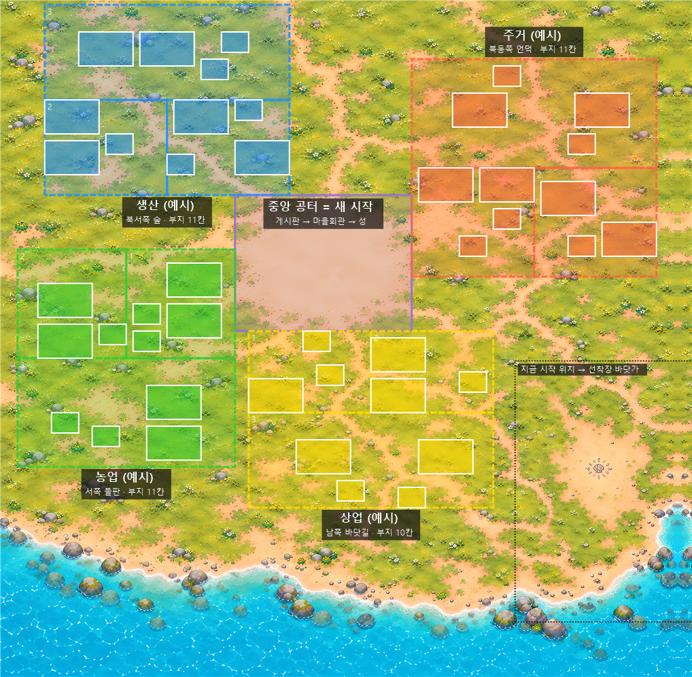
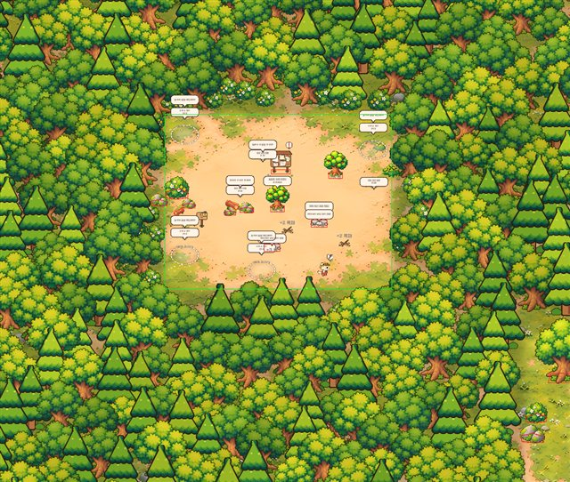

# 구역 · 이사 — 작업 기록

- 작성: 2026-10-14, `feature/Districts` (기준 develop `3c1031c`)
- 원본: 「해달왕국 구역·이사 기획안」(2026-10-13) + 그림 3장 (구역 지도 배치안, 1~5막 흐름, 기존 시스템과 연결)
- 진행 방식: **단계로 나눠 구현하고, 한 단계가 끝날 때마다 멈춰서 확인받는다** (사용자 요청)

## 0. 나눈 단계

| 단계 | 내용 | 상태 |
|---|---|---|
| 1 | **구역 바탕**: 구역 종류 · 지도 위 블록과 부지 칸 · 건물마다 들어갈 구역 · 블록 용도 정하기 규칙 · 왕국 질서도 · 구역 보너스(KingdomBonus) · 세이브 · 테스트 · 배치안 그림 | 끝 (확인됨) |
| 2 | **시작 위치를 중앙 공터로**: 첫 배치 · 걷기 영역 · 카메라 범위 · 영토를 공터에서 사방으로(방향 = 구역 블록) · 블록이 단계마다 커짐 · 용도는 그 시설이 생겨야 · 남동쪽 = 바닷가 · 옛 세이브 (7장) | **끝 (확인 대기)** |
| 3 | 2막 · 3막: 또박이 → 행정 해달 승격 연출 · "음… 좀 정신없네요" · 마을회관 질서도 게이지 · **승격 후 중앙 공터 하이라이트·첫 주거 지정 튜토리얼** · 열린 구역 용도 선택·변경 · 구역 바닥 표시 (최신 9장) | **끝 (확인 대기)** |
| 4 | 4막 이사 지시서: 1장에 건물 1~3개 · 대상 건물 · 목표 구역 반짝임 · 부지 칸 고르기 · 건설 해달이 들고 옮김 · 장마다 보상 · 다 끝나면 넓은 광장 + 정리 전·후 비교 컷 | |
| 5 | 5막: 특성 건물은 맞는 구역에만 · 농업 구역을 정하면 밭 해금(초반 밭 빼기) · 질서도로 마을회관 → 성 · 길드 상업 구역 분가 · 구역 밖 건물 "민원" 말풍선 · 생산 · 농업 보너스 적용처 · 메인 퀘스트 Lv.4~9 재배치 · 밭 없는 초반 돈 확인 | |

## 1. 팀에서 정할 것 → 지금 쓰는 값 (바꾸기 쉬움)

| 정할 것 | 지금 쓰는 값 | 바꾸는 곳 |
|---|---|---|
| 미리 정한 블록 vs 직접 칠하기 | **미리 정한 블록** (기획안 제안) | — |
| 패널티 vs 보너스만 | **보너스만** (구역 밖 건물은 보너스에 안 셈). 민원 말풍선은 5단계 | — |
| 밭을 농업 구역으로 vs 밭 화면 유지 | (제안 없음) **밭 화면은 그대로, 해금만 농업 구역으로** 할 예정 (5단계) | — |
| 구역 위치 | **지도 배치안 그대로**: 주거 = 북동, 상업 = 남쪽 바닷가 쪽, 생산 = 북서 숲, 농업 = 서쪽. 단, 플레이어가 블록마다 용도를 고르므로 이 배치는 "예시 용도"(추천) | `SettlementSetup.Districts.DistrictTable` |
| 성 목표 레벨 | Lv.16 이후 (기획안 제안). 조건은 질서도 80 (임시) | `_castleOrder` |
| 옛 세이브 | **이사 완료로 처리 + 건물을 구역 부지에 자동 배치** (2단계) | — |
| 질서도 계산식 · 기준값 | 아래 3장 (임시) | 설정 `_orderMatchWeight` 등 |
| 밭 없는 초반 돈 | 5단계에서 `Tools/Balance/p0_pacing.py`로 확인 | — |

1단계 확인 뒤 사용자 결정 (2026-10-14):

- **블록은 작게 시작해 점점 커짐** — 그 방향으로 영토를 넓힐 때마다 블록의 최대 크기(칸 · 부지 칸)가 열린다 (2단계에서 함).
- **시설이 있어야 쓸모 있는 구역(상업 · 농업 등)은 그 시설이 열릴 때 함께 열림** (2단계에서 함: 용도별 시설 발전).
- **첫 구역(주거)이 열릴 때 튜토리얼로 구역 정하는 법을 알려 줌** (3단계).
- 지도 도구는 Python으로 유지 (이 컴퓨터에 Python 3.12 + pillow · numpy · opencv 설치).

이번에 따로 정한 것 (기획안에 없음 — 확인 필요):

- **한 용도는 한 블록에만** (네 용도를 한 번씩 다 쓴 뒤에는 겹쳐도 됨). 블록이 4개뿐이라 용도를 겹치게 고르면 밭(농업)이 영영 안 열리는 일을 막으려고.
- 기획안 밖의 특성 건물 구역: **건설소 · 어업 작업소 → 생산**, **기록관 → 중앙(행정)**. 가로등 · 공동 식탁 · 비축 상자 · 환영 소품은 구역 없음(어디든).
- 의자 · 벤치 = 주거의 "쉬는 자리".

## 2. 지도 배치안



- 점선 = 용도를 고르는 블록 (색은 예시 용도), 작은 숫자 = 블록 단계 (1 = 공터 쪽, 그 방향 영토 확장 1단계에서 열림), 실선 = 중앙 공터 (정해짐),
  흰 칸 = 부지 칸 (큰 칸 8×5 = 집 · 건물, 작은 칸 4×3 = 의자 · 벤치 · 특성 건물).
- 부지 칸은 지도의 모래길을 피해 풀밭에 줄 맞춰 놓음 (칸마다 모래 비율을 재서 길이 20% 넘게 지나가는 자리는 뺌). 단계마다 3~4칸.
- 블록 · 칸 수: 중앙 공터(부지 없음 — 게시판 → 마을회관 → 성 자리) · 북동 11칸 · 남쪽 10칸 · 북서 11칸 · 서쪽 11칸 = **부지 43칸**.
- 만드는 곳: 블록 단계 칸 · 부지 칸은 지도 도구 `Tools/MapExpansion/build_territory_art.py`의 `DIRECTIONS` · `SLOT_TARGETS` → `territory_layout.json`의 `districts` →
  `Tools/Settlement/Apply Districts`가 에셋으로. 그림: `powershell -ExecutionPolicy Bypass -File Tools/MapExpansion/draw_districts.ps1` (에셋을 그대로 읽음).

좌표는 광장 꾸미기 격자의 **세이브 좌표** (부탁 건물 자리의 기본 칸과 같은 기준, 칸 − 격자 기준 칸 (77, 3)).

| 변환 | 식 |
|---|---|
| 세이브 좌표 → 바닥 픽셀 (plaza_layout · territory_layout 기준) | (x + 0.8) × 40, (33.6 − y) × 40 |
| 세이브 좌표 → 지도 그림 픽셀 (Plaza_WorldMap.jpg) | 40x + 3061, 3466 − 40y |
| 중앙 공터 (시작 땅) | 세이브 x −42 ~ −16, y 38 ~ 58 (바닥 픽셀 x −1648 ~ −608, y −976 ~ −176) |

## 3. 규칙

### 블록 용도 정하기 (`DistrictRules.CheckDesignate`)

이유를 이 순서로 하나만 돌려줌: 없는 블록 → 정해진 블록(중앙) → 아직 안 열림(첫 단계 = 그 방향 영토 확장 1단계 전) → 이미 정함 →
고를 수 없는 용도(없음 · 중앙) → **그 용도의 시설이 아직 없음** → 첫 구역은 주거 → 다른 블록이 이미 그 용도.

| 용도 | 열리는 시설 (임시) | 잠겼을 때 말 |
|---|---|---|
| 주거 | 처음부터 | — |
| 상업 | `p4_trader_settled` (짤랑이 입주 → 가게 부탁이 나옴) | 장사하는 해달이 마을에 살게 되면 상업 지역을 정할 수 있어요 |
| 생산 | `p4_lumber_settled` (쿵쿵이 · 꾸벅이 입주 → 목공소 부탁이 나옴) | 나무 하는 해달이 마을에 살게 되면 생산 지역을 정할 수 있어요 |
| 농업 | `farmland` (밭 개간, 5단계에서 농업 구역 쪽으로 옮김) | 밭을 일구면 농업 지역을 정할 수 있어요 |

### 블록이 커짐 (`DistrictBlockDefinition.Stages`)

블록 = 단계 3개. 단계 n이 열리는 발전 = 그 방향 영토 확장 n단계 (`territory_ne_1` …). 앞 단계부터 차례로만 셈.
열린 단계의 칸만 블록이고 (맞는 구역 판정 · 질서도), 부지 칸도 열린 단계 것만 쓴다 (`FreeSlot(..., openStages)`).

### 왕국 질서도 (`DistrictRules.Evaluate`)

```text
질서도 = 60 × (맞는 구역에 있는 구역 건물 수 ÷ 구역 건물 수) + 10 × (용도를 정한 블록 수)   (0~100)
```

| 항목 | 내용 |
|---|---|
| 구역 건물 | 광장 꾸미기 격자에 놓인 건물 · 부탁 건물 자리 중 구역이 있는 것 (공사 중 포함). 구역 없음(가로등 등)은 안 셈 |
| 맞는 구역 | 건물이 차지한 칸이 **블록의 열린 칸 안에 다 들어 있고** 그 블록의 용도가 건물의 구역과 같음. 걸치면 안 맞음 |
| 1막 | 집이 공터에 있으니 0 → 첫 구역(주거)을 정하면 10 → **이사 지시서가 열림 (10)** → 집을 옮길수록 오름 |
| 성 | 80 (임시) — 블록 4개를 다 정하면 40, 나머지 40은 이사로 채움 |

### 구역 보너스 (`DistrictRules.BonusPercent`, 수치 임시)

그 용도의 구역이 있을 때만: 기본 % + 그 구역에 맞게 들어선 건물마다 %, 최대 %. `KingdomBonus`가 특성 건물 효과와 더해서 묻는다.

| 구역 | 효과 (`KingdomBonusKind`) | 기본 | 건물마다 | 최대 | 쓰는 곳 |
|---|---|---|---|---|---|
| 주거 | 방문 간격 −% (`VisitSpeed`) | 0 | 5 | 20 | 이미 있음 (장난감 방문) |
| 상업 | 판매가 +% (`SellPrice`) | 0 | 5 | 10 | 이미 있음 (판매) |
| 생산 | 생산 속도 +% (`ProductionSpeed`, 새로) | 0 | 5 | 20 | 5단계에서 붙임 |
| 농업 | 자라는 시간 −% (`GrowSpeed`, 새로) | 10 | 0 | 10 | 5단계에서 붙임 |

지금은 용도를 정하는 화면이 없어서(3단계) 게임에서 보너스가 생기지 않는다.

### 부지 칸 (`DistrictRules.FreeSlot` · `OriginIn`)

들어가는 빈 칸 중 **가장 작은 칸** (의자는 작은 칸, 집은 큰 칸), 놓는 자리는 **가로 가운데 · 아래 맞춤** (이사 · 옛 세이브 자동 배치에 씀).

## 4. 구조 (1단계)

| 파일 | 하는 일 |
|---|---|
| `Settlement/Data/DistrictType.cs` | 구역 용도 enum (숫자로 저장 — 뒤에만 붙임) · 표시 이름 · 고를 수 있는 용도 · `IDistrictBuilding` |
| `Settlement/Data/DistrictBlockDefinition.cs` | 블록: ID · 이름 · 정해진 용도 · 예시 용도 · 단계(`DistrictStage`: 발전 · 칸) · 부지 칸 (`DistrictSlot`: 칸 · 단계) |
| `BuildingDefinition` · `ConstructionPlotDefinition` | `_district` (들어갈 구역) |
| `SettlementConfig` | 블록 목록 · 첫 구역(주거) · 질서도 가중치 · 이사 · 성 기준 · 구역 보너스 표 (`DistrictBonusEntry`) · 용도가 열리는 시설 (`DistrictTypeUnlock`) |
| `Model/DistrictRules.cs` | 열림 · 단계 · 용도 정하기 · 고를 수 있는 용도 · 아직 안 고른 블록 · 질서도 · 보너스 · 부지 칸 — 순수 C# |
| `Model/Settlement.Districts.cs` | 블록 용도 기록 + 세이브 (`SettlementSaveData.districts`) |
| `SettlementManager.Districts.cs` | 광장 격자에서 구역 건물 읽기 · 질서도(한 프레임에 한 번) · `TryDesignateDistrict` · 구역 보너스 → `KingdomBonus.Source` |
| `Common/KingdomBonus.cs` | `ProductionSpeed`(7) · `GrowSpeed`(8) 추가 |
| `Editor/Settlement/SettlementSetup.Districts.cs` | `Tools/Settlement/Apply Districts`: 블록 에셋 5개(`Scriptable Obejects/Settlement/Districts/`, 칸은 지도 배치에서) · 건물 구역 표 · 용도 시설 표 · 설정 기본값 |
| `Tools/MapExpansion/draw_districts.ps1` | 배치안 그림 |

## 5. 확인 (1단계)

| 확인 | 결과 |
|---|---|
| 배치 모드 `Tools/Settlement/Apply Districts` | 오류 없음. 다른 에셋 변화 없음 |
| EditMode 전체 | 450 / 450 (`DistrictTests` 9개) |

## 6. 2단계 — 중앙 공터에서 시작 (2026-10-14)

### 땅



시작 화면 (아무것도 안 지음): 공터 가운데 게시판 · 흔드는 나무 2 · 바위 2 · 나뭇가지 2 · 건설 해달, 공터 서쪽 가장자리에 밭 가는 길, 네 가장자리에 개간 자리(점선 원). 둘레는 모두 숲.


집 · 의자 · 가로등을 짓고 북동쪽 1단계를 넓힌 뒤 (집 자리는 건설 모드의 처음 자리 — 플레이어가 옮김). 초록 선 = 걷기 영역.

| 땅 | 칸 (세이브 좌표 x, y, 가로, 세로) | 열림 |
|---|---|---|
| 중앙 공터 | (−42, 38, 26, 20) | 처음부터 (광장 기본 걷기 영역 `MainPlaza`) |
| 북동 1 · 2 · 3 (예시: 주거) | (−16, 46, 18, 16) · (2, 46, 18, 16) · (−16, 62, 36, 16) | `territory_ne_1` · `_2` · `_3` |
| 남 1 · 2 · 3 (예시: 상업) | (−40, 26, 18, 12) · (−22, 26, 18, 12) · (−40, 12, 36, 14) | `territory_s_1` … |
| 북서 1 · 2 · 3 (예시: 생산) | (−52, 58, 18, 14) · (−70, 58, 18, 14) · (−70, 72, 36, 14) | `territory_nw_1` … |
| 서 1 · 2 · 3 (예시: 농업) | (−58, 34, 16, 16) · (−74, 34, 16, 16) · (−74, 18, 32, 16) | `territory_w_1` … |
| 바닷가 (옛 시작 광장) | (−1, −4, 26, 37) | `fishing_found` (Lv.15 낚시터 발견). 숲 없음 |

- 블록 사이 · 지도 가장자리 숲은 늘 남는다. 공터 둘레 숲은 나무 그림이 공터로 넘어오지 않게 띄움.
- 단계 = 그 땅의 숲을 개간 N번(1단계 3번 · 2 · 3단계 2번, 조각마다 숲이 사라지고 그루터기) → 영토 확장 미션 → 그 땅이 열림 (걷기 영역 · 카메라 · 구역 블록 단계 · 부지 칸).
- 개간 기회 규칙은 그대로 (Lv.6에 1번, 레벨마다 1번, 한 번에 한 곳). 4방향 × 7번 = 28번 → **속도는 정해야 함** (7장).

| 단계 표 (`SettlementSetup.Territory.TerritoryTable`, 임시) | 개간 시간 | 목재 | 미션 재료 | 경험치 |
|---|---|---|---|---|
| 1단계 (방향마다) | 3 · 4 · 5분 | 30 · 35 · 40 | 골드 500 · 목재 40 · 돌 15 | 600 |
| 2단계 | 6 · 8분 | 45 · 55 | 골드 1,200 · 목재 70 · 돌 30 | 1,000 |
| 3단계 | 10 · 13분 | 60 · 75 | 골드 2,400 · 목재 110 · 돌 50 | 1,500 |

### 시작 묶음 옮기기 (`SettlementSetup.CenterStart`)

광장 배치 도구(Setup Plaza · P2 · P3 · Apply Building Plots)는 지금도 옛 광장 픽셀로 만들고, 끝에서 `ApplyCenterStart`가 묶음별로 옮긴다
(묶음마다 정해진 만큼, 아직 옛 광장에 있는 것만 → 도구 하나만 다시 돌려도 같음). 건설 자리 기본 칸은 그 뒤에 다시 계산된다.

| 묶음 | 옛 자리 → 새 자리 (바닥 픽셀) |
|---|---|
| 게시판 · 마을회관 · 길드 · 바위 · 흔드는 나무 · 나뭇가지 · 모임 자리 · 공동 식탁 · 쉼터 벤치 · 회관 장식 · 정리 작업 자리 · 건설 해달 · 요정 · 해달 나오는 자리 · 처음 카메라 | 게시판 (400, 525) → (−1120, −715), 같은 거리 (칸 −38, +31) |
| 첫 집 · 두 번째 집 · 의자 · 가로등 · 비축 상자 | 공터 북동 · 북서 귀퉁이 · 위 · 동쪽 · 남서쪽 (처음 자리일 뿐, 건설 모드에서 고름) |
| 밭 가는 길 (잡목 · 표지판 · 개간 자리) | (545, 150) → 공터 서쪽 가장자리 (−1600, −560). 5단계에서 농업 구역으로 |
| 새 이웃의 집 묶음 (P3) | 처음 넓힌 방향의 1단계 땅 (`TerritoryAnchor` 방향 4곳, 건설 자리 기본 칸도 방향마다) |
| 나무 · 덤불 · 바위 장식, 피크닉 · 울타리 | 옛 광장(바닷가)에 그대로 |

### 옛 세이브 (정착 세이브 버전 5, `CenterStartMigration`)

| 무엇 | 어떻게 |
|---|---|
| 영토 | 옛 서쪽 · 북쪽 진행 → 새 단계에 차례로 (1단계를 북동 → 서 → 남 → 북서, 그다음 2단계 …). 넓힌 단계는 그대로 넓힘(보상 · 경험치 다시 안 줌), 남은 개간 수는 다음 단계로. 진행 중이던 옛 개간은 끝난 것으로 (해달은 쉼). 옛 광장 동쪽 확장(`plaza_expand_01`)은 넓힌 단계 하나 |
| 구역 | "이사까지 끝난 것": 열린 블록마다 예시 용도 (그 시설이 아직이면 비워 둠) |
| 광장 물건 | 열린 땅 밖에 있는 것만: 구역 건물 → 맞는 구역의 빈 부지 칸, 나머지(장난감 · 구역 없음 · 맞는 구역 없음) → 옛 광장 자리를 공터로 그대로 민 자리 → 겹치거나 공터 밖이면 공터의 가까운 빈자리 |
| 아직 안 놓인 건물 (자리를 고르기 전에 지은 것) | 새 기본 칸 = 공터 (기존 `ReconcilePlots`) |

### 지도 도구

- 이 컴퓨터에 Python 3.12 + pillow · numpy · opencv-python-headless 설치.
- `python Tools/MapExpansion/build_territory_art.py` — 배치만 다시 (지도 · 나무 그림은 있는 것). `--rebuild-sprites` · `--rebuild-map`(업스케일 캐시 필요)은 따로.
- 출력: `territory_layout.json` (`regions` 걷기 · 카메라 땅, `groups` 숲 묶음(`development` 사라지는 발전, 비면 늘 남음 · `stumpsUntil`), `sites` 방향 · 단계별 개간 자리,
  `homes.list` 방향별 이웃집 자리, `districts` 블록 단계 · 부지 칸, `tiers` 개간 수), `Territory/Shade_*.png`, `preview_forest.png`(커밋 안 함).

### 구조 (2단계)

| 파일 | 하는 일 |
|---|---|
| `TerritoryDirection` | `NorthEast` · `South` · `NorthWest` 추가 (`West` = 서쪽 블록, `North`는 옛 값) |
| `TerritoryRules` | 칸 발전 없앰. 처음 넓힘 · 이웃집 방향(처음 넓힌 쪽) · `DirectionKey` · `AnyLeft` |
| `TerritoryMapView` | 카메라 범위 = 공터 + 열린 땅(발전 · 직사각형) + 숲 여유. 넓히면 그 땅을 비춤 |
| `TerritoryAnchor` · `ConstructionPlotDefinition` | 방향마다 자리 / 기본 칸 목록 |
| `DistrictBlockDefinition` · `DistrictRules` | 블록 단계 · 용도 시설 |
| `Model/CenterStartMigration.cs` · `SettlementManager.Territory` | 옛 세이브 옮기기 (버전 5) |
| `SettlementManager.Buildings` | 자리를 잃은 건물을 공터 가운데부터 찾음 |
| `Editor/.../SettlementSetup.Territory.cs` | 새 배치 읽기 · 4방향 × 3단계 데이터 (옛 서쪽 · 북쪽 영토 · 개간 작업 · 미션 에셋은 지움) · 광장 영토 · 공터 걷기 영역 |
| `Editor/.../SettlementSetup.CenterStart.cs` | 시작 묶음 옮기기 (`Tools/Settlement/Apply Center Start`) |
| `Tools/MapExpansion/build_territory_art.py` | 땅 나누기 · 숲 · 그늘 · 걷기 다각형 · 개간 자리 · 블록 단계 · 부지 칸 |

다시 만들 때: `python Tools/MapExpansion/build_territory_art.py` → `Tools/Settlement/Apply Map Expansion` → `Tools/Settlement/Apply Districts`.

### 확인 (2단계)

| 확인 | 결과 |
|---|---|
| 배치 모드 `Apply Map Expansion` + `Apply Districts` | 오류 없음. 건설 자리 기본 칸이 모두 공터 안 (첫 집 (−23, 53) · 두 번째 집 (−41, 54) · 의자 (−33, 56) · 가로등 (−18, 50) …), 이웃집은 방향 자리 4곳. 표 재생성으로 바뀐 남의 에셋(해달 · 부탁 · 그림 설정 · 폰트)은 되돌림 |
| EditMode 전체 | **456 / 456** (`TerritoryTests` 8 — 4방향 · 이웃집 방향 · 옛 세이브 넓힌 단계 · 하던 개간, `DistrictTests` 14 — 블록 단계 · 용도 시설 · 옛 세이브 용도 · 물건 옮기기 · 지도 배치와 영토 데이터) |
| 광장 스냅샷 | 위 그림 2장 (시작 · 북동 1단계) |
| PlayMode (임시 확인, 커밋 안 함. 세이브 폴더 백업 → 실행 → 복원, md5 같음) | 실제 세이브(Lv.4, 버전 3)로 광장: 버전 5로 옮김 · 카메라가 공터에서 시작 · 카메라 범위 = 공터 + 숲 여유 · 지은 집 · 의자 · 가로등이 공터 기본 칸에 놓임 · 해달이 걷기 영역 위 |


## 7. 남은 것 · 정할 것 (2단계 뒤)

| 질문 | 메모 |
|---|---|
| 개간 기회 속도 | 4방향 × 7번 = 28번인데 기회는 레벨마다 1번 (Lv.6 → 33). 첫 구역은 Lv.8 (기획안 3막 Lv.6~9와 맞음), 나머지는 느림 → 기회를 늘리거나(레벨마다 2번 등) 2 · 3단계 개간 수를 줄일지 |
| 용도가 열리는 시설 | 상업 = 짤랑이 입주(Lv.11~12), 생산 = 쿵쿵이 입주(Lv.12~13), 농업 = 밭(지금 Lv.4). 5단계에서 밭이 뒤로 가면 농업도 같이 |
| 공터 크기 | 26 × 20칸. 1막 건물(집 2 · 의자 · 가로등 · 게시판 → 마을회관)은 다 들어감. 쉼터 벤치 · 공동 식탁 · 비축 상자(2막 이후)까지 들어가면 꽤 붐빔 = 기획 의도 |
| 바닷가 | 낚시터를 찾으면(Lv.15) 걷기 · 카메라만 열림. 남쪽 3단계와 붙어 있지 않아 걸어서는 못 감 (선착장 연결은 5단계에서) |
| 옛 광장의 장식 | 피크닉 · 울타리(밭 · 두 번째 집과 함께 나타남)는 바닷가에 남아 보이지 않음. 공터로 옮길지 |

## 8. 3단계 — 행정 해달 · 구역 정하기 (2026-10-14)

상태: **구현 완료, 사용자 확인 대기**. 4단계 이사 지시서는 시작하지 않음. 커밋·푸시 없음.

### 구현

- `board_upgraded` + `receptionist_assigned` + 실제 `role_board_manager` 담당이 `otter_receptionist`일 때, 광장에서 또박이를 비추며 "음… 좀 정신없네요" → 행정 해달 승격 안내. 기존 팝업·여행·다른 튜토리얼·꾸미기를 기다린다.
- 안내 종료 시 기존 발전 목록에 `admin_otter_promoted`를 저장한다. 이미 조건을 채운 옛 세이브도 다음 광장에서 한 번, 진행 중 나가면 다음 방문에 재시도한다. 세이브 필드·버전 추가 없음.
- 승격한 또박이를 누르면 행정 해달 대사와 마을회관 현황을 연다. 회관 화면은 `board_upgraded`부터 열 수 있게 수정했다 (기존 코드의 길드 확장 조건도 유지).
- 회관에 **왕국 질서도 0~100 게이지**, 다음 기준까지 남은 점수, 미지정 블록 수와 **구역 정하기** 버튼. 승격 전에는 이 카드를 숨긴다. 영토 확장 카드와 완료 기록은 함께 표시되도록 배치를 조정했다.
- 구역 선택: 블록 이름, 이전·다음 블록, 네 용도, 추천 용도, 잠긴 사유, 선택 가능한 용도가 없을 때 안내. 첫 구역 추천은 주거로 맞춘다. 최종 확인 시 `TryDesignateDistrict`로 조건을 재검사하며 이미 정한 용도는 바꿀 수 없다.
- 광장의 미지정 블록 위에 누를 수 있는 표지를 표시한다. 정한 블록은 **열린 단계만** 용도 색으로 옅게 표시하며, 건설·꾸미기 모드에서는 열린 부지 칸 테두리를 표시한다.
- 기존 `TutorialOverlay` / `TutorialPointer`로 첫 구역 설명과 주거 버튼 강조. `District.Intro`는 설명 완료, `District`는 **실제 주거 지정 성공** 때만 `tutorialsDone`에 기록한다. 건너뛰기·화면 닫기로 완료되지 않는다. 이미 구역을 정한 옛 세이브는 첫 구역 설명을 다시 강요하지 않는다.
- 구역 지정 등 상태 변화 후 같은 프레임에도 최신 질서도를 보도록 캐시를 무효화한다.

### 구조

| 파일 | 내용 |
|---|---|
| `Settlement/Model/DistrictGuideRules.cs` | 승격 조건·중복 방지, 첫 구역 안내 조건, 잠금·목표 문구, 용도 색 |
| `GameManager.Districts.cs` · `Tutorial/ZoneTutorials.cs` | 광장 승격 연출, 튜토리얼 설명·실제 지정 완료·정리 |
| `Settlement/UI/DistrictPopupView.cs` · `DistrictPresenter.cs` | 블록 탐색·용도 선택·최종 확인·실시간 갱신 |
| `Settlement/UI/TownHallPopupView.cs` · `TownHallPresenter.cs` | 질서도 게이지·구역 카드·배치 |
| `Settlement/World/DistrictMapView.cs` | 구역 색·열린 부지 테두리·미지정 표지 (`TerritoryMapView`가 씬에 붙임) |
| `SettlementManager.Districts.cs` · `SettlementManager.cs` | 승격 저장·구역 화면 요청·회관 열림·질서도 캐시 |
| `Settlement/World/SettlementOtterView.cs` | 승격 후 대사·회관 연결 |
| `Editor/Settlement/SettlementSetup.DistrictUI.cs` | 좁은 범위의 UI 생성 메뉴, 회관·구역 화면만 교체 |
| `Tests/EditMode/DistrictGuideTests.cs` | 승격 조건·한 번만·저장 왕복·옛 세이브·첫 구역·시설 잠금·목표·프리팹 연결 (11개) |

### 재생성

`Tools/Settlement/Rebuild District UI` (`SettlementSetup.RebuildDistrictUI`)만 실행하면 된다. `GlobalUI.prefab`의 회관·구역 화면과 presenter 연결만 갱신한다. 전체 Global UI 생성 경로에도 포함했다. `Apply Map Expansion` / `Apply P3 Projects`는 실행하지 않았다.

### 확인

| 확인 | 결과 |
|---|---|
| 좁은 UI 생성 메뉴 | Unity 배치 실행 성공, 회관·구역 화면 연결 확인 |
| EditMode 전체 | **467 / 467** (기존 456 + 구역 안내 11) |
| 실제 광장 PlayMode (임시 검사) | 광장 진입 연결, 승격 연출·한 번만, 설명 건너뛰기는 미완료, 다시 안내 → 주거 버튼 → 확인 → 실제 지정·완료 저장, 질서도 10점, 회관 게이지·미지정 카드, 색칠·꾸미기 부지 테두리, 다음 블록 용도 잠금 확인 |
| 세이브 보호 | 세이브 폴더 전체 백업 → 검사 → 원본 복원, 14개 파일 SHA256·파일 수 일치. 임시 플레이 검사·참조 변경 제거 |

화면 기록: `Images/구역이사_3단계_구역선택.png`, `Images/구역이사_3단계_질서도.png`, `Images/구역이사_3단계_부지.png`.

### 남은 것

- 사용자 확인 후 **4단계 이사 지시서** 진행. 현재 게이지의 "이사 지시서 기준 달성"은 질서도 안내이며 이사 기능은 아직 없음.
- 개간 기회 속도, 용도별 시설 조건, 질서도 수식·기준·보너스 수치는 1·2단계 값을 유지했다. 7장의 미정 항목과 5단계 범위는 그대로 남아 있다.

## 9. 3단계 수정 — 중앙 주거 튜토리얼과 용도 변경 (2026-10-14)

사용자 수정 요청: **마을회관 완성·또박이 행정 해달 승격 후 중앙 공터를 주거로 설정하도록 하이라이트 튜토리얼을 보여 주고, 설정한 용도를 나중에 바꿀 수 있어야 한다.** 아래가 현재 규칙이며, 1~8장의 ‘중앙 행정 고정 / 개간 뒤 첫 주거 / 한 용도 한 블록 / 용도 변경 불가’ 기록을 대체한다.

- 중앙 공터는 처음부터 열린 땅이다. 승격 후 다른 팝업이 닫히면 중앙 공터로 카메라를 옮기고, 땅의 보이는 영역에 하이라이트와 주거 구역 설명을 표시한다. 추가 숲 개간·Lv.8을 기다리지 않는다.
- 설명 다음에는 **중앙 공터의 구역 선택 화면**을 열고 **주거 지역 버튼**을 강조한다. 첫 중앙 지정은 주거이며, 실제 지정에 성공해야 완료된다. 설명만 넘기거나 화면을 닫아서는 완료되지 않는다.
- 이미 승격했으나 중앙을 지정하지 않은 세이브는 다음 광장 방문에 안내한다. 이전 바깥 구역 튜토리얼 완료 기록과 구분하기 위해 `District.Center.Intro` / `District.Center`를 사용한다. 기존 구역 기록을 지우지 않는다.
- 중앙 에셋의 행정 기본값과 GUID는 그대로 두고, 기존 `districts` 저장 목록의 중앙 지정 값을 런타임에서 우선한다. 아직 지정하지 않았을 때는 기본 행정으로 판정되며, 주거 지정 후 중앙의 집은 주거 보너스·질서도에 포함된다. 세이브 필드·버전 추가 없음.
- 회관의 구역 정하기 버튼은 미지정 땅이 없어도 보인다. 관리 화면은 **열린 모든 변경 가능한 블록**을 탐색하며, 현재 용도를 표시하고 다른 용도로 바꿀 수 있다.
- 시설 잠금은 유지한다. 잠긴 용도로 바꾸려 하면 기존 용도는 보존된다. 용도 변경은 기존 건물을 옮기거나 삭제하지 않는다. 같은 용도를 여러 블록에 사용할 수 있다 (중앙과 바깥 땅 모두 주거 가능).
- 지정한 중앙도 질서도의 지정 블록 수에 포함된다. 기존 가중치 60·블록당 10과 0~100 제한은 유지한다. 4단계 이사 흐름은 중앙 주거 정책에 맞춰 후속 확인이 필요하다.

검증: 별도 프로젝트 복사본과 `CodexQA/DistrictCenterCheck` 저장 경로를 사용했다. 원본 Unity와 사용자 세이브를 종료·교체하지 않았다. 

| 확인 | 결과 |
|---|---|
| EditMode 전체 | **470 / 470**. 새 중앙 안내·변경·세이브 테스트 3개 및 기존 규칙 변경 반영 |
| 실제 광장 PlayMode (별도 복사본, 임시 검사) | **1 / 1**. 외곽 땅이 닫혀 있어도 중앙 하이라이트·안내, 중앙 주거 선택 버튼 강조, 실제 지정 완료, 미지정 땅 0개일 때도 회관 관리 버튼 표시, 상업 변경·저장 왕복·주거로 복귀 확인 |
| 원본 보호 | 테스트는 복사본과 별도 회사·제품 저장 경로에서 실행. 원본 Unity를 종료하지 않고 사용자 세이브를 덮어쓰지 않음 |

확인 방법: 코드를 반영하고 플레이를 다시 시작하거나 광장을 재방문한다. 중앙을 아직 지정하지 않았으면 승격 이후 즉시 중앙 안내가 시작된다. 지정한 용도 변경은 **마을회관 → 구역 정하기 → 현재와 다른 열린 용도 → 예**.

## 10. 3단계 다듬기 — 구역 화면 UX (2026-10-15, Claude, `feature/DistrictFix`)

- 버그: 구역을 정한 뒤 "○○이 주거 지역이 되었어요" 말풍선이 안 사라짐 → `ShowGuide`(HideGuide 전까지 남는 할 일 안내) 대신 `GameNotices` 알림.
- 구역 색은 **구역 화면 · 꾸미기 모드 · 이사 지시서 화면을 켰을 때만** 보인다 (평상시 광장은 깨끗하게). 미지정 표지는 평상시 그대로.
- 구역 화면을 **아래 시트**(1000×900, 2×2 용도 칸)로 바꾸고 배경 어둡게를 옅게 → 위쪽 절반에 고르는 땅이 보임.
  열면 카메라가 가장 멀리(`PlazaCameraController.SetOverview`) 보고 땅을 시트 위로 비춤, 닫으면 원래 확대. 고르는 땅 테두리 + 땅 위 이름표("중앙 공터 · 주거 지역").
  블록이 세로 화면보다 커서(중앙 26칸 폭 > 가장 멀리 봐도 약 14.6칸) 색만으로는 안 읽혀 이름표를 둠.
- 현재 용도 칸은 회색(잠김과 같음) 대신 그 용도 색으로 강조, 누르면 아무 일 없음. 블록이 하나면 "(1 / 1)" 뺌.
- 다시 만들기: `Tools/Settlement/Rebuild District UI`.

## 11. 4단계 — 이사 지시서 (2026-10-15, Claude, `feature/DistrictFix`)

사용자 결정: 옮기는 데 **시간이 걸림** (건설 해달이 들고 옮김), 지시서는 **마을회관 창**에서.

### 흐름

1. 행정 해달 승격 뒤 질서도가 `RelocationOrder`(10)에 닿으면 또박이가 지시서를 냄 (알림 "이사 지시서 #1이 나왔어요!").
   지시서 = 맞지 않는 구역에 있는 다 지은 구역 건물 중 **같은 용도끼리 1~3채**, 그 용도 블록에 **들어갈 빈 부지 칸이 있는 만큼만** (칸을 차례로 맡겨 보며 셈 → 늘 끝낼 수 있음). 맞지 않는 건물이 가장 많은 용도부터.
2. 마을회관 질서도 카드에 "이사 지시서 #1 · 주거 지역으로 0/3 · 보상" + **[이사하기]** (구역 정하기 왼쪽).
3. 이사 지시서 화면 (`RelocationModePresenter`, 광장에서만): 옮길 건물 주황 테두리, 그 건물이 들어갈 **빈 부지 칸이 반짝임**. 칸을 누르면 확인 → 옮김.
   아래 패널에 지시서 · 진행 · 안내 · [건물 보기] [빈 자리 보기] [닫기] (위쪽 끝 블록이 가려지지 않게 글도 아래에). 카메라는 가장 멀리.
4. 옮기기: 격자에서는 바로 부지 칸으로 (가로 가운데 · 아래 맞춤), **`RelocationSeconds`(90초) 동안 "이사 중"** — 건물 위 "이사 중 0:42" + 진행 막대, 건설 해달이 공사가 없으면 그 건물 앞에서 망치질.
   이사 중인 건물은 질서도 · 지시서에서 아직 제자리로 치지 않고, 다시 옮길 수 없다. 꺼 둔 동안에도 시간이 흐름.
5. 지시서의 건물이 모두 제자리(이사 끝)면 보상(건물마다 골드 150 + 경험치 40, 임시) → 다음 지시서.

- **꾸미기 모드에서 구역 건물을 옮겨도 이사 시간이 걸린다** (행정 해달 뒤부터. 그냥 옮기면 지시서가 의미 없어짐). 구역 없는 물건 · 승격 전은 예전처럼 바로.

### 구조

| 파일 | 내용 |
|---|---|
| `Settlement/Model/Settlement.Relocation.cs` | 지시서 · 끝낸 수 · 옮기는 중인 건물 기록 + 세이브 (`SettlementSaveData.relocation`, 옛 세이브 = 지시서 없음. 버전 안 올림) |
| `Settlement/Model/RelocationRules.cs` | 맞는 구역 · 빈 부지 칸(작은 칸부터) · 지시서 고르기 · 끝낸 수 · 보상 (순수 C#) |
| `Settlement/SettlementManager.Relocation.cs` | 구역 건물 · 차지한 칸 읽기, `TryRelocate` / `TryRelocateToSlot`, Update 틱(이사 끝 → 보상 → 다음 지시서) |
| `DistrictRules` · `SettlementManager.Districts` | `DistrictPlacement.Moving` — 이사 중이면 질서도에서 안 맞음 |
| `SettlementConfig` | `_relocationSeconds` 90 · `_relocationGoldPerBuilding` 150 · `_relocationExp` 40 (에셋에 없으면 기본값) |
| `Settlement/UI/RelocationModePresenter.cs` | 이사 지시서 화면 (코드로 만듦, 캔버스 110) |
| `TownHallPopupView` · `TownHallPresenter` | [이사하기] (구역 정하기 버튼 복사) · 지시서 한 줄 |
| `DistrictMapView` | "이사 중" 표시 · 지시서 화면에서도 구역 색 |
| `BuilderOtterController` · `SettlementPlazaView` | 건설 해달 일터를 공사 현장 말고 임의 지점으로도 (`SetWork`), 공사가 없으면 이사하는 건물 앞 |
| `DecorModePresenter` | 다 지은 건물 옮기기 → `SettlementManager.TryRelocate` |
| `Tests/EditMode/RelocationTests.cs` | 지시서 고르기(빈 칸 수만큼) · 지시서 없음 · 빈 칸 순서 · 이사 중 미완료 · 질서도 · 없어진 건물 · 세이브 왕복 (6개) |

### 확인

| 확인 | 결과 |
|---|---|
| EditMode 전체 | **476 / 476** |
| 실제 광장 PlayMode (임시, 세이브 백업 → 복원) | Lv.9 세이브에서 북동쪽을 주거 · 중앙을 생산으로 바꿔 지시서 #1(집 · 의자 · 새 이웃의 집) 생성 → 회관 카드 [이사하기] → 지시서 화면(빈 칸 반짝임) → 작은 집 옮김 → "이사 중" 막대 → 5초(빠른 시계) 뒤 끝, 질서도 20 → 35 |

### UI 다듬기 (같은 날)

- 광장 월드 표시를 단색 사각형에서 **UI와 같은 스티커 그림**으로: `Resources/UI/DistrictVisualStyle`(종이 판 · 색 칩 · 복숭아 리본 · 막대, `Rebuild District UI`가 만듦) + `WorldSticker`(월드 9-slice 판 · 글자).
  - 미지정 표지 = 종이 판 (땅 이름 + "이 땅을 뭘로 쓸까요?"), 구역 이름표 = 종이 판 + 용도 색 칩. 이름표는 **그 땅에서 화면에 보이는 부분의 위쪽**으로 따라가고(HUD · 아래 패널 제외), 땅이 안 보이면 숨김.
  - 이사 중 = 종이 판 + "이사 중 0:42" + 막대 (지붕 위, `WorldSticker.AboveBuilding`).
  - 지시서 화면: 빈 자리 = 용도 색 스티커 판(깜빡임) + "여기로!" 태그, 옮길 건물 = 발밑 복숭아 판 + 지붕 위 통통 튀는 "옮길 건물" 리본, 아래 패널에 보상 줄.
- 구역 시트: 카드를 외곽선 있는 스티커 카드로, 제목 앞 용도 색 칩, 잠긴 칸은 회색 대신 옅은 베이지 + 옅은 글자, 카드 높이 280 → 200 (시트 900 → 760).

### 마을회관 화면 다시 짜기 · 구역 시트 전환 (2026-10-15)

- 구역 시트에서 이전 · 다음: 고르는 땅의 이름표 **하나만** 화면 위쪽 가운데에 고정(카메라가 움직여도 미끄러지지 않고 글만 바뀌며 살짝 튀어나옴). 다른 땅 이름표는 숨김. 위쪽 여백을 오른쪽 뽑기 버튼까지(0.27).
- 마을회관(`TownHallPopupView`, 만들기 `SettlementSetup.TownHall.cs` — `Rebuild District UI`): 고정 위치 → **카드가 내용만큼 쌓이는 스크롤**.
  머리말(마을회관 그림 · 정착 단계 · 마을 발전 막대) / 카드마다 아이콘 머리말: 주민 현황(집) · 지금 하는 일(건설 해달) · 다음 목표(퀘스트, 외곽선 종이 카드로 강조) · 왕국 질서도(또박이, 점수 오른쪽 · [이사하기][구역 정하기]) · 영토 확장(개간) · 완료한 발전(칩, `FlowLayoutGroup`으로 줄바꿈 + 개수).
  예전처럼 카드를 복사해 위치를 옮기는 코드는 없앰 (영토 · 이사 버튼도 빌더가 만듦).
- 새 그림이 생기면 자동으로 씀: `Assets/Art/Settlement/ICON_Trophy.png`(완료한 발전, 없으면 게시판 업그레이드 그림), `ICON_Labor_Settled/_Available/_Working.png`(주민 칩). 넣은 뒤 `Rebuild District UI`.

## 12. 5단계 일부 — 성 승격 (2026-10-15, Claude)

- 행정 해달 뒤 질서도가 `CastleOrder`(80)에 닿으면 `castle_ready`가 열림(한 번, 내려가도 안 닫힘) → 알림 "왕국 질서도 80 달성!" → 게시판 큰 부탁 **"왕국의 성을 세워요"**(`req_build_castle`, 또박이, 순서 14).
  짓기 · 건설 해달 · 완성 연출 · 완료 팝업은 다른 큰 부탁과 같은 흐름 → `castle_built`, 정착 단계 **"해달 왕국"**. 건설 `con_castle`: 골드 3,000 · 목재 · 돌(길드의 1.6배) · 180초 (임시).
- 광장: 마을 길드 현장을 복사한 `Site_Castle`(건설 해달 · 먼지). 성 그림 `Assets/Art/Settlement/Prop_Castle.png`가 있으면 길드 건물을 복사해 성으로 바꿔 끼움(`castle_built`에 나타나고 길드는 숨김). 없으면 길드 그림이 그대로.
- 만들기: `Tools/Settlement/Apply Castle` (`SettlementSetup.ApplyCastle`, 에셋 · 단계 · 광장. 그림을 넣은 뒤 다시 실행).
- 치트: `OtterKingdom/Dev/구역 · 성 테스트` — 상태(승격 · 질서도 · 성 · 지시서), 행정 해달 승격, 질서도 덮어쓰기(저장 안 됨), 성 세우기 바로 열기, 성 재료 받기, 빠른 타이머, 성 되돌리기(`Settlement.DevForget`).
- 코드: `CastleRules`, `SettlementManager.Castle`(틱 · `DevOrderOverride`), `Settlement.Dev`, 테스트 `CastleTests`(2개).

## 13. 5단계 일부 — 민원 말풍선 · 구역 보너스 적용처 (2026-10-15, Claude)

- **민원 말풍선**: 행정 해달 뒤, 그 용도의 구역이 있는데 밖에 있는(이사 중 아님) 다 지은 구역 건물 지붕 위에 "민원!" 복숭아 리본(통통). 평상시 광장에서만(꾸미기 · 구역 · 이사 화면에서는 숨김).
  누르면 이사 지시서 화면, 지시서가 없으면 "또박이: 이 건물은 ○○ 지역에 있어야 해요" 알림. (`DistrictMapView`, 0.5초마다 다시 셈)
- **생산 구역 `ProductionSpeed`**: 주민 작업(정착 · P3 생활 의뢰)이 +p% 빨리 끝남 (`KingdomBonus.Faster` = 시간 ÷ (1 + p/100)). 작업 화면의 시간 표시도 같은 값.
- **농업 구역 `GrowSpeed`**: 밭 자라는 시간 −p% (`FarmService.CurrentDurationMultiplier` = 밭 레벨 배율 × 효과, 최대 90%). 새로 심는 작물부터, 오프라인은 원래처럼 효과 없음.
  ※ `FarmService`(밭)는 팀원 파일 — 한 줄만 바꿈.

### 남은 것 (4단계)

- ~~정리 전·후 비교 컷~~ → 14절에서 만듦.
- 건설 해달이 실제로 집을 **들고 가는** 그림 (지금은 새 자리에서 망치질 + 막대).
- 지금 규칙(중앙 = 주거 가능)에서는 집이 중앙에 있으면 이미 맞아서, 지시서는 주로 상점 · 공방 같은 특성 건물이 상업 · 생산 구역을 정한 뒤에 나온다. 기획 의도(1막 집 이사)와 맞는지 확인 필요.
- 보상 · 이사 시간 수치는 임시.

## 14. 5단계 나머지 — 특성 건물 구역 제한 · 길드 분가 · 정리 전후 비교 컷 (2026-10-15, Claude)

- **특성 건물은 맞는 구역에만** (`SettlementManager.DistrictBuildings`): 행정 해달 뒤, 구역이 정해진 `BuildingDefinition`(가게 · 공방 …)을 **새로** 지을 때 그 용도 구역 안에만 놓을 수 있다.
  - 그 용도 구역이 아직 없으면 "○○ 지역부터 정해 주세요 (마을회관 → 구역 정하기)", 밖에 두면 고스트가 빨갛고 "○○ 지역 안에만…" 안내.
  - 처음 놓아 볼 자리는 맞는 구역의 빈 부지(`TryFindDistrictSpot`). 집 · 의자 같은 게시판 건물, 이미 지은 건물(옮기기는 이사 · 민원), 중앙(행정)은 제한 없음.
- **길드 분가** (`Tools/Settlement/Apply Guild Branch` = `SettlementSetup.ApplyGuildBranch`, 여러 번 실행해도 같음):
  - 건물 `bld_guild_branch` "길드 지부" — 상업 지역 전용, 6×4, 골드 2,500 · 목재 50 · 돌 30 · 300초, 판매가 +5%, `castle_built` 뒤. 그림은 예전 접수소(`Prop_GuildOffice`).
  - 게시판 부탁 `req_guild_branch` (순서 17, 접수원, 결과 발전 `guild_branch_built`). 수치는 임시.
- **정리 전 · 후 비교 컷** (`RelocationShowcasePresenter`, 코드로 만든 화면 · 스스로 생김):
  - 첫 이사 지시서가 나오면 중앙 공터를 사진으로 저장(세이브 폴더 `relocation_before.png`, 발전 `relocation_before_taken`).
  - 지시서를 하나 이상 끝내고 옮길 · 이사 중 건물이 없으면 같은 구도로 한 장 더 찍어 폴라로이드 두 장(정리 전 / 정리 후) + 또박이 한 줄 + 질서도. 한 번만(`relocation_showcase_done`).
  - 광장에서만, 다른 팝업 · 알림 · 연출 · 꾸미기 · 이사 화면이 끝난 뒤에 뜸.
- 확인: EditMode 481/481, PlayMode 임시 테스트로 구역 제한 안내 · 길드 지부 · 비교 컷 화면 확인.

### 남은 것

- 새 게임 Lv.1~10 통으로 해 보기(QA).

## 15. 건설 해달이 건물을 이고 이사 (2026-10-15, Claude)

- 이사가 시작되면(`SettlementManager.OnRelocationStarted`: 배치 ID + 옛 칸) 광장(`SettlementPlazaView.TryStartCarry`)이 옛 자리에 건물 그림을 남기고, 새 자리의 건물은 숨김.
- 건설 해달(`BuilderOtterController.SetCarryWork`)이 옛 자리로 가서 건물을 **작게 머리에 이고**(통통 · 살짝 흔들) 새 자리까지 걸어간 뒤 내려놓고 남은 시간 동안 망치질.
  - 따로 그림 없이 옮기는 건물 자체 그림을 씀 → 집 · 가게 · 공방 어느 건물이든 맞음. 건설 해달 모습(써니) 그대로.
  - 게시판 부탁 건물(건설 자리)은 씬의 건물 묶음을 숨김(`ConstructionPlotAnchor.SetHidden`), 꾸미기 건물은 `DecorBoardView.SetHidden`.
  - 다른 공사로 불려 가거나 이사가 먼저 끝나면 바로 내려놓음(숨긴 그림이 남지 않게). 씬을 다시 열면 옛 자리를 모르니 새 자리에서 바로 일함.
  - 빠른 타이머(5초)를 켜 두면 걸어가는 사이에 이사가 끝나 이고 가는 모습은 거의 안 보임.
- 수치(인스펙터 · 건설 해달): 이고 걷는 속도 ×1.4, 그림 가로 1.6, 높이 1.45.

### 남은 것

- 새 게임 Lv.1~10 통으로 해 보기(QA).
