# 왕국 화면 개편 시안 (2026-11-12)

- 시안 그림: `Docs/Images/왕국화면_시안/` — `python Tools/UIGen/kingdom_mockup.py Docs/Images/왕국화면_시안 <일터 창 캡처>`로 다시 그림
- 실제 게임 UI 부품(`RuntimeUIStyle`의 9-slice 그림)과 게임 폰트로 그림. **숫자 · 이름은 예시**

## 1. 테스터 피드백

1. 레벨업 조건이 잘 보였으면 좋겠다
2. 게시판에서 마을 전체를 관리하는 화면으로 들어가야 하는데, 따로 탭(화면)으로 있으면 좋겠다
3. 땅 용도 설정이 중요한 것 같은데 불편하다
   - a) 용도 설정 창을 찾기 힘들다
   - b) 설치할 때 용도가 바뀌는 거라면 무슨 의미인지 모르겠다

## 2. 지금 상태 (코드 확인)

| 피드백 | 원인 |
|---|---|
| 1 | 레벨은 경험치 + **게시판 부탁(발전)**으로 묶여 있음 (`ProfileManager.SetLevelCap`). 막히면 상단 경험치 막대가 꽉 찬 채 멈추고, 이유는 어디에도 안 보임 |
| 2 | "마을회관 · 발전 현황" 한 장에 8가지가 세로로 쌓임: 다음 목표 · 주민 현황 · 지금 하는 일 · 질서도 + 이사 + 구역 정하기 · 영토 확장 · 완료한 발전 · 섬 지도 · 일터와 설비 (`TownHallPopupView`). 들어가는 길은 게시판 맨 아래 "마을 발전 현황" 줄이나 광장의 회관 건물 |
| 3a | 구역 정하기는 회관 화면 중간의 버튼, 또는 건물을 지으려다 "○○ 지역부터 정해 주세요 (마을회관 → 구역 정하기)" 글자 안내뿐 |
| 3b | **효과는 이미 있음**. 질서도 = 맞는 구역에 있는 건물 비율 × 가중치 + 정한 구역 수 (`DistrictRules.Evaluate`), 구역 보너스 = 맞게 들어선 건물마다 % (`BonusPercent`: 주거 손님 방문 · 상업 판매가 · 생산 생산 속도 +5%/채, 농업 자라는 시간 −10%). 하지만 화면에는 안 보이고, 용도를 바꿀 때 "건물은 그대로 남아요"뿐이라 손해 · 이득을 모름 |

지금 회관 화면: `Docs/Images/구역이사_3단계_질서도.png`

## 3. 시안

### 00 상단 바 — 레벨이 막혔을 때
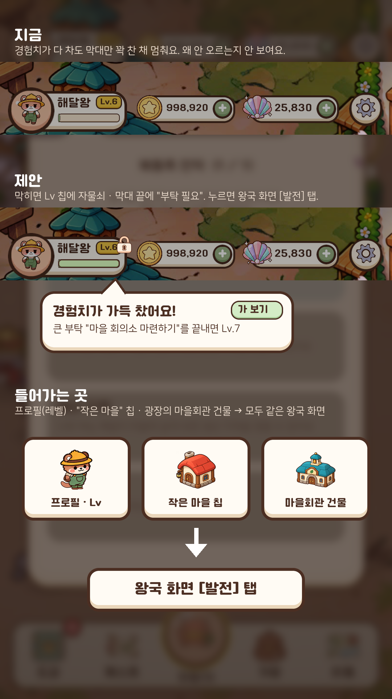

- 막히면 Lv 칩에 자물쇠, 막대는 꽉 참. 처음 막힌 순간 한 번 말풍선: "경험치가 가득 찼어요! 큰 부탁 ○○를 끝내면 Lv.7" [가 보기]
- 프로필(레벨) · "작은 마을" 칩 · 광장의 마을회관 건물 → **모두 같은 왕국 화면**

### 01 왕국 화면 [발전] 탭
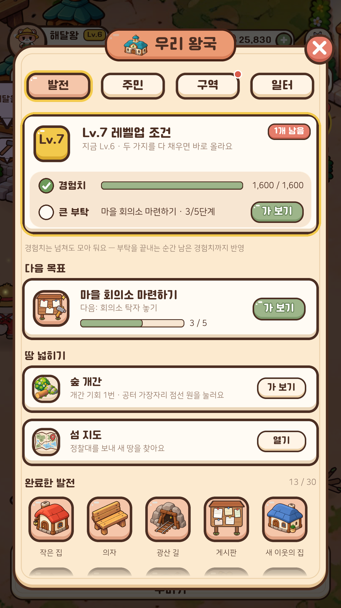

- 레벨이 막혔을 때만 맨 위에 금테 카드 "Lv.7 레벨업 조건": 경험치 ✓ / 큰 부탁 ○ [가 보기]
- 다음 목표 (지금 회관의 다음 목표 그대로) · 땅 넓히기 (숲 개간 · 섬 지도) · 완료한 발전 (글자 나열 → 아이콘 칸)

### 02 [주민] 탭
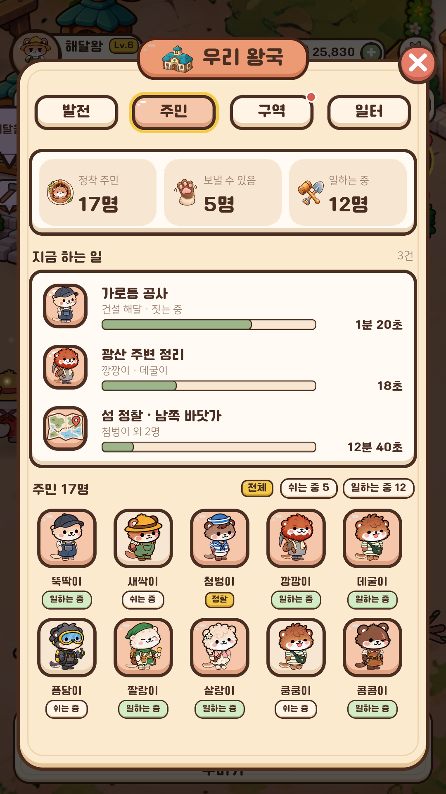

- 주민 현황 3칸, 지금 하는 일 (건설 · 작업 · 정찰을 줄마다 진행 막대 + 남은 시간), 주민 목록 (상태 표: 일하는 중 / 쉬는 중 / 정찰)

### 03 [구역] 탭
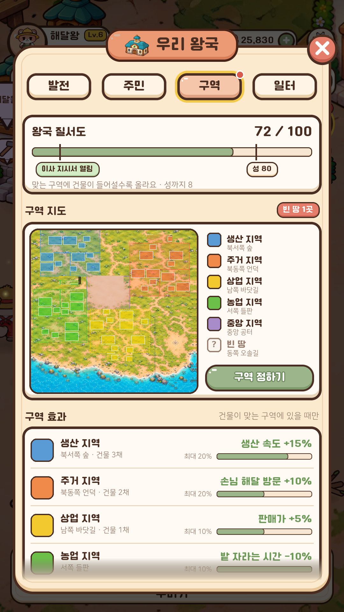

- 질서도 막대에 기준 표시 (이사 지시서 10 · 성 80)
- 구역 지도 + 범례 + [구역 정하기]. 빈 땅이 있으면 탭에 빨간 점
- **구역 효과**: 구역마다 맞는 건물 수 → 지금 보너스 / 최대 (`BonusPercent` 그대로)
- 이사 지시서

### 04 꾸미기(건설) 모드 — [구역 보기]
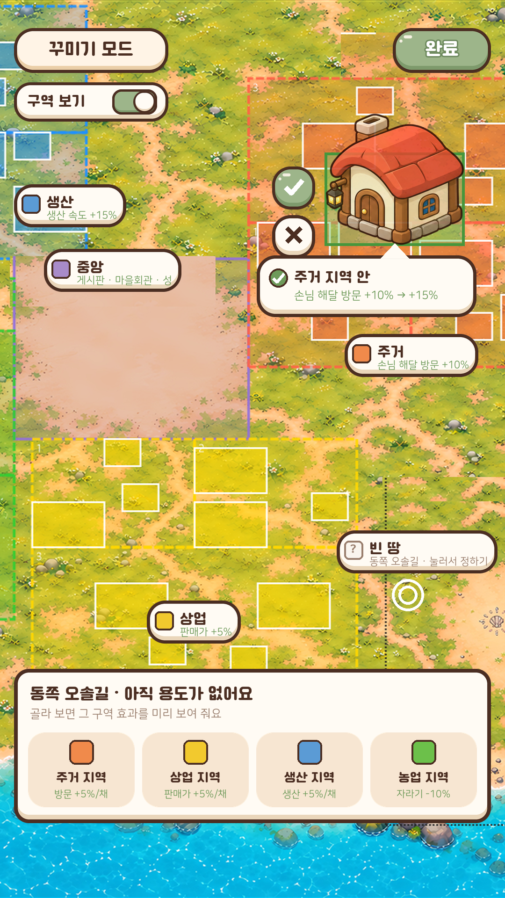

- 스위치를 켜면 블록에 구역 색 + 이름표 (지금 효과)
- 특성 건물을 놓을 때 미리보기: "주거 지역 안 · 손님 해달 방문 +10% → +15%" (구역 밖이면 빨간 글씨 "구역 밖 · 보너스 없음")
- 빈 땅을 누르면 아래 시트에서 바로 용도 고르기 (용도마다 효과 미리보기). "마을회관 → 구역 정하기" 안내 대신 이 시트를 엶

### 05 용도 바꾸기 확인
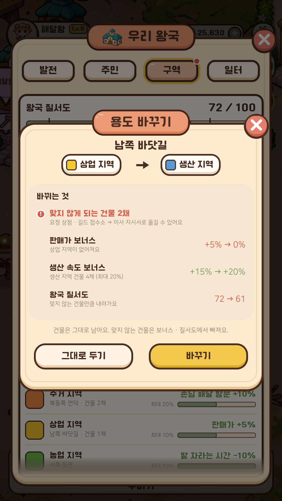

- "기존 건물은 그대로 두고 용도만 바꿔요" 대신 **바뀌는 것을 숫자로**: 맞지 않게 되는 건물 · 보너스 변화 · 질서도 변화
- 계산은 지금 규칙 그대로 (바꾼다고 가정하고 `Evaluate` · `BonusPercent`를 한 번 더)

### 06 [일터] 탭
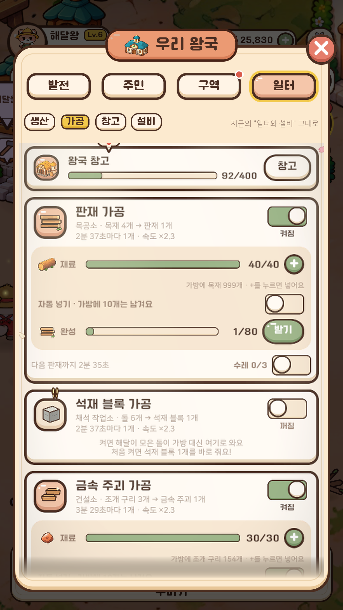

- 지금의 "일터와 설비" 창을 탭 안으로. 위에 작은 칩 4개 (생산 · 가공 · 창고 · 설비)

## 4. 구현 (2026-11-12, feature/KingdomScreen)

정한 것: 게시판 카드는 "왕국 화면" 바로가기로 남김 · 레벨 조건 카드는 다음 레벨이 큰 부탁에 묶였을 때 (경험치가 다 차면 "1개 남음") · [구역] 빨간 점 = 빈 땅 또는 이사 지시서.

| 시안 | 구현 | 파일 |
|---|---|---|
| 00 상단 바 | Lv 칩 · 경험치 막대를 누르면 왕국 화면 (마을회관 전에는 레벨 조건 알림). 막히면 칩에 자물쇠 + 막히는 순간 알림 한 번. "작은 마을" 칩도 왕국 화면 | `TopBarView`, `SettlementStatusView` → `SettlementPresenter`, `SettlementManager.OpenKingdomOrHint` |
| 01~03, 06 왕국 화면 | `KingdomSheet` (RuntimeUIWindow "우리 왕국", 탭 4개). 마을회관 요청(`RequestTownHall`)이 이 창을 엶. 예전 `TownHallPopupView`는 씬에 남아 있지만 열지 않음 | `KingdomSheet`, `SettlementManager.Kingdom` (회관 계산을 옮김), `TownHallPresenter` |
| 01 [발전] | 왕국 단계 · 마을 발전 막대, 레벨업 조건, 다음 목표, 왕국 발전 · 연구 (B의 `ProsperityManager.Open`), 땅 넓히기 (숲 개간 · 섬 지도), 완료한 발전 (아이콘 칸) | |
| 02 [주민] | 현황 3칸, 지금 하는 일 (건설 · 주민 작업 · 정찰, 0.5초마다 남은 시간), 주민 칸 (쉼 / 작업 / 정찰) | |
| 03 [구역] | 질서도 (이사 지시서 · 성 기준 표), **구역 지도 대신 땅 목록** (용도 색 · [정하기]/[바꾸기]), 구역 효과 (`DistrictEffects.Lines`), 이사 지시서 | `DistrictEffects` |
| 04 꾸미기 모드 | 구역 색은 원래 보였음 → **물건을 들고 있지 않을 때 이름표도 보임**. 특성 건물을 놓을 때 안내에 "생산 지역 · 생산 속도 +15% → +20%". 그 용도의 구역이 없으면 "지금 땅의 용도를 정할까요?" → 꾸미기를 닫고 구역 고르기 | `DecorModePresenter` (`IsPlacing`), `DistrictMapView` |
| 05 용도 바꾸기 | 확인 창 글에 바뀌는 것 (맞지 않게 되는 건물 · 보너스 · 질서도). 용도 고르기 칸 설명 = 그 용도의 효과 | `DistrictPresenter`, `DistrictPopupView`, `DistrictRules` (`DistrictOverride` 미리보기 인자) |
| 06 [일터] | 예전 "일터와 설비" 창을 탭 안으로 (위 버튼 = 생산 · 가공 · 창고 · 설비). `OpenProduction(tab)`도 이 탭을 엶 | `ProductionSheet` (MonoBehaviour → 탭 안에 그리는 부품) |

- 안내 글의 "마을회관 → 구역 정하기 / 섬 지도 / 일터"를 "왕국 화면의 구역 탭 / 섬 지도 / 일터 탭"으로 바꿈.
- 테스트: `DistrictEffectsTests` (미리보기가 세이브를 안 바꿈 · 맞지 않게 되는 건물 · 보너스 · 질서도 · 글).
- 남은 것: 구역 지도 그림(시안 03의 지도 — 지금은 목록), 예전 `TownHallPopupView` 정리(씬 · 만들기 코드 `SettlementSetup.BuildTownHallPopup`).

## 5. 지금 코드에서 가져올 것 (설계 때 메모)

| 시안 | 데이터 · 동작 (지금 있는 것) |
|---|---|
| 레벨 조건 | `ProfileManager.Instance.Progress` (Level · Exp · Cap), `SettlementManager.LevelCapRequest`, `FindLevelLockedRequest`, `TownHallPresenter.TerritoryFirstGoal` |
| 다음 목표 | `TownHallPresenter.OpenHall`의 분기 (정찰 → 공동사업 → 광산 이야기 → 부탁 → 레벨 잠금) + `HandleHallGo` |
| 땅 넓히기 | `TownHallPresenter.ShowTerritory`, `SettlementManager.OpenIslandMap` |
| 완료한 발전 | `TownHallPresenter.CompletedNames` (아이콘은 부탁의 건물 그림 · 공동사업 `Icon`) |
| 주민 | `SettlementManager.GetLaborSummary`, `TownHallPresenter.WorkText` (→ 줄마다 데이터로 쪼개기) |
| 구역 | `DistrictOrder.Score`, `DistrictGuideRules.OrderGoal`, `PendingDistrictBlocks`, `RequestDistrict`, `RelocationLine`, `DistrictRules.BonusPercent`, `config.DistrictBonuses` |
| 용도 바꾸기 미리보기 | `DistrictRules.Evaluate`에 "이 블록이 이 용도라면"을 넘길 수 있게 (세이브는 안 바꾸는 순수 계산) |
| 건설 모드 구역 보기 | `DecorModePresenter` (`RequiredDistrictFor` · `FitsRequiredDistrict` · `HintNeedDistrict`), 블록 영역은 `DistrictBlockDefinition` |
| 일터 | `ProductionSheet` (탭마다 `Draw`) |

## 6. 만드는 순서 (제안)

1. **레벨 조건**: 상단 바 자물쇠 + 말풍선, 발전 탭 맨 위 카드 — 작고 바로 보임
2. **왕국 창 틀**: `RuntimeUIWindow`로 "우리 왕국" 4탭. `RequestTownHall`이 이 창을 엶 (들어가는 곳 3개 그대로 연결)
3. 회관 화면 내용을 탭으로 옮기기: 발전 → 주민 → 구역 (옮긴 뒤 `TownHallPopupView` 정리)
4. 일터 탭: `ProductionSheet`의 그리기를 "부모를 받아 그리는" 함수로 떼어 탭 안에서 다시 씀
5. 구역: 효과 줄 → 용도 바꾸기 미리보기 → 건설 모드 [구역 보기]

## 7. 정할 것

- 게시판의 "마을 발전 현황" 줄: 없앨지, 왕국 화면 바로가기로 남길지
- 레벨 조건 카드: 막혔을 때만(시안) / 항상
- [구역] 탭 빨간 점 기준: 빈 땅 · 이사 지시서 · 둘 다
- 탭 이름: 발전 · 주민 · 구역 · 일터

## 8. 연구 트리 시안 (왕국 발전 [연구] 탭)

지금은 기술 24개가 카드로 세로 목록 (`ProsperityScreen`, B 파일). 선행 관계가 분야마다 갈라지는 트리라 트리로.
그림: `python Tools/UIGen/research_mockup.py Docs/Images/왕국화면_시안` (기술 · 선행 · Lv · RP는 `ProsperityResearch.Techs` 그대로, 진행은 예시 Lv.29 · 3 RP).

### 참고한 것
- Whiteout Survival: 연구가 분야 트리 3개 · 각 트리는 여러 단계, 높은 단계는 연구소 레벨로 열림 → **분야 탭 + 레벨 "단계 띠"**
- 쿠키런: 킹덤 연구소: 연구소 레벨마다 기술 묶음이 열리고 앞 단계를 끝내야 다음 → **단계 단위로 열림 · 완료 표시**
- 모바일 연구 화면에서 흔한 것: 지금 할 수 있는 것을 빛으로 · 바로가기, 고른 기술의 선행 길 강조, 아래 상세 시트에서 조건과 버튼

### 07 [산업] — 접힌 시트
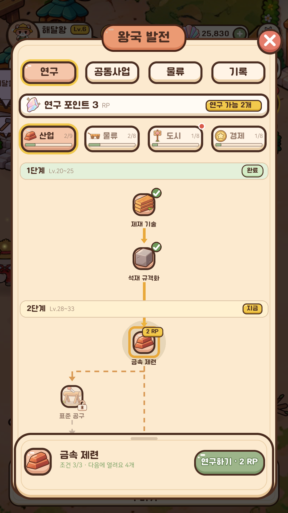

### 08 상세 시트 펼침
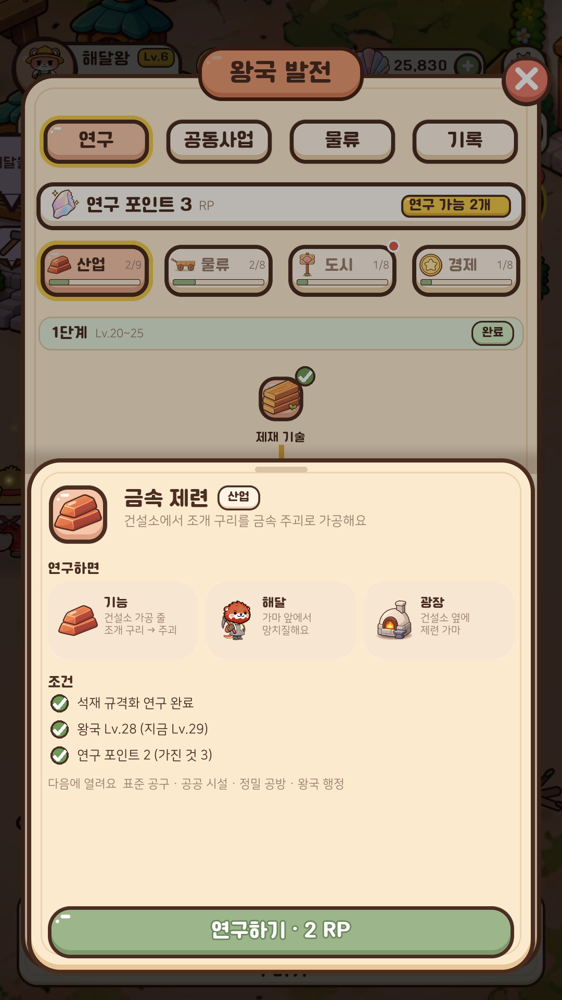

### 09 [도시] — 다른 분야 선행 · 조건이 남은 기술
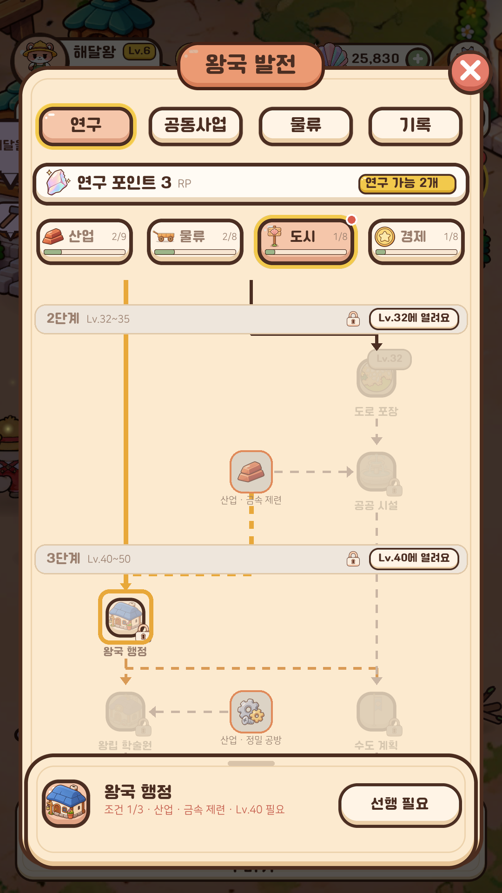

| 원칙 | 화면에서 |
|---|---|
| 분야를 나눠 선이 엉키지 않게 | 분야 탭 4개 (아이콘 · 이름 · 진행 막대 · 연구 가능하면 빨간 점). 위 연구 포인트 · 분야 탭은 고정, 아래 트리만 스크롤 |
| 레벨 조건은 노드마다가 아니라 단계로 | "1단계 Lv.20~25 완료" · "2단계 지금" · "3단계 Lv.36에 열려요" 띠. 잠긴 단계는 흐리게, 같은 단계 안에서 레벨이 모자란 노드만 "Lv.30" 꼬리표 |
| 지금 할 수 있는 것부터 | 연구 가능 노드는 빛 + "2 RP" 꼬리표, 위에 "연구 가능 2개 ›" (누르면 그 노드로 스크롤 · 선택). 열 때 첫 연구 가능 노드로 스크롤 |
| 고르면 길이 보이게 | 고른 기술까지의 선행 길은 진한 주황, 이걸로 열리는 길은 점선 |
| 다른 분야 선행은 그 자리에 | 흐린 "산업 · 금속 제련" 노드 (분야 색 테두리) + 점선. 누르면 그 분야 탭으로 |
| 왜 연구하는지 | 시트 "연구하면": 기능 · 해달 · 광장 3칸 (기획서 "연구 결과는 3중 보상") |
| 왜 못 하는지 | 시트 "조건" 체크리스트 (선행 · 레벨 · RP) + 빠진 것 옆 [산업 탭으로 ›]. 버튼은 "선행 필요"로 잠김 |

- 구현 메모: 노드 자리는 분야마다 손으로 정한 표 (단계 · 줄 · 열 l/c/r) — 기술이 늘면 표에 한 줄. 상태는 `ProsperityResearch.Check`(완료 / 가능 / 선행 / 레벨 / RP). 연구 완료 순간: 노드 튀어나옴 + 선이 초록으로 차오름 + "광장에서 보기" 알림. B의 화면이라 B와 나눠서

### 구현 (2026-11-12)
- `ResearchTreeLayout` (순수 C#): 분야마다 단계 · 줄 · 열(l/c/r) 표, 다른 분야 선행은 Ghost 칸. 기술을 늘리면 표에 추가 — `ResearchTreeLayoutTests`가 빠진 기술 · 위로 가는 선 · 겹친 칸을 잡음
- `ResearchTreePanel`: 위 고정(연구 포인트 · [연구 가능 n개] · 분야 탭) / 트리(단계 띠 · 선 · 노드) / 아래 고정 시트(접힘 ↔ 펼침, 조건 체크리스트 · [그 분야로] · 연구하기). 연구하면 알림 + 다음 연구 가능 기술로 자동 이동
- `ResearchTreeIcons`: 노드 그림은 `IndustryConfig`(가공품 · 공사 · 만들기 · 창고 · 수레 · 주택 · 작업대)에서 기술 ID로 찾음 (따로 그림 표 없음)
- `ProsperityScreen`(B): [연구] 탭의 카드 목록만 트리로 교체. 새 시대 시작 · 다음 발전 카드 · 다른 탭은 그대로, 장터 주문은 [경제] 분야 아래. 다시 그려도 스크롤 유지
- `RuntimeUIWindow.AddHeader / AddFooter`: 스크롤되지 않는 위 · 아래 칸
- 아직: 시트 "연구하면" 3칸(기능 · 해달 · 광장)은 기술마다 설명 데이터가 없어 효과 한 줄로 대신함

## 9. 공동사업 창 (CommunityProjectPresenter)

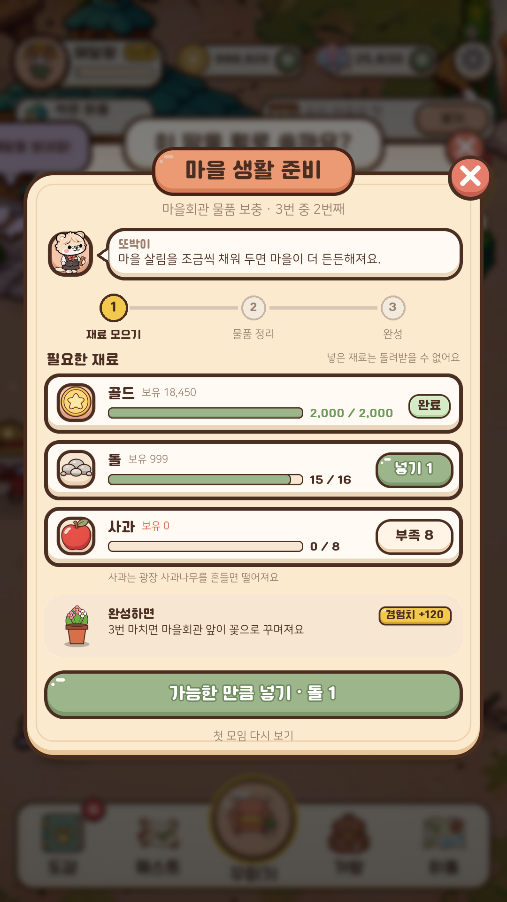
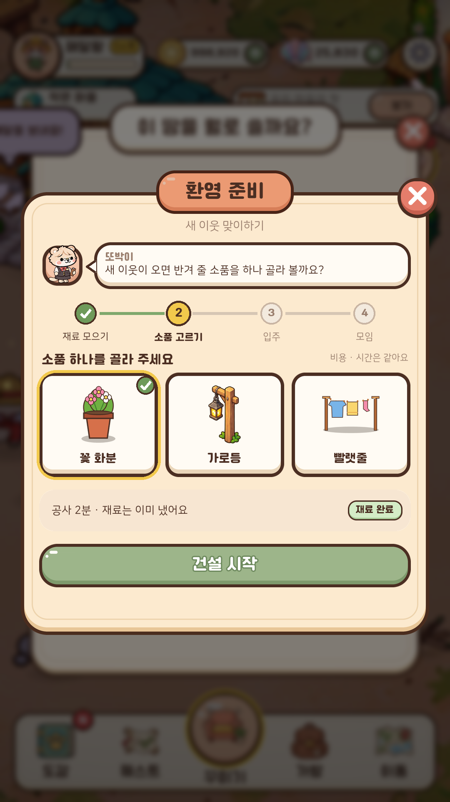

그림: `python Tools/UIGen/project_mockup.py Docs/Images/왕국화면_시안`

구현 (2026-11-12): 단계별 동작(`FillStage` · `Advance` · `Choose` · 자리 고르기 · 광장으로)은 그대로, 만들기 · 채우기만 바꿈
- 리본 제목(사업 이름) · X · 반복 사업 회차 ("마을회관 물품 보충 · 2번째") — `RuntimeUIWindow.AddRibbon / AddClose` (일터 · 왕국 창과 같은 코드)
- 주민 얼굴 + 말풍선, 단계 표시(① 재료 모으기 → ②…, 끝냄 초록 · 지금 금색) — 단계 · 위치가 바뀔 때만 다시 만듦
- 재료 카드: 아이콘 · 보유(모자라면 빨강) · 진행 막대 · 넣음/필요 · [넣기 n] / 완료 / [부족 n]. 재료 단계가 끝나면 숨김
- 안내 칸(지금 단계 글) · 소품 고르기는 그림 카드 · 완성하면 카드(결과 · 경험치)
- 큰 버튼 하나: [가능한 만큼 넣기 · 실제로 넣을 양] 또는 지금 단계 버튼. [닫기]는 X로, 첫 모임 다시 보기는 아래 작은 버튼
- 아직: 재료 구하는 곳 안내(데이터 없음), 생활 의뢰 창은 예전 모양

