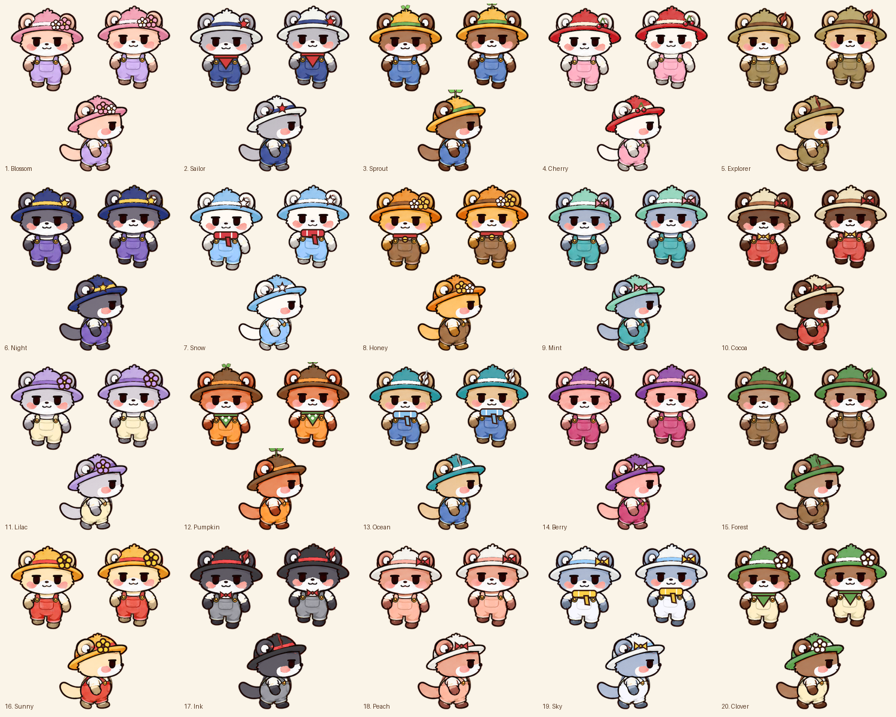
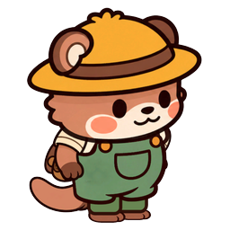
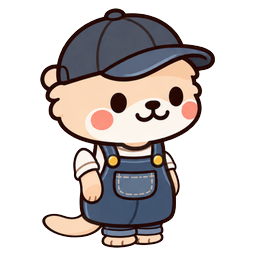
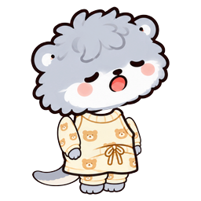
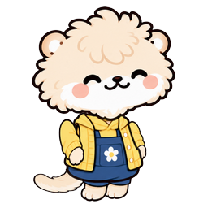
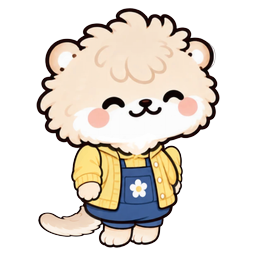
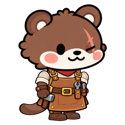
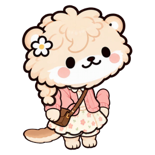

# 해달왕국 캐릭터 행동과 순간 포착 기획

작성일: 2026-10-12

21종의 공통 동작과 고유 행동을 정리한 기획 초안. 기존 이름과 특성을 바탕으로 하며 세부 동작과 순간 포착은 제안이다. 꾸벅이는 요청 기준으로 레어를 반영한다. 다른 이야기·전문 해달의 등급은 미정이고 방문 해달은 기존 방문 등급을 따른다.

## 공통 동작

- **이동**: 상하좌우 걷기, 멈춰 서기, 방향 돌리기
- **대기**: 눈 깜빡이기, 주변 두리번거리기, 기지개 켜기
- **의자**: 의자에 올라앉기 → 발이나 몸으로 리듬 타기 → 내려오기
- **축구공**: 공을 짧게 차며 드리블하기, 굴러가는 공 따라가기
- **퍼즐**: 조각 집기 → 방향 돌려 맞춰보기 → 끼우고 기뻐하기
- **식사**: 식탁이나 피크닉 매트에서 간식 먹기
- **교류**: 다른 해달에게 손 흔들기, 마주 보고 이야기하기

공통 놀이는 물건이 배치되어 있을 때 발생한다. 아래 캐릭터는 모두 공통 동작을 포함한다.

## 캐릭터별 고유 행동

### 새싹이 농부

- 등급: 등급 미정
- 기존 설정: 농사 담당
- 고유 행동 제안: 익은 작물을 양손으로 잡아 쏙 뽑는다. 수확물을 바구니에 담고 이마의 땀을 닦는다.

### 깡깡이 광부

- 등급: 등급 미정
- 기존 설정: 채굴 담당
- 고유 행동 제안: 곡괭이로 바위를 두드린다. 캐낸 돌을 살피다가 반짝이는 광석을 발견하면 높이 들어 보인다.

### 첨벙이 낚시꾼

- 등급: 등급 미정
- 기존 설정: 낚시 담당
- 고유 행동 제안: 낚싯대를 던지고 찌를 바라본다. 입질이 오면 몸을 뒤로 젖히며 물고기를 끌어 올린다.

### 뚝딱이 건설 해달

- 등급: 등급 미정
- 기존 설정: 건설 담당
- 고유 행동 제안: 설계도를 펼쳐 확인한다. 망치질을 하고 완성한 구조물을 가볍게 두드려 확인한다.

### 또박이 게시판 관리 해달

- 등급: 등급 미정
- 기존 설정: 기록과 접수 담당
- 고유 행동 제안: 게시판의 삐뚤어진 종이를 반듯하게 고친다. 서류에 도장을 찍고 가지런히 쌓는다.

### 몽실 탐험가

- 등급: 등급 미정
- 기존 설정: 왕국에 처음 온 탐험가
- 고유 행동 제안: 손을 이마에 대고 먼 곳을 살핀다. 지도로 길을 확인하고 탐험을 쉬며 간식을 꺼내 먹는다.

### 꾸벅이 잠꾸러기

- 등급: 레어 반영
- 기존 설정: 늘 졸린 성격이며 기존 작업 특성은 나무캐기
- 고유 행동 제안: 크게 하품한다. 나무 의자에 앉아 꾸벅꾸벅 졸다가 고개가 툭 떨어지면 잠깐 깬다.

### 물감이 화가

- 등급: 등급 미정
- 기존 설정: 그림 그리기와 손재주
- 고유 행동 제안: 작은 그림판에 붓질한다. 뒤로 물러나 고개를 갸웃하며 완성한 그림을 감상한다.

### 포근이 다정한 이웃

- 등급: 등급 미정
- 기존 설정: 운반 특성이며 이웃 돕기를 좋아함
- 고유 행동 제안: 이웃의 짐을 함께 들어준다. 빨랫줄의 수건을 걷어 포개고 벤치의 방석을 정돈한다.

### 쿵쿵이 나무꾼

- 등급: 흔함
- 기존 설정: 나무캐기
- 고유 행동 제안: 나무를 양팔로 감싸 흔든다. 떨어진 나뭇가지를 모아 어깨에 멘다.

### 데굴이 조약돌 수집가

- 등급: 흔함
- 기존 설정: 채굴
- 고유 행동 제안: 동그란 돌을 앞발로 데굴데굴 굴린다. 마음에 드는 돌을 닦아 나란히 놓는다.

### 보들이 새싹 돌보미

- 등급: 흔함
- 기존 설정: 농사
- 고유 행동 제안: 새싹 앞에 쪼그려 앉아 잎을 살핀다. 작은 물뿌리개로 물을 주고 잎을 살짝 쓰다듬는다.

### 퐁당이 물놀이 해달

- 등급: 흔함
- 기존 설정: 낚시
- 고유 행동 제안: 물가에서 발로 물장구친다. 조개를 주워 배 위에 놓고 작은 돌로 톡톡 두드린다.

### 영차 힘센 운반 해달

- 등급: 흔함
- 기존 설정: 운반
- 고유 행동 제안: 짐을 번쩍 들어 옮긴다. 짐을 내려놓고 팔을 털다가 자기 힘에 뿌듯해한다.

### 짤랑이 장사꾼

- 등급: 흔함
- 기존 설정: 장사
- 고유 행동 제안: 동전을 하나씩 세어 쌓는다. 물건을 닦아 진열하고 지나가는 해달에게 보여준다.

### 재잘이 수다쟁이

- 등급: 레어
- 기존 설정: 장사
- 고유 행동 제안: 다른 해달에게 다가가 손짓하며 이야기한다. 자기 이야기에 먼저 웃고 상대의 반응을 살핀다.

### 콩콩이 수리공

- 등급: 레어
- 기존 설정: 건설
- 고유 행동 제안: 의자 다리나 장난감을 살핀다. 작은 망치로 콩콩 고치고 직접 사용해본다.

### 꼼꼼이 공예가

- 등급: 레어
- 기존 설정: 손재주
- 고유 행동 제안: 퍼즐 조각을 색깔별로 정리한다. 작은 소품에 리본을 묶고 비뚤어진 부분을 고친다.

### 두리번 길잡이

- 등급: 레어
- 기존 설정: 탐험
- 고유 행동 제안: 갈림길에서 번갈아 주변을 살핀다. 나침반과 지도를 확인하고 갈 방향을 가리킨다.

### 끄적이 기록가

- 등급: 레어
- 기존 설정: 기록
- 고유 행동 제안: 마을을 관찰하며 수첩에 적는다. 가로등 아래에서 기록을 읽다가 생각이 떠오르면 급히 덧쓴다.

### 살랑이 벚꽃 해달

- 등급: 에픽 한정
- 기존 설정: 벚꽃 바람개비를 좋아하는 한정 해달
- 고유 행동 제안: 벚꽃 바람개비에 입김을 분다. 떨어지는 꽃잎을 따라가 양손으로 받아 머리에 얹는다.

## 순간 포착

평소 고유 행동 → 조건 충족 → 확률로 특별 장면 발생 → 플레이어가 직접 포착 → 도감 등록. 레어 이상 조건은 주인공에게 적용하며 흔함 해달도 동료로 참여할 수 있다. 장면은 재발생하고 도감에는 제목, 주인공, 함께한 해달, 첫 발견 날짜를 남긴다. 미발견 상태는 짧은 힌트를 보여준다. 확률과 유지 시간은 플레이 검증 후 정한다.

### 꾸벅이 졸음은 옮는 거야
- 조건: 나무 벤치에서 졸고 있고 옆자리가 비어 있음
- 장면 제안: 지나가던 해달이 옆에 앉아 하품하다 함께 잠든다. 마지막에는 서로 기대어 고개를 꾸벅인다.
- 포착 지점: 두 해달이 서로 기대어 졸고 있는 순간

### 재잘이 우리끼리 비밀인데
- 조건: 식탁이나 피크닉 매트에서 다른 해달과 대화 중
- 장면 제안: 귓속말을 하자 상대가 놀라고 둘이 배를 잡고 웃는다. 옆 해달까지 궁금해서 얼굴을 들이민다.
- 포착 지점: 둘이 웃는 사이 세 번째 해달이 얼굴을 들이미는 순간

### 콩콩이 손님 편안하시죠
- 조건: 빈 나무 의자를 수리하고 다른 해달이 근처에 있음
- 장면 제안: 고친 의자에 친구를 앉혀본다. 친구가 편안하게 몸을 흔들자 콩콩이가 의자 옆에서 같은 박자로 몸을 흔든다.
- 포착 지점: 앉은 친구와 콩콩이가 같은 박자로 움직이는 순간

### 꼼꼼이 마지막 조각은 거기
- 조건: 다른 해달과 퍼즐을 맞추는 중
- 장면 제안: 마지막 조각을 찾다가 친구 머리 위에 붙은 것을 발견한다. 조각을 떼어 끼우고 둘이 하이파이브한다.
- 포착 지점: 퍼즐을 완성하고 둘의 앞발이 마주치는 순간

### 두리번 아 이쪽이었구나
- 조건: 가로등 근처에서 지도를 보고 있고 다른 해달이 다가옴
- 장면 제안: 지도를 거꾸로 보고 고민한다. 친구가 지도를 돌려주자 둘이 동시에 고개를 기울였다가 길을 깨닫고 끄덕인다.
- 포착 지점: 바로 놓인 지도를 함께 보고 고개를 끄덕이는 순간

### 끄적이 오늘의 모델
- 조건: 밤에 가로등 아래에서 기록 중
- 장면 제안: 옆 해달이 수첩을 들여다보니 자기 얼굴 낙서가 있다. 모델이 된 해달이 같은 표정을 지으면 끄적이가 그림을 덧그린다.
- 포착 지점: 수첩 속 그림과 모델 해달이 같은 표정을 짓는 순간

### 살랑이 우리 마을에 봄이 왔어요
- 조건: 벚꽃 바람개비로 놀고 있고 다른 해달들이 근처에 있음
- 장면 제안: 바람개비가 빠르게 돌며 꽃잎이 흩날린다. 살랑이가 빙글 돌자 친구들이 모여 꽃잎을 잡고 모두 머리에 꽃잎을 하나씩 얹는다.
- 포착 지점: 모여든 해달들 머리 위에 꽃잎이 하나씩 놓인 순간

## 등급 확정 후 추가할 장면

해당 캐릭터가 레어 이상으로 정해질 경우에만 적용하는 후보.

- **새싹이 — 당근 하나에 둘이서**: 큰 당근이 안 뽑혀 친구와 함께 당기다가 둘 다 엉덩방아를 찧는다.
- **깡깡이 — 너도 반짝여**: 광석의 반짝임이 친구 얼굴에 비쳐 서로 반짝이는 얼굴을 구경한다.
- **첨벙이 — 오늘의 대어는 화분**: 물고기 대신 낡은 장화를 낚자 친구가 꽃 한 송이를 꽂아준다.
- **뚝딱이 — 현장 감독의 새 모자**: 설계도에 몰두한 사이 친구가 머리 위에 작은 나무토막을 쌓는다.
- **또박이 — 접수 중 작은 소동**: 바람에 날리는 서류를 친구와 잡다가 둘 얼굴에 한 장씩 붙는다.
- **몽실 — 목적지는 간식**: 지도 위에 간식을 올려두자 친구들이 모여 탐험 회의가 간식 시간이 된다.
- **물감이 — 모델님 눈 떠주세요**: 초상화를 그리다가 모델이 잠들어 그림도 자는 얼굴로 수정한다.
- **포근이 — 담요 반쪽 나눠요**: 졸고 있는 친구에게 담요를 덮어주다가 자신도 옆에서 잠든다.

## 제작 참고

같은 직업도 새싹이는 수확, 보들이는 돌보기, 뚝딱이는 건축, 콩콩이는 수리, 또박이는 정리, 끄적이는 관찰 기록으로 구분한다. 이미지들은 프로젝트의 외형 참고 자료이며 제안 동작의 완성 예시는 아니다.

참고: Docs/해달_모습20_작업기록.md, Docs/광장생활_작업기록.md, Assets/Editor/Settlement/OtterCastSetup.cs, Assets/Editor/Settlement/SettlementSetup.Traits.cs, Assets/Editor/Gacha/GachaSetup.cs.